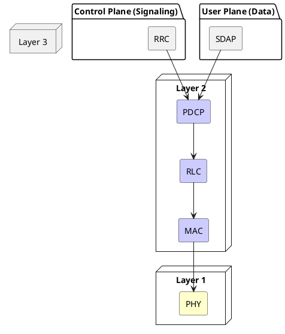

# 5G NR Protocol Stack (L1, L2, L3)

## Overview
Before diving into how the 5G base station (gNB) is split into different hardware units, it is critical to understand the software protocols that run inside it. The 5G radio interface protocols are logically divided into three layers: **Layer 1 (Physical), Layer 2 (Data Link), and Layer 3 (Network/Control)**.

## Content

### The Protocol Stack Diagram
The protocol stack governs how raw user data (like an IP packet from Netflix) or control signaling (like a handover command) is processed, encrypted, chopped up, and finally transmitted over the air as radio waves.

### Layer 3: The Brains (Control Plane)
**RRC (Radio Resource Control)**
- **Role:** The absolute master of the radio interface. It exists *only* in the Control Plane.
- **Function:** Handles broadcasting system information, establishing connections, managing handovers, and configuring all the lower layers (L1 and L2). When the network needs to command the UE to do something, it sends an RRC message.

### Layer 2: The Data Link (Data Processing)
Layer 2 is responsible for taking raw IP packets and preparing them for the physical radio. It consists of four sublayers (from top to bottom):

**1. SDAP (Service Data Adaptation Protocol) - *New in 5G***
- **Role:** QoS (Quality of Service) management.
- **Function:** Maps 5G QoS flows coming from the 5G Core to Data Radio Bearers (DRBs). It also marks packets with a QoS Flow ID (QFI) so the UE knows how to handle them.
- *Note:* SDAP exists *only* in the User Plane.

**2. PDCP (Packet Data Convergence Protocol)**
- **Role:** Security and compression.
- **Function:** Ciphers (encrypts) and integrity-protects the data. It also performs IP header compression (ROHC) to save radio bandwidth, and handles sequence numbering so packets aren't lost during handovers.

**3. RLC (Radio Link Control)**
- **Role:** Error correction and segmentation.
- **Function:** If a packet is too big for the radio channel, RLC chops it up (segmentation). It also provides highly reliable error correction via **ARQ (Automatic Repeat Request)**. If the lower layers completely fail to deliver a packet, the RLC receiver sends a Negative Acknowledgement (NACK) back to the sender, demanding a retransmission of that specific sequence number.

**4. MAC (Medium Access Control)**
- **Role:** The Scheduler and Fast Error Correction.
- **Function:** Multiplexes data from different radio bearers onto the physical layer. The MAC scheduler decides *which* UE gets to transmit, on *which* frequency, at *what* exact millisecond. 
- **HARQ (Hybrid ARQ):** MAC handles ultra-fast error correction using HARQ. Unlike the slower RLC ARQ which just asks for a new packet, HARQ uses "soft-combining." If a packet arrives slightly corrupted, the MAC layer keeps the bad packet in memory and asks for a small redundancy version. It combines the corrupted packet with the redundancy bits to mathematically reconstruct the original data, saving immense amounts of time and bandwidth.

> [!TIP]
> **Interview Question: HARQ vs ARQ.** Both existed in LTE, and both exist in 5G. Why do we need both? 
> **HARQ (MAC Layer)** is incredibly fast (millisecond level) but isn't 100% reliable because it relies on soft-combining and limited retries. 
> **ARQ (RLC Layer)** acts as the safety net. It is slower, but it provides absolute guarantee of delivery by requesting a full retransmission of the lost packet if HARQ gives up.

### Layer 1: The Muscle
**PHY (Physical Layer)**
- **Role:** The actual radio transmission.
- **Function:** Handles coding, modulation (e.g., turning bits into QAM symbols), Massive MIMO beamforming, and mapping the data onto the actual OFDM subcarriers and radio frequencies. 

### The Flow of Data
When an IP packet arrives at the gNB for a UE:
1. **SDAP** maps it to a radio bearer based on its QoS priority.
2. **PDCP** encrypts it and slaps a sequence number on it.
3. **RLC** chops it into smaller segments if needed.
4. **MAC** schedules it for transmission and attaches HARQ redundancy bits.
5. **PHY** turns the bits into a radio wave and blasts it out of the antenna.

### Comparison with NB-IoT (Interview Focus)
NB-IoT devices (like smart meters) send very tiny amounts of data very infrequently. Pushing a 10-byte temperature reading through the massive SDAP -> PDCP -> RLC -> MAC user plane stack is terribly inefficient.
- **Data over NAS (DoNAS):** To solve this, NB-IoT supports **Control Plane CIoT EPS Optimization**. Instead of setting up User Plane data bearers (DRBs), the UE stuffs its tiny data payload directly inside an RRC/NAS control plane signaling message. 
- **Bypassing the Stack:** Because data is sent over the Control Plane via NAS, the SDAP layer is completely absent, and User Plane PDCP is bypassed. The data goes straight to the AMF/MME in the core!

## Key Takeaways
- **L3 (RRC)** controls the connection.
- **L2** processes the data. It flows through **SDAP** (QoS), **PDCP** (Security), **RLC** (Segmentation/Error Correction), and **MAC** (Scheduling).
- **L1 (PHY)** handles the raw radio wave transmission.
- **SDAP** is the only totally new protocol in 5G compared to 4G LTE.

---
*Last updated: 2026-08-08*
