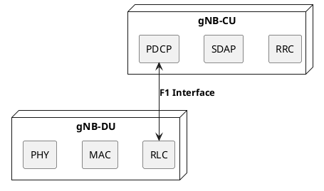

# CU-DU Separation (F1 Interface)

## Overview
One of the most revolutionary architectural changes in 5G NG-RAN is the disaggregation of the base station (gNB). Instead of a monolithic piece of hardware, the 3GPP defined a functional split, separating the gNB into a **Central Unit (CU)** and one or more **Distributed Units (DU)**. This separation occurs over the standardized **F1 interface**.

## Content

### 1. Why Split the gNB?
In LTE, the eNB was generally a single physical box at the cell site (though baseband and radio units were sometimes separated via CPRI). 
In 5G, operators need to support massive bandwidths, edge computing, and extreme densification. By splitting the gNB:
- **Centralization & Virtualization:** The complex, non-real-time upper layers (RRC, PDCP) can be centralized in a regional datacenter running on standard commercial off-the-shelf (COTS) cloud servers.
- **Coordination:** A single CU can manage multiple DUs, enabling excellent coordination for features like Dual Connectivity and Carrier Aggregation across different cell sites.
- **Cost Efficiency:** The DUs, which handle the real-time, heavy-lifting physical layer processing, can be deployed closer to the antenna, keeping site costs lower.

### 2. The 8 Split Options
While 3GPP studied many different ways to slice the protocol stack across the fronthaul and midhaul (Options 1 through 8), they officially standardized **Option 2** for the CU-DU split (and Option 7 for the DU-RU split in O-RAN).

Here is a summary of the conceptual split options evaluated by 3GPP (TR 38.801):

| Split Option | Name | Split Point | Characteristics |
| :--- | :--- | :--- | :--- |
| **Option 1** | RRC / PDCP | Between RRC and PDCP | Rarely used. RRC is centralized, but all data processing is at the edge. |
| **Option 2** | PDCP / RLC | Between PDCP and RLC | **The 3GPP Standard for CU-DU split.** Ideal for centralizing ciphering and dual connectivity. |
| **Option 3** | Intra-RLC | Within RLC (High/Low) | Splitting ARQ (High) from segmentation (Low). Too complex, dropped. |
| **Option 4** | RLC / MAC | Between RLC and MAC | Requires very low latency midhaul. Not widely adopted. |
| **Option 5** | Intra-MAC | Within MAC (High/Low) | Splits centralized scheduling from HARQ. Dropped. |
| **Option 6** | MAC / PHY | Between MAC and PHY | Centralizes MAC scheduling. Requires extreme transport bandwidth. |
| **Option 7** | Intra-PHY | Within PHY (High/Low) | **The O-RAN Standard for DU-RU (Fronthaul) split.** Keeps baseband at DU, sends raw IQ samples to RU. |
| **Option 8** | PHY / RF | Between PHY and RF | The classic CPRI split from LTE. Very high fronthaul bandwidth required. |

### 3. The Protocol Split (Option 2)
Under the standardized **Option 2**, the protocol stack is divided exactly between the PDCP and RLC layers:
- **gNB-CU (Central Unit):** Hosts the **RRC, SDAP, and PDCP** protocols.
- **gNB-DU (Distributed Unit):** Hosts the **RLC, MAC, and PHY** protocols.

### 3. The F1 Interface
The interface that connects the CU and the DU is called the **F1 interface**. It is an open, standardized interface, meaning an operator could theoretically buy a CU from Ericsson and a DU from Nokia, and they would interoperate (this is the foundational idea behind Open RAN / O-RAN).

The F1 interface is split into Control Plane and User Plane:
- **F1-C (Control Plane):** Uses SCTP. It carries F1AP (F1 Application Protocol) messages. It is used for setting up the interface, managing cells on the DU, and transferring RRC messages generated by the CU down to the DU so they can be sent over the air to the UE.
- **F1-U (User Plane):** Uses GTP-U (GPRS Tunnelling Protocol) over UDP. It carries the actual user data (PDCP PDUs) between the CU and the DU.

> [!IMPORTANT]
> A critical constraint of the F1-U interface is **latency**. Because the RLC layer (in the DU) requires rapid feedback for ARQ (Automatic Repeat Request) from the MAC/PHY, but the ciphering/integrity happens in the PDCP (in the CU), the transport network connecting the CU and DU (often called the **midhaul**) must have low latency, typically around 1-10 milliseconds depending on the deployment scenario.

### 5. Why One CU to Multiple DUs?
Even though the CU and its DUs collectively form a single logical `gNB`, the architecture is designed so that one CU can control dozens of DUs. Why?
1. **Mobility & Handover Masking:** If a UE moves from the coverage of DU #1 to DU #2, and both are controlled by the same CU, the CU doesn't need to perform a full Xn handover to another gNB. It simply performs an internal "Intra-CU Handover" (modifying the UE context from one DU to another via F1AP). The 5G Core (AMF/UPF) is completely unaware, reducing core signaling storms.
2. **Dual Connectivity / Carrier Aggregation:** A CU can easily aggregate data streams across multiple DUs. It can split a PDCP flow and send half the packets down to DU #1 and half to DU #2, providing the UE with massive throughput from two different cell sites simultaneously.

### 6. Standard Protocols vs. Vendor Implementations
When looking at real-world gNB software, you often see modules that aren't strictly "3GPP protocols."
- **The DU Manager / CU Manager:** 3GPP defines the protocols (RRC, PDCP, RLC), but they don't define *how* the software boots up, manages its Kubernetes pods, handles hardware alarms, or talks to the NMS (Network Management System). Vendors (like Nokia, Ericsson) build "Manager" modules (OAM - Operations, Administration, and Maintenance) to handle the lifecycle of the DU/CU software. These are proprietary but strictly necessary for commercial deployments.
- **Where is SDAP?** 3GPP defines SDAP to map 5G QoS flows to radio bearers. However, in an **NSA Option 3x** deployment, the gNB connects to the 4G EPC. The 4G EPC does not understand 5G QoS flows (it uses EPS bearers). Therefore, in NSA mode, **SDAP is bypassed or entirely absent**. SDAP only activates when the gNB connects to a 5GC (Standalone mode).

## Key Takeaways
- The 5G gNB is split into the **CU** (Central Unit) and **DU** (Distributed Unit).
- The split occurs between the PDCP and RLC layers (**Option 2**).
- **CU hosts:** RRC, SDAP, PDCP.
- **DU hosts:** RLC, MAC, PHY.
- They communicate via the **F1 interface** (F1-C for control, F1-U for data).

---
*Last updated: 2026-08-08*
