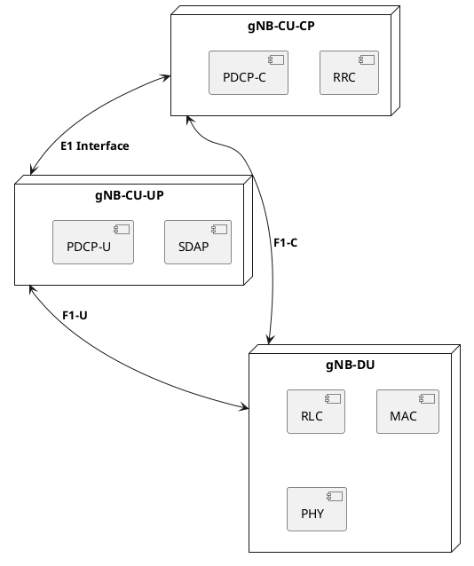

# CU-CP and CU-UP Split (E1 Interface)

## Overview
As a part of the 5G RAN evolution (and O-RAN), 3GPP defined a further split of the Central Unit (CU) into the **CU-CP** (Central Unit - Control Plane) and **CU-UP** (Central Unit - User Plane). This allows for independent scaling of the control and data planes.

## 1. The Architecture

- **CU-CP** handles signaling. It terminates RRC (talking to the UE) and NGAP (talking to the AMF). It also terminates the control plane portion of PDCP.
- **CU-UP** handles data. It terminates SDAP and the user plane portion of PDCP. It talks to the UPF via NG-U (GTP-U).
- The **E1 Interface** connects the CU-CP and CU-UP. It only carries control signaling (E1AP), *no user data*. 

## 2. Why Split the CU? (Independent Scaling)
Different use cases require different network scaling:
- **IoT / Smart Meters:** Millions of devices sending tiny amounts of data. You need a massive **CU-CP** to handle all the RRC connections and mobility, but a very small **CU-UP** because data volume is low.
- **eMBB (Enhanced Mobile Broadband) / Fixed Wireless Access:** A few users downloading massive 4K video streams. You need a small **CU-CP** (few connections) but a massive **CU-UP** to handle the gigabits of PDCP encryption and SDAP routing.

By splitting them, operators can run CU-CP and CU-UP on different Kubernetes clusters or even in different geographical locations (e.g., CU-CP central, CU-UP near the edge for lower latency).

## 3. The E1 Interface (E1AP)
The CU-CP controls the CU-UP using the E1 Application Protocol (E1AP). The primary purpose of E1AP is **Bearer Context Management**.

When a UE connects and needs a PDU session, the CU-CP tells the CU-UP to allocate resources (GTP-U tunnels, PDCP entities) for that UE.

### Example E1AP Call Flow (Bearer Setup)
1. **CU-CP → CU-UP:** `Bearer Context Setup Request` (Tells CU-UP: "Create a data pipeline for UE 123 with these QoS parameters and security keys.")
2. **CU-UP → CU-CP:** `Bearer Context Setup Response` (Tells CU-CP: "Done. Here are my GTP-U tunnel endpoints for F1-U and NG-U.")

## LTE vs 5G Comparison

| Aspect | LTE (eNB) | 5G (gNB) |
|--------|-----------|----------|
| CU/DU Split | ❌ No | ✅ Yes (F1 interface) |
| CP/UP Split in RAN | ❌ No | ✅ Yes (E1 interface) |
| CP/UP Split in Core | ✅ Yes (CUPS - S-GW-C/U) | ✅ Yes (AMF vs UPF) |

## Interview Q&A

**Q: Does the E1 interface carry user data?**
**A:** No. The E1 interface is strictly for control plane signaling (E1AP over SCTP/IP) between the CU-CP and CU-UP. User data travels from the Core (UPF) to the CU-UP, and then directly to the DU via F1-U.

**Q: Can one CU-CP control multiple CU-UPs?**
**A:** Yes. A single CU-CP can manage multiple CU-UPs, which is useful for edge computing where user plane gateways are distributed closer to the users while the control plane remains centralized.

**Q: Where does the SDAP layer reside in the split architecture?**
**A:** The SDAP layer, which maps 5G QoS flows to radio bearers, resides entirely in the CU-UP because it operates exclusively on user plane data.

---
*Last updated: 2026-08-08*
