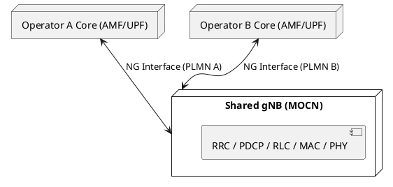

# Network Sharing (MOCN, MORAN, GWCN)

## Overview
Building a 5G RAN is incredibly expensive (antennas, fiber, power, site leases). To save costs, operators frequently share infrastructure. 3GPP defines several architectures for RAN sharing, the most common being **MOCN (Multi-Operator Core Network)** and **MORAN (Multi-Operator Radio Access Network)**.

## 1. MOCN (Multi-Operator Core Network)
In MOCN, multiple operators share the **entire radio network** (Antennas, DUs, CUs) and the **same spectrum frequency**. They only maintain separate Core Networks.

### How it works (PLMN Identity)
- The gNB broadcasts multiple **PLMN IDs** (e.g., PLMN A for AT&T, PLMN B for T-Mobile) in `SIB1`.
- When a UE wakes up, it reads `SIB1`, sees its home PLMN is supported, and initiates RACH.
- During `RRCSetupComplete`, the UE includes the `selectedPLMN-Identity`.
- The gNB looks at this selected PLMN and routes the initial NAS message (via NGAP) to the correct operator's AMF.

## 2. MORAN (Multi-Operator Radio Access Network)
In MORAN, operators share the physical hardware (the towers, the baseband servers), but **they use their own dedicated spectrum frequencies**. 

### How it works
- The gNB hardware runs completely separate logical cells for Operator A and Operator B.
- Cell 1 (Freq A) broadcasts only PLMN A. Cell 2 (Freq B) broadcasts only PLMN B.
- It is essentially two independent gNBs logically running on the same physical box.
- Costs are shared for power and site rental, but spectrum is kept strictly isolated.

## 3. GWCN (Gateway Core Network)
Less common in 5G, but in this model, operators share the RAN *and* parts of the Core (specifically the AMF/MME). They only split at the data gateways (UPF/SGW).

## 4. O-RAN and Neutral Hosts
With O-RAN and virtualization, a third party (a "Neutral Host") can build a massive cloud-native RAN network and lease it out to tier-1 operators via MOCN. The tier-1 operators don't own the antennas or the gNB software; they just plug their 5G Cores into the Neutral Host's gNBs.

## Interview Q&A

**Q: What is the main difference between MOCN and MORAN?**
**A:** Spectrum sharing. In MOCN, operators share both the RAN hardware and the radio frequencies. In MORAN, operators share the RAN hardware but use their own dedicated radio frequencies (separate logical cells).

**Q: In a MOCN setup, how does the shared gNB know which AMF to send the UE's attach request to?**
**A:** The UE reads the list of broadcasted PLMN IDs in SIB1 and selects its home PLMN. It includes this `selectedPLMN-Identity` in the `RRCSetupComplete` message. The gNB uses this PLMN ID to determine which operator's AMF should receive the NGAP Initial UE Message.

**Q: If two operators share a gNB via MOCN, can they have different feature sets or QoS policies?**
**A:** Yes. The gNB can be configured to apply different radio resource management (RRM) policies, QoS profiles, and slice configurations based on the PLMN ID of the UE.

---
*Last updated: 2026-08-08*
