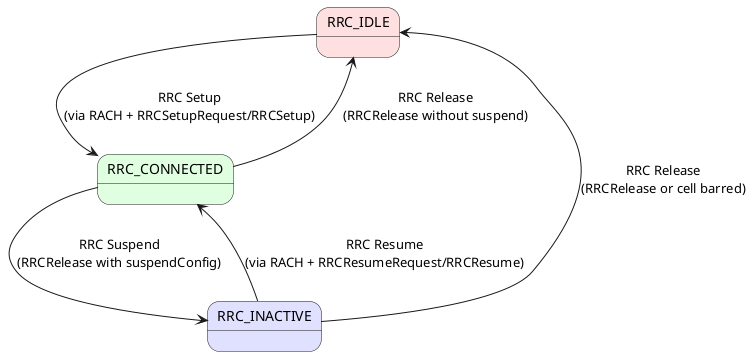

# RRC States and Transitions

## Overview
The RRC state of a UE determines everything: how it moves between cells, how much battery it consumes, and what signaling is needed to send data. 5G introduces a third state (`RRC_INACTIVE`) that didn't exist in LTE, specifically to solve the IoT/small-data problem.

## 1. The Three RRC States

### RRC_IDLE
- **Connection:** None. No SRBs, no DRBs.
- **gNB knows:** Nothing about this UE.
- **Core (AMF) knows:** UE's registered Tracking Area List (rough location).
- **Mobility:** **Cell Reselection** — UE autonomously measures neighbors and camps on the best one. Network is not involved.
- **Monitoring:** UE wakes up periodically to check for **Paging** messages (using I-DRX cycle).
- **Power consumption:** Very low.

### RRC_CONNECTED
- **Connection:** Active. SRB1 (and SRB2, DRBs after setup) are established.
- **gNB knows:** Exact cell, beam, security context, bearer config.
- **Core (AMF) knows:** Exact gNB serving the UE.
- **Mobility:** **Handover** — network-controlled. UE sends Measurement Reports; gNB decides.
- **Monitoring:** UE can use **C-DRX** (Connected DRX) to micro-sleep between scheduling opportunities.
- **Power consumption:** Highest.

### RRC_INACTIVE (New in 5G)
- **Connection:** Suspended. AS context (security keys, bearer configs) is stored at the **last serving gNB** (anchor gNB) and optionally at the AMF.
- **gNB knows:** The anchor gNB holds the UE context. The current cell may not know the UE.
- **Core (AMF) knows:** The anchor gNB (via RAN-based Notification Area).
- **Mobility:** **Cell Reselection** — same as IDLE. But if UE crosses the RAN-based Notification Area (RNA) boundary, it must notify the anchor gNB.
- **Monitoring:** Paging (using I-DRX), plus RNA updates.
- **Power consumption:** Very low (similar to IDLE).
- **Key benefit:** Transitioning INACTIVE → CONNECTED requires only `RRCResumeRequest` / `RRCResume` — no full security setup or bearer negotiation. Dramatically faster than IDLE → CONNECTED.

## 2. State Transition Diagram

## 3. Transition Details

| Transition | Trigger | RRC Message | What Happens |
|-----------|---------|-------------|--------------|
| IDLE → CONNECTED | UE has data or responds to paging | `RRCSetupRequest` → `RRCSetup` | Full setup: RACH, SRB1 establishment, NAS registration, SMC, SRB2, DRB setup |
| CONNECTED → IDLE | Network releases UE | `RRCRelease` (no `suspendConfig`) | All bearers torn down. UE context deleted from gNB. |
| CONNECTED → INACTIVE | Network suspends UE | `RRCRelease` with `suspendConfig` IE | Bearers suspended (not deleted). gNB stores context. UE gets `I-RNTI` and `resumeMAC-I`. |
| INACTIVE → CONNECTED | UE has data or responds to paging | `RRCResumeRequest` → `RRCResume` | Fast resume: RACH, verify identity with `resumeMAC-I`, restore bearers from stored context. No full NAS re-registration. |
| INACTIVE → IDLE | Context expires or cell is barred | `RRCRelease` or timer expiry | Stored context is discarded. UE must do full setup next time. |

## 4. Key Timers Per State

| Timer | State | Purpose | Typical Value |
|-------|-------|---------|---------------|
| **T300** | IDLE → CONNECTED | Wait for `RRCSetup` after sending `RRCSetupRequest` | 1000 ms |
| **T319** | INACTIVE → CONNECTED | Wait for `RRCResume` after sending `RRCResumeRequest` | 1000 ms |
| **T380** | INACTIVE | Periodic RNA update timer | Minutes to hours |
| **DRX cycle** | IDLE / INACTIVE | How often UE wakes to check for paging | 320 ms - 10.24 s |

## 5. LTE vs 5G Comparison

| Aspect | LTE | 5G NR |
|--------|-----|-------|
| States | 2: RRC_IDLE, RRC_CONNECTED | 3: + **RRC_INACTIVE** |
| Fast resume | ❌ Must do full RRC Connection Setup from IDLE | ✅ RRC Resume from INACTIVE (skip auth/security setup) |
| Small Data Transmission | ❌ Full connection required | ✅ SDT: send data in INACTIVE via RACH Msg3 without entering CONNECTED |
| Context storage | Not applicable | gNB stores UE context for INACTIVE state |

> [!TIP]
> **NB-IoT comparison:** NB-IoT introduced a similar concept called "RRC Suspend/Resume" (CP CIoT) in Rel-13. 5G's RRC_INACTIVE state is essentially the evolution of this concept, applied to all UEs, not just IoT.

## Interview Q&A

**Q: Why was RRC_INACTIVE introduced? What problem does it solve?**
**A:** In LTE, a UE that finished sending data was released to RRC_IDLE. When it needed to send data again (even a small IoT packet), it had to do a complete RRC Setup, Security Mode Command, and Bearer Setup — massive signaling overhead.
RRC_INACTIVE solves this by keeping the UE context stored. The UE sleeps like IDLE but can resume to CONNECTED in just 2 messages (`RRCResumeRequest` → `RRCResume`), skipping the entire security and bearer negotiation.

**Q: What is the `suspendConfig` IE in RRCRelease?**
**A:** When the gNB wants to move the UE to `RRC_INACTIVE` (instead of IDLE), it includes the `suspendConfig` IE in the `RRCRelease` message. This contains:
- `fullI-RNTI`: The Inactive RNTI — a unique identifier for this UE's stored context
- `shortI-RNTI`: A shorter version for RACH Msg3
- `ran-PagingCycle`: DRX cycle for paging in INACTIVE
- `ran-NotificationAreaInfo`: The RNA boundary — the set of cells where the UE can move without notifying the network

**Q: What is the difference between Cell Reselection and Handover?**
**A:**
- **Cell Reselection** = UE-controlled mobility in IDLE/INACTIVE. UE autonomously picks a better cell. Network is not involved.
- **Handover** = Network-controlled mobility in CONNECTED. UE sends Measurement Reports; gNB decides and commands the switch via `RRCReconfiguration`.

---
*Last updated: 2026-08-08*
