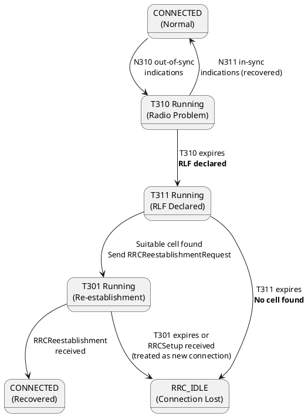

# RRC Timers Reference

## Overview
RRC timers control the UE's behavior during critical procedures. If a timer expires, the UE knows something went wrong and takes a specific recovery action. These are extremely common interview questions — interviewers expect you to know the timer name, what triggers it, and what happens on expiry.

## 1. Connection Setup Timers

| Timer | Starts When | Expires When | On Expiry | Typical Value |
|-------|-------------|-------------|-----------|---------------|
| **T300** | UE sends `RRCSetupRequest` | `RRCSetup` or `RRCReject` received | UE considers connection attempt failed. May retry or inform NAS. | 100, 200, 300, 400, 600, 1000, 1500, 2000 ms |
| **T302** | UE receives `RRCReject` with `waitTime` | Timer expires | UE is allowed to retry connection. Implements access barring backoff. | Value from `waitTime` in `RRCReject` |
| **T319** | UE sends `RRCResumeRequest` (from INACTIVE) | `RRCResume` or `RRCRelease` received | Resume failed. UE may fall back to IDLE and do full setup. | 100, 200, 300, 400, 600, 1000, 1500, 2000 ms |

## 2. Security Timers

| Timer | Starts When | Expires When | On Expiry | Typical Value |
|-------|-------------|-------------|-----------|---------------|
| **T309** | Implementation-defined | Security mode fails | UE aborts the procedure | Implementation-specific |

## 3. Handover Timers

| Timer | Starts When | Expires When | On Expiry | Typical Value |
|-------|-------------|-------------|-----------|---------------|
| **T304** | UE receives `RRCReconfiguration` with `reconfigurationWithSync` (handover command) | UE successfully completes RACH on target cell | **Handover Failure.** UE initiates RRC Re-establishment. This is a critical KPI — T304 expiry = HO failure = potential call drop. | 50, 100, 150, 200, 500, 1000, 2000, 10000 ms |

> [!WARNING]
> **T304 is the most critical mobility timer.** If it expires, the handover has failed. The UE declares a handover failure and attempts RRC Re-establishment to the best available cell. A high T304 expiry rate in KPIs indicates poor mobility configuration or coverage gaps.

## 4. Radio Link Failure (RLF) Timers

| Timer | Starts When | Expires When | On Expiry | Typical Value |
|-------|-------------|-------------|-----------|---------------|
| **T310** | PHY declares **radio link problem** (N310 consecutive out-of-sync indications from L1) | PHY recovers (N311 consecutive in-sync indications) | **Radio Link Failure (RLF) declared.** UE stops all transmissions. Starts T311 for re-establishment. | 0, 50, 100, 200, 500, 1000, 2000 ms |
| **T311** | RLF is declared (T310 expired) | UE finds a suitable cell for re-establishment | UE goes to **RRC_IDLE** — connection is fully lost. | 1000, 3000, 5000, 10000, 15000, 20000, 30000 ms |
| **T301** | UE sends `RRCReestablishmentRequest` on the new cell | `RRCReestablishment` or `RRCSetup` received | Re-establishment failed. UE goes to RRC_IDLE. | 100, 200, 300, 400, 600, 1000, 1500, 2000 ms |

### RLF Detection Chain
```
PHY out-of-sync × N310 → Start T310 → T310 expires → RLF! → Start T311 → Find cell → Send RRCReestablishmentRequest → Start T301
```

## 5. Measurement Timers

| Timer | Starts When | Expires When | On Expiry | Typical Value |
|-------|-------------|-------------|-----------|---------------|
| **T321** | UE receives measurement config with `reportOnLeave` | UE leaves the measurement reporting range | UE sends a final Measurement Report | Configured by gNB |

## 6. Cell Reselection Timers (IDLE/INACTIVE)

| Timer | Purpose | Typical Value |
|-------|---------|---------------|
| **T320** | Limits the validity of cell reselection priority info received in `RRCRelease` | Minutes to hours |
| **Treselection** | A neighbor cell must be better than the serving cell for this duration before the UE reselects | 0-7 seconds |

## 7. Counter + Timer Relationships

| Counter | Works With | Purpose |
|---------|-----------|---------|
| **N310** | T310 | Number of consecutive out-of-sync indications from PHY before starting T310 | 
| **N311** | T310 | Number of consecutive in-sync indications from PHY to stop T310 (recovery) |

## 8. Visual: Timer Flow for RLF and Recovery



## LTE vs 5G Timer Comparison

| Timer | LTE | 5G NR | Difference |
|-------|-----|-------|------------|
| T300 | Same concept | Same | No change |
| T301 | Same concept | Same | No change |
| T304 | Same concept | Same | No change |
| T310 | Same concept | Same | No change |
| T311 | Same concept | Same | No change |
| T319 | ❌ Does not exist | ✅ New | For RRC Resume from INACTIVE (new state) |
| T380 | ❌ Does not exist | ✅ New | RNA update timer (for INACTIVE) |

## Interview Q&A

**Q: What is the sequence of events when a Radio Link Failure occurs?**
**A:**
1. PHY layer detects N310 consecutive out-of-sync indications → starts **T310**
2. If PHY recovers (N311 in-sync indications) before T310 expires → T310 stops, no RLF
3. If T310 expires → **RLF is declared**
4. UE stops all UL transmissions, starts **T311**, and searches for a suitable cell
5. If a suitable cell is found → UE sends `RRCReestablishmentRequest`, starts **T301**
6. If T301 expires or T311 expires → UE goes to **RRC_IDLE** (connection fully lost)

**Q: What happens when T304 expires during a handover?**
**A:** T304 expiry means the UE failed to successfully access the target cell within the allowed time. The UE declares a **Handover Failure**, which is treated as a type of RLF. The UE then starts T311 and attempts RRC Re-establishment on the best available cell (which could be the source cell, the target cell, or even a third cell).

**Q: What is the difference between T310 and T311?**
**A:**
- **T310** is the "last chance" timer — it runs while the radio link is degrading. If the link recovers (N311 in-sync), T310 stops and everything is fine.
- **T311** runs *after* RLF is declared. The UE is now disconnected and actively searching for any cell to attempt re-establishment.

---
*Last updated: 2026-08-08*
