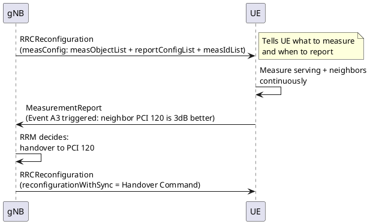

# RRC Measurements and Events

## Overview
The UE in `RRC_CONNECTED` state doesn't decide when to hand over — the gNB does. But the gNB can't see the radio conditions from the UE's perspective. So the gNB configures the UE with **measurement objects** and **reporting configurations**, and the UE sends back **Measurement Reports** when specific conditions (events) are triggered.

## 1. Measurement Quantities

| Quantity | Full Name | What It Measures | Used For |
|----------|-----------|-----------------|----------|
| **RSRP** | Reference Signal Received Power | Average power of reference signals (SSB or CSI-RS) in dBm | Signal strength — "How loud is this cell?" |
| **RSRQ** | Reference Signal Received Quality | RSRP / (N × RSSI) — ratio of signal to total received power | Signal quality — "How clean is this cell's signal?" |
| **SINR** | Signal to Interference + Noise Ratio | Signal power / (Interference + Noise) in dB | Best quality metric — used natively in 5G for cell selection |

> [!TIP]
> **5G vs LTE measurement difference:** LTE primarily uses RSRP for handover decisions. 5G natively uses **SINR** as a first-class measurement quantity (it was only added to LTE in later releases). This makes 5G mobility decisions more accurate in high-interference environments.

## 2. Measurement Objects
A **Measurement Object** tells the UE *what* to measure:
- **SSB-based:** Measure the SSB (SS Reference Signal) of neighbor cells — most common, lower UE complexity
- **CSI-RS-based:** Measure CSI-RS beams — higher accuracy, used for beam-level measurements

The gNB configures:
- `measObjectNR` — measure NR cells
- `measObjectEUTRA` — measure LTE cells (for inter-RAT handover)

## 3. Reporting Configuration
Tells the UE *when* and *how* to report:
- **Event-triggered:** Report only when a specific condition is met (most common)
- **Periodic:** Report at regular intervals (less common, used for SON/RIC data collection)

## 4. Measurement Events (The Core Interview Topic)

### NR-to-NR Events (A-Events)

| Event | Condition | Plain English | Primary Use |
|-------|-----------|---------------|-------------|
| **A1** | Serving > Threshold | "My serving cell is good enough" | Stop inter-frequency measurements to save battery |
| **A2** | Serving < Threshold | "My serving cell is getting weak" | Start inter-frequency measurements; trigger coverage-based actions |
| **A3** | Neighbor > Serving + Offset | "A neighbor is better than my serving cell by X dB" | **The main handover trigger** |
| **A4** | Neighbor > Threshold | "A neighbor is absolutely strong (regardless of serving)" | Load balancing, small cell offloading |
| **A5** | Serving < Threshold1 AND Neighbor > Threshold2 | "My serving cell is bad AND a neighbor is good" | Coverage-based handover when serving cell is failing |
| **A6** | Neighbor > SCell + Offset | "A neighbor is better than my Secondary Cell" | Secondary Cell change in Carrier Aggregation |

### Inter-RAT Events (B-Events) — NR-to-LTE

| Event | Condition | Plain English | Primary Use |
|-------|-----------|---------------|-------------|
| **B1** | Inter-RAT Neighbor > Threshold | "An LTE cell is strong enough" | Trigger inter-RAT measurement / possible fallback |
| **B2** | NR Serving < Threshold1 AND LTE Neighbor > Threshold2 | "5G is failing AND LTE is available" | **5G → LTE fallback handover** |

### How A3 Works (Most Important Event)

```
Trigger condition: Mn + Ofn + Ocn - Hys > Ms + Ofs + Ocs + Off
```
Where:
- `Mn` = Neighbor cell measurement (RSRP/RSRQ/SINR)
- `Ms` = Serving cell measurement
- `Off` = A3 offset (the "hysteresis" configured by gNB)
- `Hys` = Event hysteresis
- `Ofn/Ocn` = Neighbor frequency/cell-specific offsets
- `Ofs/Ocs` = Serving frequency/cell-specific offsets

The condition must be true for a duration called **Time-to-Trigger (TTT)** before the UE sends the report. This prevents ping-pong handovers.

## 5. Time-to-Trigger (TTT)
- Configured per event
- Values: 0, 40, 64, 80, 100, 128, 160, 256, 320, 480, 512, 640, 1024, 1280, 2560, 5120 ms
- **Short TTT** = faster handover reaction but risk of ping-pong
- **Long TTT** = stable but risk of too-late handover (RLF)

## 6. Measurement Report Message
When an event is triggered, the UE sends a `MeasurementReport` on SRB1 containing:
- `measId` — which measurement configuration triggered
- `measResults` — serving cell RSRP/RSRQ/SINR + list of neighbor cells with their measurements
- `measResultServingMOList` — serving cell beam-level measurements

## 7. The Measurement Configuration Flow



## LTE vs 5G Comparison

| Aspect | LTE | 5G NR |
|--------|-----|-------|
| Events | A1-A6, B1-B2 | Same events (A1-A6, B1-B2) |
| Measurement quantity | RSRP, RSRQ (SINR added late) | RSRP, RSRQ, **SINR natively** |
| Reference signal | CRS-based (always on) | **SSB-based** or **CSI-RS-based** (beam-specific) |
| Beam measurement | ❌ Not applicable | ✅ Beam-level RSRP per SSB index |
| Inter-RAT target | GERAN, UTRAN, CDMA2000 | **EUTRA (LTE)** only |

## Interview Q&A

**Q: What is the most commonly used event for triggering a handover?**
**A:** **Event A3** — "Neighbor cell is better than serving cell by an offset." The gNB configures the A3 offset and Time-to-Trigger. When both conditions are met for the TTT duration, the UE sends a Measurement Report, and the gNB initiates a handover.

**Q: What is the relationship between A2 and A3?**
**A:** A2 and A3 are often used together:
1. A2 fires first ("serving cell is getting weak") → gNB activates inter-frequency measurements on the UE
2. A3 fires later ("neighbor on the new frequency is better than serving") → gNB triggers handover
This two-step approach saves UE battery — inter-frequency measurements are expensive (UE must tune away from serving), so they're only activated when the serving cell is weak (A2).

**Q: How does beam-level measurement work in 5G but not in LTE?**
**A:** In LTE, the CRS is broadcast across the entire cell sector — there is one measurement per cell. In 5G, the gNB transmits multiple SSB beams in different directions. The UE measures RSRP per SSB beam and reports the best N beams. The gNB can then do a **beam-level handover** (change beam within the same cell) or a **cell-level handover** based on beam measurements.

---
*Last updated: 2026-08-08*
