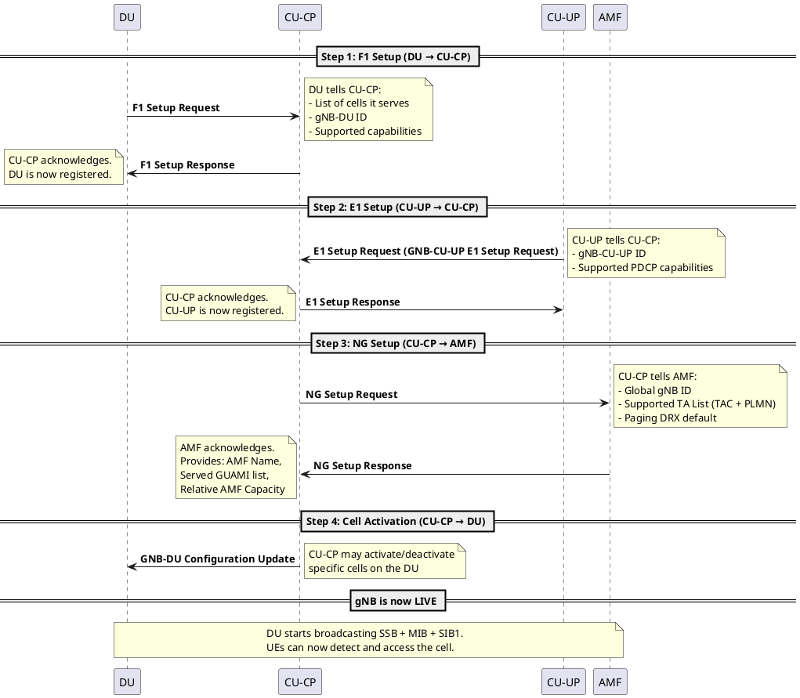

# gNB Bringup (F1, E1, NG Setup)

## Overview
Before any UE can connect, the gNB itself must boot up and establish communication with its internal components and the core network. This note covers the exact startup sequence of a disaggregated 5G gNB (CU-CP + CU-UP + DU) and what happens at each step.

## 1. The Boot Sequence

## 2. Step-by-Step Details

### Step 1: F1 Setup (DU → CU-CP)
- **Interface:** F1-C (F1AP over SCTP)
- **Who initiates:** DU
- **Key IEs in F1 Setup Request:**
  - `gNB-DU-ID` — unique identifier for this DU
  - `gNB-DU-Name` — human-readable name
  - `Served Cells List` — for each cell: NR CGI, PCI, frequency info, measurement timing config
- **Key IEs in F1 Setup Response:**
  - `Cells to be Activated List` — CU-CP tells DU which cells to turn on
  - `gNB-CU-Name`
- **On failure:** `F1 Setup Failure` — DU cannot serve any UEs

### Step 2: E1 Setup (CU-UP → CU-CP)
- **Interface:** E1 (E1AP over SCTP)
- **Who initiates:** CU-UP
- **Key IEs in E1 Setup Request:**
  - `gNB-CU-UP-ID`
  - `CN-Support` — which core network the CU-UP supports (EPC, 5GC, or both)
  - `Supported PLMNs`
- **On failure:** `GNB-CU-UP E1 Setup Failure` — user plane cannot be established

### Step 3: NG Setup (CU-CP → AMF)
- **Interface:** NG-C (NGAP over SCTP)
- **Who initiates:** CU-CP
- **Key IEs in NG Setup Request:**
  - `Global RAN Node ID` — globally unique gNB identifier
  - `Supported TA List` — list of (TAC, PLMN) pairs this gNB serves
  - `Default Paging DRX` — default DRX cycle for paging
- **Key IEs in NG Setup Response:**
  - `AMF Name`
  - `Served GUAMI List` — which GUAMI ranges this AMF handles
  - `Relative AMF Capacity` — for load balancing across AMFs
  - `PLMN Support List`
- **On failure:** `NG Setup Failure` — gNB cannot connect to the core, no UEs can register

### Step 4: Cell Activation
- CU-CP may send `GNB-DU Configuration Update` to activate specific cells
- DU begins broadcasting SSB (PSS/SSS + MIB) on activated cells
- DU begins transmitting SIB1 on PDSCH

## 3. Heartbeat and Keepalive
After setup, each interface maintains health via periodic messages:
- **F1:** `gNB-DU Status Indication` (DU reports overload)
- **E1:** `Reset` procedures if CU-UP crashes
- **NG:** `AMF Status Indication`, `Overload Start/Stop`
- **SCTP heartbeats** on all interfaces detect link failures

## 4. LTE vs 5G Comparison

| Aspect | LTE | 5G NR |
|--------|-----|-------|
| Base station | Monolithic eNB | Disaggregated: CU-CP + CU-UP + DU |
| Setup interfaces | S1 Setup (eNB → MME) only | F1 Setup + E1 Setup + NG Setup (3 interfaces!) |
| Core interface | S1-AP (eNB ↔ MME) | NGAP (gNB ↔ AMF) |
| Inter-node | X2 Setup (eNB ↔ eNB) | Xn Setup (gNB ↔ gNB) |
| Cell activation | Implicit in S1 Setup | Explicit `Cells to be Activated` in F1 Setup Response |

## Interview Q&A

**Q: In what order do the setup procedures happen when a gNB boots?**
**A:** F1 Setup (DU → CU-CP) first, then E1 Setup (CU-UP → CU-CP), then NG Setup (CU-CP → AMF). The order matters because the CU-CP needs to know its cells (from DU) before telling the AMF what it serves.

**Q: What happens if the NG Setup fails?**
**A:** The gNB cannot connect to the core network. It will still broadcast SSB and SIB1 (so UEs can detect the cell), but no UE can register or establish data connectivity. The gNB will periodically retry the NG Setup.

**Q: Which interface uses GTP-U and which uses SCTP?**
**A:**
- **SCTP** (reliable, ordered): F1-C (F1AP), E1 (E1AP), NG-C (NGAP), Xn-C (XnAP) — all control plane
- **GTP-U over UDP** (fast, unordered): F1-U, E1 (user plane), NG-U — all user plane data

**Q: How does the CU-CP know which AMF to connect to in a multi-AMF deployment?**
**A:** The CU-CP is configured with a list of AMF IP addresses. After NG Setup, the AMF provides its `Relative AMF Capacity` and `Served GUAMI List`. When a UE attaches, the CU-CP uses the UE's selected PLMN and the GUAMI to route the `INITIAL UE MESSAGE` to the correct AMF. For load balancing, it distributes UEs proportionally based on `Relative AMF Capacity`.

---
*Last updated: 2026-08-08*
