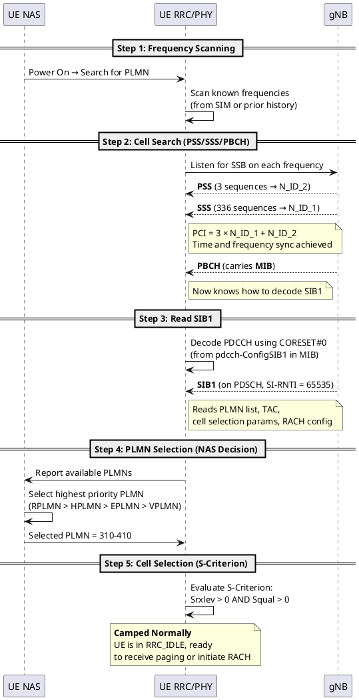

# UE Power On, Cell Search & Selection

## Overview
When a UE powers on, it knows nothing about the radio environment. It must find a network, synchronize with it, and select a cell to camp on — all before any RACH or registration can happen. This entire process is driven by the UE autonomously; the network does nothing.

## 1. The Complete Sequence



## 2. SSB Structure (Why SSB Exists)

The **Synchronization Signal Block (SSB)** is a bundle of 4 OFDM symbols containing:

| Symbol | Content | Purpose |
|--------|---------|---------|
| Symbol 0 | **PSS** (Primary Sync Signal) | Provides initial timing sync + N_ID_2 (0, 1, or 2) |
| Symbol 1 | **SSS** (Secondary Sync Signal) | Provides N_ID_1 (0-335) → full PCI = 3×N_ID_1 + N_ID_2 |
| Symbols 1-3 | **PBCH** (Physical Broadcast Channel) | Carries the **MIB** (how to decode SIB1) |
| Symbols 0-3 | **PBCH DMRS** | Demodulation reference signal for decoding PBCH |

### SSB Beam Sweeping
- In LTE, PSS/SSS are broadcast omnidirectionally across the center of the band.
- In 5G, SSBs are transmitted in **directional beams** that sweep across the cell sector.
- The gNB transmits up to **L** SSB beams per burst:
  - FR1 (< 3 GHz): L = 4 beams
  - FR1 (3-6 GHz): L = 8 beams
  - FR2 (mmWave): L = 64 beams
- Each SSB beam has an **SSB index** (0 to L-1). The UE identifies the best beam by SSB index.

> [!IMPORTANT]
> The SSB beam index is critical because it links to RACH resources. The gNB configures **SSB-to-PRACH-occasion mapping** in SIB1. When the UE selects a PRACH resource associated with its best SSB beam, the gNB immediately knows which direction to point its antenna for the RAR.

## 3. Cell Selection: S-Criterion

```
Srxlev = Q_rxlevmeas - (Q_rxlevmin + Q_rxlevminoffset) - P_compensation
Squal  = Q_qualmeas  - (Q_qualmin  + Q_qualminoffset)
```
- `Q_rxlevmeas` = measured RSRP (dBm)
- `Q_rxlevmin` = minimum required RSRP (from SIB1 `q-RxLevMin`)
- `Q_qualmeas` = measured RSRQ or SINR
- `Q_qualmin` = minimum required quality (from SIB1 `q-QualMin`)
- `P_compensation` = max(UE max power - P_MAX, 0) — adjusts for power-limited UEs

**Both `Srxlev > 0` AND `Squal > 0` must be true** → UE camps.

### If No Suitable Cell is Found
If the UE cannot find any cell passing the S-Criterion on its selected PLMN:
1. Try **"Stored Information Cell Selection"** — use frequency/cell info saved from last boot
2. If that fails → **"Initial Cell Selection"** — scan all frequencies blindly
3. If still no suitable cell → camp on **"Any Cell"** (can only make emergency calls)

## 4. PLMN Selection Priority

| Priority | PLMN Type | Description |
|----------|-----------|-------------|
| 1 | **RPLMN** | Registered PLMN — the one from last successful registration |
| 2 | **HPLMN** | Home PLMN — the operator on the SIM card |
| 3 | **EHPLMN** | Equivalent Home PLMN — operators treated as home (roaming agreements) |
| 4 | **UPLMN** | User-controlled PLMN list (configured by user) |
| 5 | **OPLMN** | Operator-controlled PLMN list (configured by operator on SIM) |
| 6 | **VPLMN** | Any other available PLMN (roaming) |

## 5. LTE vs 5G Comparison

| Aspect | LTE | 5G NR |
|--------|-----|-------|
| Sync signals | PSS/SSS in center 6 PRBs, omnidirectional | SSB in directional beams, swept across sector |
| Beams per burst | 1 (omnidirectional) | Up to 64 (FR2) |
| MIB channel | PBCH (40 ms period) | PBCH inside SSB (80 ms period) |
| Cell selection | Srxlev only (RSRP-based) | Srxlev + **Squal** (RSRP + quality) |
| PCI range | 0-503 | 0-1007 |

## Interview Q&A

**Q: What is the PSS and SSS, and how do they give the PCI?**
**A:** PSS has 3 possible sequences (N_ID_2 = 0, 1, 2). SSS has 336 possible sequences (N_ID_1 = 0-335). PCI = 3 × N_ID_1 + N_ID_2, giving 1008 unique PCIs. The UE detects PSS first for coarse synchronization, then SSS for fine synchronization and full PCI derivation.

**Q: Why does 5G use beam-swept SSBs instead of omnidirectional broadcast like LTE?**
**A:** 5G uses higher frequencies (especially FR2/mmWave) where signals decay rapidly. Omnidirectional broadcast would be too weak to reach UEs at cell edge. By concentrating the SSB energy into narrow directional beams and sweeping them across the sector like a lighthouse, each beam is strong enough to reach distant UEs, at the cost of needing multiple sweeps.

**Q: What happens if a cell fails the S-Criterion?**
**A:** The UE does not camp on it. It continues searching other cells on the same or different frequencies. If no cell passes on the selected PLMN, the UE tries other PLMNs. If no cell passes on any PLMN, the UE enters "Camped on Any Cell" state and can only make emergency calls.

---
*Last updated: 2026-08-08*
