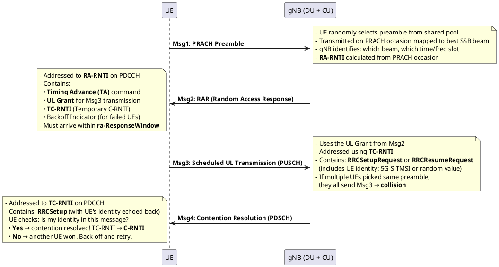

# Random Access Procedure (RACH)

## Overview
RACH is the UE's way of saying "I'm here, give me resources." It establishes uplink synchronization and gets the UE a temporary identity. Without RACH, the gNB doesn't know the UE exists.

## 1. RACH Triggers

| Trigger | RRC State | Description |
|---------|-----------|-------------|
| Initial access | IDLE → CONNECTED | UE wants to register with the network |
| RRC Resume | INACTIVE → CONNECTED | UE wants to resume a suspended connection |
| RRC Re-establishment | CONNECTED → CONNECTED | UE recovering from Radio Link Failure |
| Handover | CONNECTED | UE synchronizing with target cell after HO command |
| DL data arrival | CONNECTED (out of sync) | gNB needs to send data but UE has lost UL timing |
| UL data arrival | CONNECTED (no SR) | UE has data but no Scheduling Request resources |
| Beam failure recovery | CONNECTED | Current serving beam failed, UE tries candidate beam |
| SI request | IDLE | UE requests on-demand System Information |

## 2. Four-Step CBRA (Contention-Based)

## 3. Four-Step CFRA (Contention-Free)

| Step | Message | Description |
|------|---------|-------------|
| Pre-step | gNB assigns dedicated preamble via RRC or PDCCH order | No collision possible — preamble is reserved for this UE |
| Msg1 | Dedicated PRACH Preamble | UE transmits the assigned preamble |
| Msg2 | RAR | gNB responds with TA + UL Grant. No TC-RNTI needed (UE already has C-RNTI). |

- **Used for:** Handover (gNB assigns preamble in HO command), DL data arrival (PDCCH order), beam failure recovery
- **Advantage:** Only 2 steps, no contention resolution needed → faster

## 4. Two-Step RACH (Rel-16)

| Step | Combines | Content |
|------|----------|---------|
| **MsgA** | Msg1 + Msg3 | PRACH preamble + PUSCH payload (RRC message) transmitted together |
| **MsgB** | Msg2 + Msg4 | RAR + Contention Resolution in one response |

- **Advantage:** Halves the latency for initial access
- **Fallback:** If gNB decodes preamble but not payload → sends fallback RAR in MsgB, telling UE to retransmit Msg3 (falls back to 4-step)

## 5. PRACH Preamble Details

### Preamble Formats
- **Long preambles** (Format 0-3): Sequence length 839, SCS = 1.25 kHz or 5 kHz. Used for large cells (high coverage).
- **Short preambles** (Format A1-C2): Sequence length 139, SCS = 15/30/60/120 kHz. Used for small cells and low latency.

### Preamble Partitioning
The 64 available preambles per cell are partitioned:
- **Group A:** Lower preamble indices — for small Msg3 payloads
- **Group B:** Higher preamble indices — for large Msg3 payloads (signals gNB to allocate more UL resources)
- **CFRA preambles:** Reserved range — dedicated to specific UEs

### Power Ramping
If Msg1 fails (no RAR received):
1. UE increments preamble transmission counter
2. UE increases TX power by `powerRampingStep` (typically 2 dB)
3. UE waits a random backoff time (0 to `preambleBackoff` ms)
4. UE retransmits preamble
5. If counter reaches `preambleTransMax` → RACH procedure fails, inform upper layers

## 6. SSB-to-PRACH Occasion Mapping
- The gNB configures which PRACH time/frequency resources are associated with which SSB beams
- When UE selects its best SSB beam (e.g., SSB index 3), it transmits the preamble on the PRACH occasion mapped to SSB 3
- This tells the gNB: "I'm on SSB beam 3" → gNB can beamform Msg2 toward that direction

## 7. LTE vs 5G Comparison

| Aspect | LTE | 5G NR |
|--------|-----|-------|
| Steps | 4-step only | 4-step + **2-step (Rel-16)** |
| Preamble SCS | Fixed 1.25 kHz or 7.5 kHz | Flexible: 1.25, 5, 15, 30, 60, 120 kHz |
| Preamble length | 839 only | 839 (long) + **139 (short)** |
| Beam association | ❌ Not applicable | ✅ SSB-to-PRACH mapping |
| Beam failure recovery | ❌ Not applicable | ✅ RACH-based beam recovery |
| CFRA use | Handover only | Handover + DL data + beam failure |

## Interview Q&A

**Q: Walk through what happens if two UEs pick the same preamble (contention).**
**A:**
1. Both UEs send Msg1 with the same preamble on the same PRACH occasion
2. gNB sends one Msg2 (RAR) addressed to the common RA-RNTI — both UEs receive it
3. Both UEs send Msg3 using the UL grant from Msg2, but with different UE identities
4. gNB decodes one Msg3 successfully (the stronger one), and sends Msg4 echoing that UE's identity
5. The winning UE matches its identity → contention resolved, TC-RNTI becomes C-RNTI
6. The losing UE sees a different identity → backs off, waits random time, retries RACH

**Q: Why does CFRA skip Msg3 and Msg4?**
**A:** Because contention cannot occur. The gNB assigned a dedicated preamble — no other UE will use it. So there's no need for contention resolution (Msg4). The UE already has a C-RNTI from its existing connection (e.g., during handover), so no TC-RNTI assignment is needed either.

**Q: What is the RA-RNTI and how is it different from TC-RNTI?**
**A:**
- **RA-RNTI** identifies the RACH *occasion* (time/frequency slot), not the UE. It's calculated deterministically. All UEs that transmitted on the same occasion share the same RA-RNTI.
- **TC-RNTI** identifies the *UE* temporarily. It's assigned by the gNB in Msg2 and is unique per UE. After contention resolution, TC-RNTI is promoted to C-RNTI.

---
*Last updated: 2026-08-08*
