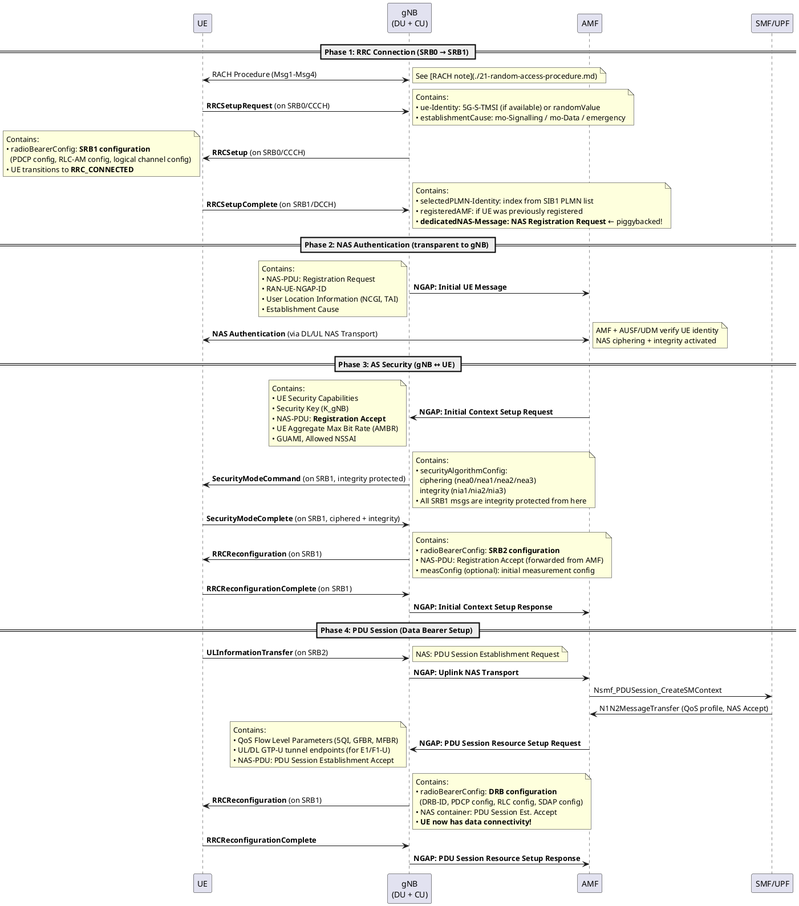

# UE Initial Registration (Attach)

## Overview
The Registration procedure connects a UE to the 5G network. It spans all layers: PHY (RACH), RRC (SRB setup), NAS (authentication), and user plane (DRB setup). In 5G, this is officially called **Registration**, not "Attach" (that's the LTE term).

## 1. Complete Call Flow with IE-Level Detail

## 2. What Happens Internally at Each Step

### Phase 1: RRC Connection
| Step | Who | What | SRB Used | Security |
|------|-----|------|----------|----------|
| RRCSetupRequest | UE → gNB | "I want to connect" | SRB0 (CCCH) | ❌ None |
| RRCSetup | gNB → UE | "Here is your SRB1 config" | SRB0 (CCCH) | ❌ None |
| RRCSetupComplete | UE → gNB | "Thanks + here is my NAS Registration Request" | SRB1 (DCCH) | ❌ None (SMC hasn't happened yet) |

### Phase 2: NAS Authentication
- **Transparent to gNB** — the gNB wraps the NAS message into NGAP and forwards it. It cannot read the NAS content.
- AMF interacts with AUSF/UDM to authenticate the UE using 5G-AKA or EAP-AKA'.
- NAS security (NAS ciphering + integrity) is activated between UE and AMF.

### Phase 3: AS Security
| Step | Who | What | SRB Used | Security |
|------|-----|------|----------|----------|
| SecurityModeCommand | gNB → UE | "Use these AS security algorithms" | SRB1 | ✅ Integrity only (not yet ciphered) |
| SecurityModeComplete | UE → gNB | "AS security activated" | SRB1 | ✅ Ciphered + Integrity |
| RRCReconfiguration (SRB2) | gNB → UE | "Here is SRB2 config + Registration Accept" | SRB1 | ✅ Ciphered + Integrity |

### Phase 4: PDU Session
- UE sends PDU Session Request on **SRB2** (because NAS messages now use SRB2)
- gNB sets up GTP-U tunnels (via E1AP to CU-UP, F1-U to DU)
- gNB configures DRBs with QoS-appropriate PDCP/RLC/SDAP settings

## 3. Key Takeaways

- Security is **hierarchical**: NAS security (UE ↔ AMF) activates first, then AS security (UE ↔ gNB)
- **Piggybacking** saves time: NAS Registration Request rides inside RRCSetupComplete
- In 5G, Registration can happen **without** PDU Session Establishment (useful for IoT/mMTC)
- The gNB acts as a **NAS relay** — it forwards NAS messages inside NGAP without reading them

## 4. LTE vs 5G Comparison

| Aspect | LTE (Attach) | 5G NR (Registration) |
|--------|-------------|---------------------|
| Name | Attach Procedure | Registration Procedure |
| Default bearer | ✅ Always created during attach | ❌ Optional — can register without PDU session |
| Core nodes | MME, SGW, PGW | AMF, SMF, UPF |
| Privacy | IMSI sent in plaintext (risk) | SUPI encrypted as SUCI (privacy by design) |
| QoS | EPS Bearer-based | QoS Flow-based (SDAP maps to DRBs) |
| First NAS piggybacked in | RRC Connection Setup Complete | RRC Setup Complete (same concept) |

## Interview Q&A

**Q: On which SRB is the first NAS message sent, and why not SRB2?**
**A:** The first NAS message (Registration Request) is piggybacked inside `RRCSetupComplete` on **SRB1**. SRB2 doesn't exist yet — it requires AS security to be activated first (after the Security Mode Command). So the first NAS message must travel on SRB1 before SRB2 is established.

**Q: What does the `Initial Context Setup Request` from the AMF contain, and why is it important?**
**A:** It contains the **K_gNB** (security key derived from NAS keys), the UE's security capabilities, the Allowed NSSAI (network slice info), and the NAS Registration Accept. It is the moment the AMF tells the gNB: "This UE is authenticated, here are the keys to encrypt its radio traffic." Without this, the gNB cannot activate AS security.

**Q: Can a UE in 5G register without establishing a data connection?**
**A:** Yes — this is a key difference from LTE. In LTE, Attach always creates a Default EPS Bearer. In 5G, the UE can complete Registration (get a 5G-GUTI, be reachable for paging) without any PDU Session. This is useful for mMTC/IoT devices that only need to be reachable or send tiny data via Small Data Transmission (SDT).

**Q: What is the internal gNB flow during the attach? What modules are involved?**
**A:** In a typical vendor implementation:
1. **DU MAC** receives Msg3 (RACH) → forwards RRC message to CU via F1AP `UL RRC Message Transfer`
2. **CU-CP UECC** (UE Context Control) creates a UE context, allocates memory
3. **CU-CP RRM** checks if the cell can admit this UE (admission control)
4. **CU-CP RRC encoder** builds the `RRCSetup` message
5. **CU-CP** sends it to DU via F1AP `DL RRC Message Transfer`
6. After AMF provides keys → **CU-CP** activates PDCP ciphering → sends SMC
7. After SRB2/DRB setup → **CU-CP** sends Bearer Context Setup to **CU-UP** via E1AP

---
*Last updated: 2026-08-08*
