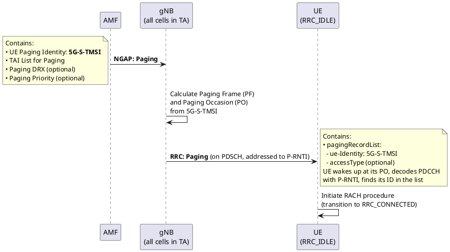

# Paging and DRX

## Overview
When the UE is in `RRC_IDLE` or `RRC_INACTIVE`, the network doesn't know exactly which cell the UE is in. To reach the UE (e.g., for an incoming call or data), the core network triggers **Paging** — broadcasting the UE's identity across all cells in its Tracking Area. To save battery, the UE doesn't listen continuously — it uses **DRX (Discontinuous Reception)** to wake up only at specific times.

## 1. Paging Flow



## 2. Paging Frame (PF) and Paging Occasion (PO) Calculation

The UE and the gNB independently calculate when paging messages are sent using the UE's identity:

```
PF: SFN mod T = (T / N) × (UE_ID mod N)
PO: i_s = floor(UE_ID / N) mod Ns
```
Where:
- **T** = DRX cycle (in frames). Minimum of `defaultPagingCycle` (SIB1) and UE-specific DRX.
- **N** = Number of Paging Frames per DRX cycle. `N = min(T, nB)` where `nB` is from SIB1.
- **Ns** = Number of Paging Occasions per PF (1, 2, or 4).
- **UE_ID** = `5G-S-TMSI mod 1024`

> [!TIP]
> **Why this formula?** It spreads UEs evenly across time so that not all UEs wake up at the same PO (which would cause a thundering herd problem). Each UE has a unique (PF, PO) pair determined by its identity.

## 3. DRX Modes

### I-DRX (Idle DRX)
- **State:** RRC_IDLE / RRC_INACTIVE
- **Cycle:** `defaultPagingCycle` from SIB1 (32, 64, 128, or 256 radio frames = 320ms to 2.56s)
- **Behavior:** UE sleeps most of the time. Wakes up only at its calculated PO to check for paging.
- **Power impact:** Massive battery saving

### C-DRX (Connected DRX)
- **State:** RRC_CONNECTED
- **Configured by:** gNB via `RRCReconfiguration` (MAC-CellGroupConfig → drx-Config)
- **Key parameters:**
  - `drx-onDurationTimer` — how long UE stays awake to check for grants (1-200 ms)
  - `drx-InactivityTimer` — how long UE stays awake after last PDCCH activity
  - `drx-LongCycle` — the main sleep-wake cycle
  - `drx-ShortCycle` (optional) — shorter cycle for bursty traffic
- **Behavior:** Even in CONNECTED, UE micro-sleeps between scheduling opportunities
- **Power impact:** Moderate saving while maintaining connection

### eDRX (Extended DRX)
- **State:** RRC_IDLE
- **Cycle:** Extended up to **10485.76 seconds (~2.9 hours)** for IoT/mMTC devices
- **Use case:** Devices that need to be reachable but very infrequently (smart meters)

## 4. DRX Cycle Comparison

| DRX Type | State | Cycle Range | Use Case |
|----------|-------|-------------|----------|
| **I-DRX** | IDLE/INACTIVE | 320 ms - 2.56 s | Normal smartphones |
| **C-DRX** | CONNECTED | ms-level (configurable) | Active but bursty traffic |
| **eDRX** | IDLE | Up to ~2.9 hours | IoT / mMTC |

## 5. LTE vs 5G Comparison

| Aspect | LTE | 5G NR |
|--------|-----|-------|
| Paging RNTI | P-RNTI (same) | P-RNTI (same) |
| Paging identity | S-TMSI | 5G-S-TMSI |
| DRX in IDLE | I-DRX (same concept) | I-DRX (same concept) |
| DRX in CONNECTED | C-DRX (same concept) | C-DRX (same concept, enhanced params) |
| eDRX | Added in Rel-13 for IoT | Supported natively |
| INACTIVE paging | ❌ No INACTIVE state | ✅ RAN-initiated paging for INACTIVE UEs |
| Paging source | MME → eNB | AMF → gNB (CN paging) or gNB → gNB (RAN paging for INACTIVE) |

> [!IMPORTANT]
> **Two types of paging in 5G:**
> 1. **CN-initiated paging** (from AMF) — for IDLE UEs. Paged across the Tracking Area.
> 2. **RAN-initiated paging** (from anchor gNB) — for INACTIVE UEs. Paged across the RAN-based Notification Area (RNA). This is new in 5G.

## Interview Q&A

**Q: How does the gNB know when to page a specific UE?**
**A:** Both the gNB and UE independently calculate the Paging Frame (PF) and Paging Occasion (PO) using the same formula based on the UE's 5G-S-TMSI and the DRX cycle configured in SIB1. The UE wakes up at its PO; the gNB transmits the paging message at the same PO.

**Q: What is the difference between CN-initiated paging and RAN-initiated paging?**
**A:**
- **CN-initiated:** AMF sends NGAP Paging to all gNBs in the UE's Tracking Area. Used for IDLE UEs.
- **RAN-initiated:** The anchor gNB (last serving gNB) pages the UE across the RAN-based Notification Area. Used for INACTIVE UEs. This avoids involving the core network.

**Q: Why does 5G support eDRX with cycles up to 2.9 hours?**
**A:** For mMTC/IoT devices like smart water meters that only need to report data once a day. These devices need to be reachable for firmware updates (paged), but waking up every 2.56 seconds to check for paging wastes battery. eDRX lets them sleep for hours between paging checks, extending battery life to 10+ years.

---
*Last updated: 2026-08-08*
