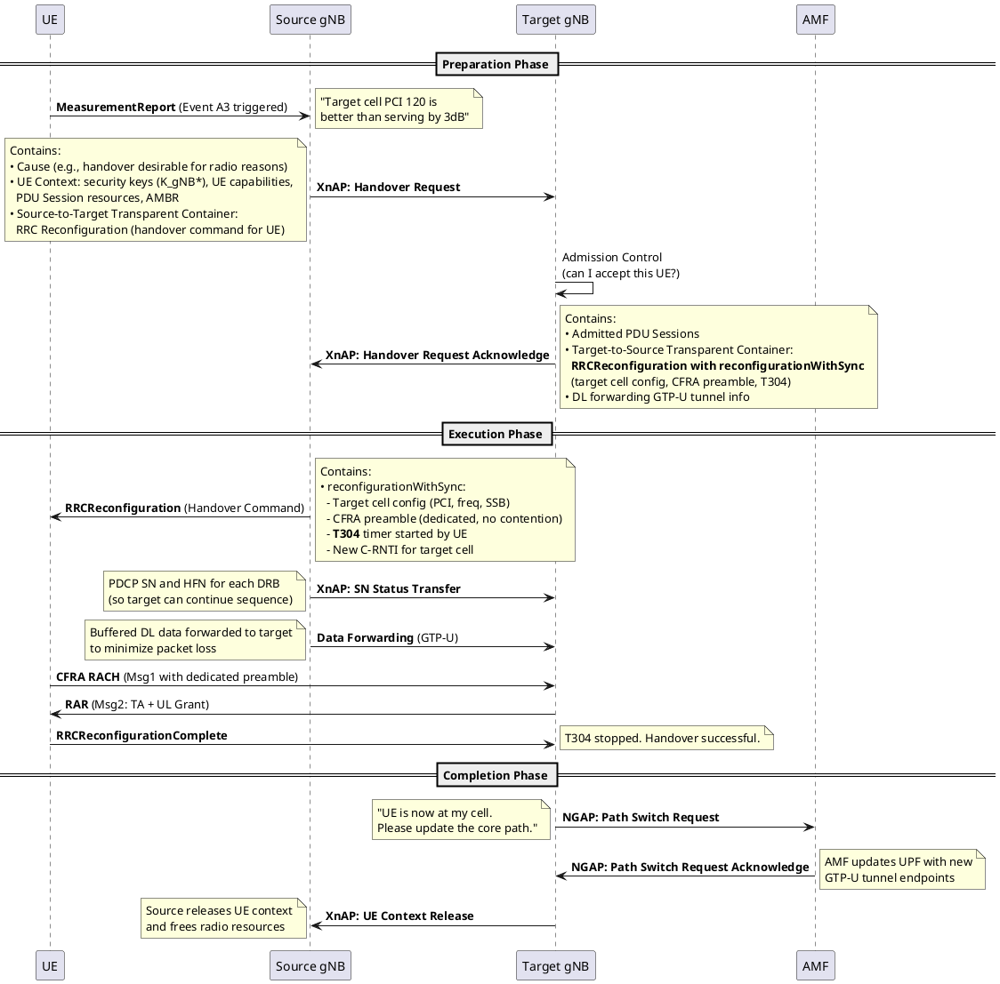

# Xn Handover (Inter-gNB)

## Overview
Xn Handover is the primary inter-gNB handover mechanism in 5G. The source gNB communicates directly with the target gNB over the Xn interface. The AMF is only notified *after* the handover succeeds (Path Switch). This is the equivalent of LTE's X2 Handover.

## 1. Complete Call Flow

## 2. Phase-by-Phase Breakdown

### Preparation Phase
| Step | Message | Key Content | Purpose |
|------|---------|-------------|---------|
| 1 | MeasurementReport | Event A3 + target PCI + RSRP/RSRQ/SINR | UE tells source: "neighbor is better" |
| 2 | XnAP: Handover Request | UE context, security, PDU sessions | Source asks target: "can you take this UE?" |
| 3 | XnAP: Handover Request Ack | Target cell config, CFRA preamble, forwarding tunnels | Target says: "yes, here is the config for the UE" |

### Execution Phase
| Step | Message | Key Content | Purpose |
|------|---------|-------------|---------|
| 4 | RRCReconfiguration (HO cmd) | `reconfigurationWithSync` with target config | Source commands UE: "switch to target cell NOW" |
| 5 | SN Status Transfer | PDCP SN/HFN per DRB | Ensures no data duplication or loss |
| 6 | Data Forwarding | Buffered DL packets via GTP-U | Minimizes packet loss during HO |
| 7 | CFRA RACH on target | Dedicated preamble (Msg1) → RAR (Msg2) | UE synchronizes with target cell |
| 8 | RRCReconfigurationComplete | — | UE confirms: "I'm on the target cell" |

### Completion Phase
| Step | Message | Key Content | Purpose |
|------|---------|-------------|---------|
| 9 | NGAP: Path Switch Request | Target cell NCGI, new GTP-U tunnels | Tell AMF to redirect core traffic to target |
| 10 | Path Switch Request Ack | Updated security keys | AMF confirms path update |
| 11 | XnAP: UE Context Release | — | Source cleans up UE resources |

## 3. What is `reconfigurationWithSync`?
This is the IE inside `RRCReconfiguration` that makes it a "handover command." It contains:
- `newUE-Identity`: New C-RNTI at the target cell
- `t304`: Handover timer (if it expires → HO failure)
- `physCellId`: Target PCI
- `rach-ConfigDedicated`: CFRA preamble assignment
- `spCellConfigCommon`: Full target cell PHY config (frequency, SSB, BWP)

## 4. LTE vs 5G Comparison

| Aspect | LTE (X2 Handover) | 5G (Xn Handover) |
|--------|-------------------|-------------------|
| Interface | X2 (X2AP) | Xn (XnAP) |
| Core notification | Path Switch via S1AP | Path Switch via NGAP |
| HO command IE | `mobilityControlInfo` | `reconfigurationWithSync` |
| Beam management | ❌ Not needed | ✅ CFRA preamble mapped to SSB beam |
| Data forwarding | ✅ via X2-U | ✅ via Xn-U |

## Interview Q&A

**Q: Why is Xn Handover preferred over N2 Handover?**
**A:** Xn Handover is faster because the source and target gNBs communicate directly over the Xn interface. The AMF is only involved *after* the handover succeeds (Path Switch). In N2 Handover, ALL preparation signaling goes through the AMF, adding latency and core network load.

**Q: What happens if T304 expires during handover?**
**A:** T304 expiry = Handover Failure. The UE:
1. Declares the handover as failed
2. Starts T311 (RLF recovery timer)
3. Searches for any suitable cell (could be source, target, or third cell)
4. Sends `RRCReestablishmentRequest` to that cell
5. If re-establishment succeeds → connection recovered. If T311 expires → UE goes to IDLE.

**Q: What is SN Status Transfer and why is it needed?**
**A:** The PDCP layer uses sequence numbers for each DRB. When the UE hands over, the target gNB must know the exact PDCP SN where the source left off, so it can continue the sequence without duplicating or losing packets. The source sends the current PDCP SN and Hyper Frame Number (HFN) per DRB in the SN Status Transfer.

---
*Last updated: 2026-08-08*
