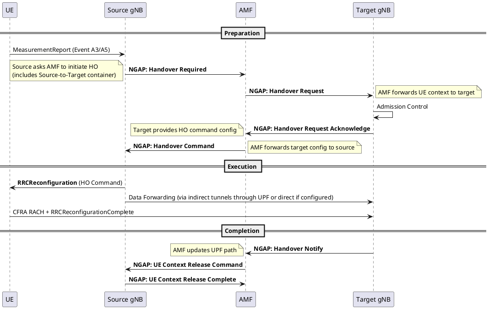

# N2 Handover (AMF-Routed)

## Overview
N2 Handover is used when no direct Xn interface exists between the source and target gNBs. All handover signaling must be routed through the AMF over the N2 (NG) interface. It is slower than Xn Handover but works between any two gNBs connected to the same (or different) AMF.

## 1. Call Flow

## 2. Key Differences from Xn Handover

| Aspect | Xn Handover | N2 Handover |
|--------|-------------|-------------|
| Direct gNB-gNB communication | ✅ Yes (Xn interface) | ❌ No — everything through AMF |
| Source → Target preparation | XnAP: Handover Request | NGAP: Handover Required → AMF → Handover Request |
| Core involvement | Only after HO (Path Switch) | Throughout the entire procedure |
| Completion message | Path Switch Request | **Handover Notify** (AMF already knows) |
| Latency | Lower | Higher (extra AMF hops) |
| Data forwarding | Direct via Xn-U | Indirect (may go through UPF) |
| When used | gNBs have Xn link | No Xn link, or inter-AMF HO |

## 3. When N2 Handover is Used
- No Xn interface between source and target gNBs
- Source and target gNBs are connected to **different AMFs** (inter-AMF handover)
- Network policy mandates AMF involvement (e.g., for network slicing decisions)

## Interview Q&A

**Q: What is the main downside of N2 Handover compared to Xn Handover?**
**A:** Higher latency. Every message in the preparation phase must transit through the AMF, adding network hops. Also, data forwarding may need to go through the UPF (indirect forwarding) instead of directly between gNBs, potentially causing more packet loss during the handover gap.

**Q: What message does the source gNB send to the AMF to initiate an N2 Handover?**
**A:** `NGAP: Handover Required`. This contains the target cell ID, the cause, and a Source-to-Target Transparent Container (which includes the UE's current config and capabilities). The AMF then sends an `NGAP: Handover Request` to the target gNB.

---
*Last updated: 2026-08-08*
