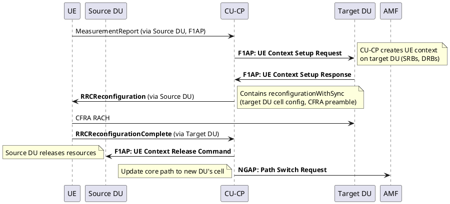
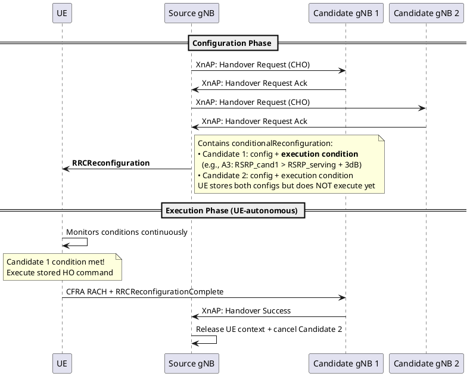

# Intra-gNB Handover & Conditional Handover (CHO)

## Overview
This note covers two important mobility mechanisms: Intra-gNB handover (moving between DUs within the same CU) and Conditional Handover (CHO), a Rel-16 feature that pre-configures handover to avoid failures.

## 1. Intra-gNB Handover (Inter-DU)

When a UE moves between two cells served by different DUs under the **same CU-CP**, the handover is handled entirely internally — no Xn, no AMF involvement.

### Flow

### Key Characteristics
- **AMF involvement:** Minimal — only a Path Switch after completion
- **CU-UP:** May not need to change at all (PDCP stays in CU)
- **Speed:** Very fast — CU controls both DUs directly via F1AP
- **No SN Status Transfer needed** between DUs because PDCP (in CU) doesn't change
- **This is why CU-DU split exists** — intra-CU mobility is seamless

## 2. Conditional Handover (CHO) — Rel-16

### The Problem CHO Solves
In standard handover, the gNB sends the HO command based on a single Measurement Report. But by the time the UE executes the HO, the radio conditions may have changed (UE moved further, beam faded). This causes:
- **Too-early HO:** UE hasn't moved enough, ping-pongs back
- **Too-late HO:** UE moved too far, RLF before HO completes

### How CHO Works
The gNB **pre-configures** the UE with handover commands for multiple candidate cells. The UE stores them and autonomously executes the handover when it detects the configured condition is met.

### CHO Flow

### CHO vs Standard Handover

| Aspect | Standard HO | Conditional HO |
|--------|-------------|----------------|
| When command is sent | After MeasReport (reactive) | **Before** any trigger (proactive) |
| Execution timing | Immediate after receiving command | UE decides when, based on condition |
| Number of targets | 1 | Multiple candidates pre-configured |
| Ping-pong risk | Higher | Lower (condition-based execution) |
| HO failure risk | Higher (stale measurement) | Lower (real-time condition check) |
| Signaling overhead | Lower (one target) | Higher (multiple targets prepared) |

## 3. DAPS Handover (Dual Active Protocol Stack) — Rel-16

- **Concept:** UE maintains connection to **both** source and target cells simultaneously during handover (make-before-break).
- **Benefit:** Near-zero interruption time — data flows from both cells until target is confirmed.
- **Use case:** VoNR, URLLC where even milliseconds of interruption are unacceptable.
- **Cost:** Higher UE complexity (two active radio stacks) and more radio resources consumed.

## LTE vs 5G Comparison

| Aspect           | LTE                     | 5G NR                                                  |
| ---------------- | ----------------------- | ------------------------------------------------------ |
| Intra-eNB/gNB HO | Internal (same concept) | Internal via F1AP (CU-DU split makes it more explicit) |
| CHO              | ❌ Not supported         | ✅ Rel-16                                               |
| DAPS             | ❌ Not supported         | ✅ Rel-16                                               |
| RACH-less HO     | ❌                       | ✅ Supported (pre-allocated resources)                  |

## Interview Q&A

**Q: Why is Intra-gNB (Inter-DU) handover so much faster than Inter-gNB?**
**A:** Because the CU-CP controls both DUs directly. There is no Xn signaling between separate gNBs. The CU simply creates a UE context on the target DU via F1AP and tears down the source DU context. PDCP stays in the CU, so no SN Status Transfer is needed and data forwarding is minimal.

**Q: If CHO conditions for two candidate cells are met simultaneously, which one does the UE choose?**
**A:** The UE selects the candidate cell with the **best measurement result** at the time of execution. If both conditions trigger at the same time, the UE picks the stronger cell.

**Q: What is the key advantage of DAPS over standard handover?**
**A:** Zero interruption time. In standard HO, there is a brief gap (HO interruption time) while the UE detaches from the source and attaches to the target. In DAPS, the UE maintains data flow with the source while simultaneously connecting to the target — it only releases the source after confirming the target is working.

---
*Last updated: 2026-08-08*
