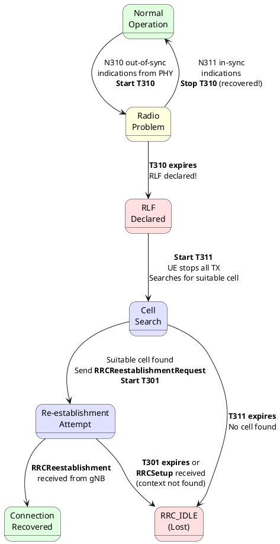
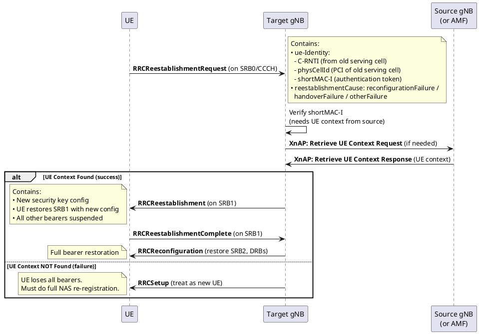

# Radio Link Failure (RLF) & RRC Re-establishment

## Overview
Radio Link Failure is the "emergency brake" of the RRC layer. When the radio connection between the UE and gNB deteriorates beyond recovery, the UE declares RLF and attempts to re-establish its connection on the best available cell. Understanding RLF detection, the timer chain, and the re-establishment flow is critical for any L3 interview.

## 1. RLF Causes

| Cause | Description | Detection |
|-------|-------------|-----------|
| **T310 expiry** | Radio link degradation (N310 consecutive out-of-sync indications from PHY) | Most common cause |
| **T304 expiry** | Handover failure — UE couldn't access target cell in time | Treated as RLF |
| **Random Access failure** | RACH on serving cell failed (preambleTransMax reached) | MAC layer reports |
| **RLC max retransmissions** | RLC AM exceeded `maxRetxThreshold` for SRB | RLC reports to RRC |
| **Integrity check failure** | Consecutive PDCP integrity failures on SRB | Security failure |

## 2. RLF Detection and Recovery Chain

## 3. Timer Chain Detail

| Step | Timer | Duration | What UE Does | On Expiry |
|------|-------|----------|--------------|-----------|
| 1. Radio problem detected | **T310** | 0-2000 ms | Waits for recovery (N311 in-sync indications) | **RLF declared** |
| 2. RLF declared | **T311** | 1000-30000 ms | Searches for suitable cell to re-establish | Goes to **RRC_IDLE** |
| 3. Cell found | **T301** | 100-2000 ms | Waits for `RRCReestablishment` from new gNB | Goes to **RRC_IDLE** |

## 4. RRC Re-establishment Flow

## 5. Key Fields in RRCReestablishmentRequest

| Field | Purpose |
|-------|---------|
| `c-RNTI` | UE's C-RNTI from the old serving cell — identifies which UE this is |
| `physCellId` | PCI of the old serving cell — helps target gNB find the source gNB |
| `shortMAC-I` | 16-bit Message Authentication Code — proves the UE is legitimate (derived from security keys) |
| `reestablishmentCause` | Why re-establishment was triggered: `reconfigurationFailure`, `handoverFailure`, `otherFailure` |

## 6. What Happens at the Target gNB

1. Target receives `RRCReestablishmentRequest`
2. It needs the UE context (security keys) to verify `shortMAC-I`
3. If target is the same gNB (intra-gNB re-establishment) → it already has the context
4. If different gNB → target sends `XnAP: Retrieve UE Context Request` to the source gNB
5. If source gNB responds with context → target can verify and accept the UE
6. If source doesn't respond or context is gone → target sends `RRCSetup` (new connection), and the UE must re-register with the AMF

## 7. LTE vs 5G Comparison

| Aspect | LTE | 5G NR |
|--------|-----|-------|
| RLF detection | T310 + N310/N311 (same) | T310 + N310/N311 (same) |
| Re-establishment | RRCConnectionReestablishmentRequest | RRCReestablishmentRequest |
| Context retrieval | X2: Retrieve UE Context | Xn: Retrieve UE Context (same concept) |
| Beam failure | ❌ Not applicable | ✅ Beam Failure Recovery (separate from RLF) |
| Re-establishment causes | handoverFailure, reconfigurationFailure, otherFailure | Same causes |
| INACTIVE fallback | ❌ Not available | ✅ UE can fall back to INACTIVE instead of IDLE |

## Interview Q&A

**Q: Walk through the complete RLF detection and recovery sequence.**
**A:**
1. PHY detects N310 consecutive out-of-sync indications → **T310 starts**
2. If N311 in-sync before T310 expires → recovered, no RLF
3. T310 expires → **RLF declared**. UE stops all transmissions.
4. **T311 starts**. UE performs cell search for any suitable cell.
5. Suitable cell found → UE sends `RRCReestablishmentRequest` with old C-RNTI, PCI, shortMAC-I. **T301 starts**.
6. If target gNB verifies shortMAC-I → sends `RRCReestablishment` → connection recovered.
7. If T301 expires or context not found → UE goes to **RRC_IDLE**, must do full re-registration.

**Q: What is `shortMAC-I` and why is it needed?**
**A:** It's a 16-bit integrity token derived from the UE's AS security keys. It prevents a rogue UE from impersonating another UE during re-establishment. The target gNB retrieves the UE context (including security keys) from the source gNB and independently calculates what shortMAC-I should be. If it matches → the UE is legitimate.

**Q: What is the difference between RLF and Beam Failure?**
**A:**
- **RLF** = the entire radio link to the cell is lost (all beams failed). Recovery requires re-establishment on a potentially different cell.
- **Beam Failure** (5G only) = only the current serving beam failed, but other beams from the same cell may still work. Recovery uses a RACH-based **Beam Failure Recovery** procedure to switch to a candidate beam within the same cell, without re-establishment.

**Q: After successful re-establishment, does the UE immediately have DRBs?**
**A:** No. After `RRCReestablishment`, only **SRB1** is restored. All other bearers (SRB2, DRBs) are suspended. The gNB then sends an `RRCReconfiguration` to restore SRB2 and all DRBs. Until that `RRCReconfiguration`, the UE has no data connectivity.

---
*Last updated: 2026-08-08*
