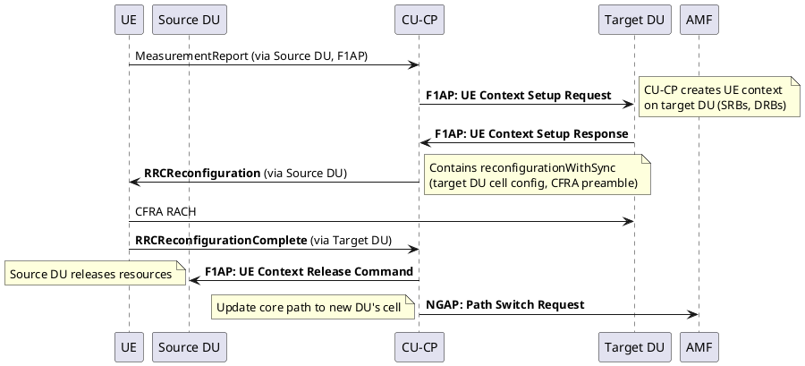

# Intra-gNB Handover (Inter-DU via F1AP)

## Overview
When a UE moves between two cells served by different DUs under the **same CU-CP**, the handover is handled entirely internally — no Xn, no AMF involvement. This is one of the key advantages of the CU-DU split architecture.

## Content

### How It Works

The CU-CP orchestrates everything via F1AP. Since PDCP terminates at the CU (not the DU), there is no need for SN Status Transfer — the PDCP entity simply continues operating while the lower layers (RLC/MAC/PHY) are moved to the new DU.

### Call Flow

### Key Characteristics
- **AMF involvement:** Minimal — only a Path Switch after completion to update the core network path
- **CU-UP:** May not need to change at all (PDCP stays in CU)
- **Speed:** Very fast — CU controls both DUs directly via F1AP
- **No SN Status Transfer needed** between DUs because PDCP (in CU) doesn't change
- **This is why CU-DU split exists** — intra-CU mobility is seamless

### 🪤 Interview Trap: "Does the AMF know about intra-gNB HO?"
Yes! Even though it's an internal handover, the CU sends a **Path Switch Request** to the AMF after completion. The AMF needs to update the UPF tunnel endpoint (the new DU's cell has different transport-layer info). Candidates often say "AMF is not involved at all" — that's wrong.

## LTE vs 5G Comparison

| Aspect | LTE (Intra-eNB) | 5G NR (Intra-gNB / Inter-DU) |
|--------|------------------|-------------------------------|
| Architecture | Monolithic eNB — all internal | CU-DU split — explicit F1AP signaling |
| Protocol visibility | Hidden inside eNB | Visible on F1 interface (can be debugged/traced) |
| PDCP continuity | Handled internally | Guaranteed — PDCP stays in CU |
| SN Status Transfer | Not needed | Not needed |

## Key Takeaways
- Intra-gNB HO is the fastest HO type because the CU orchestrates both DUs via F1AP.
- No Xn signaling, no NGAP Handover procedure — just F1AP UE Context Setup + Release.
- PDCP continuity is inherent — the key architectural benefit of CU-DU separation.
- AMF is still notified via Path Switch Request after completion.

---
*Last updated: 2026-10-18*
