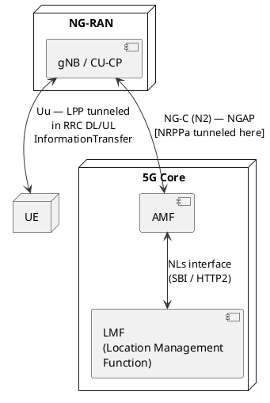
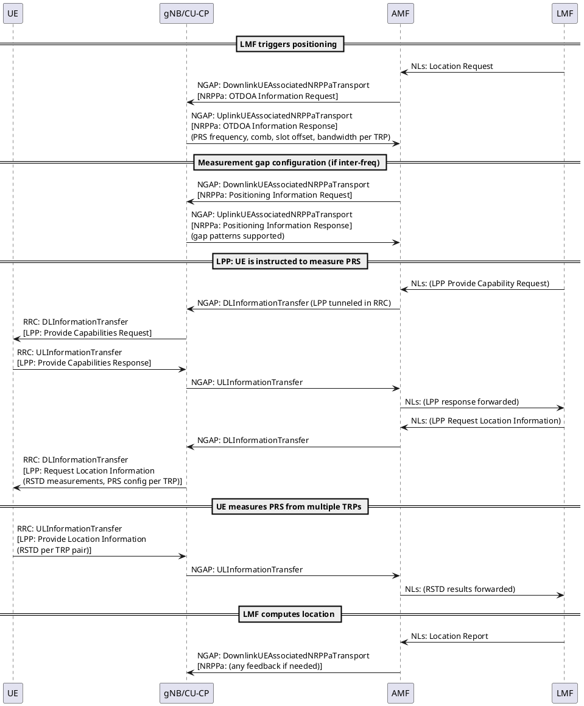

# 5G NR Positioning & NRPPa

## Overview

5G NR Positioning enables the network to determine the geographic location of a UE
with high accuracy. While positioning existed in LTE (LPPa over S1, LPP over Uu),
5G NR introduced a completely new set of positioning methods, a new protocol
(**NRPPa** — NR Positioning Protocol A), and a new core network function (**LMF**).
The key driver is centimeter-level accuracy requirements for use cases like
emergency calls, asset tracking, and network-assisted navigation.

> **Key correction:** Positioning is **NOT** 5G-only. LTE had it too (see comparison
> table below). What 5G added is dramatically higher accuracy, new reference signals
> (NR PRS), and new measurement methods.

---

## 1. Architecture — Who Talks to Whom

### 5G SA Positioning Architecture



**Critical point on NRPPa transport:**
NRPPa messages are **NOT** sent directly on a new interface. They are **tunneled inside
NGAP messages** on the N2 interface between gNB and AMF. The AMF then relays them
to/from the LMF via the NLs interface (SBI).

```
gNB  ─────NGAP (UplinkUEAssociatedNRPPaTransport)──────► AMF ─── NLs ──► LMF
gNB  ◄────NGAP (DownlinkUEAssociatedNRPPaTransport)────── AMF ◄── NLs ─── LMF
```

The NGAP message simply carries the NRPPa PDU as an opaque blob — AMF does not
interpret NRPPa content, it just relays it.

**Non-UE associated NRPPa** (for assistance data, TRP info — not tied to a specific UE):
```
gNB  ─────NGAP (UplinkNonUEAssociatedNRPPaTransport)────► AMF ─── NLs ──► LMF
```

### LMF (Location Management Function) — New in 5G SA

| | LTE | 5G NR |
|--|-----|-------|
| Location server | E-SMLC (Evolved Serving Mobile Location Centre) | **LMF** (Location Management Function) |
| Where it sits | Network (IMS / EPC) | 5G Core (as a Network Function) |
| gNB-facing protocol | **LPPa** (TS 36.455) over S1-AP | **NRPPa** (TS 38.455) over NGAP |
| UE-facing protocol | **LPP** (TS 36.355) | **LPP** extended (TS 37.355) — same protocol, extended for NR |
| Accuracy | 10–50m typical | Sub-meter possible (DL-TDOA, Multi-RTT) |

---

## 2. Key Specifications

| Spec | Title | What It Covers |
|------|-------|---------------|
| **TS 38.455** | NRPPa | The NRPPa protocol itself — all messages, IEs, ASN.1 |
| **TS 37.355** | LPP | LTE Positioning Protocol, extended for NR — UE ↔ LMF |
| **TS 38.305** | NG-RAN Stage 2 for positioning | Architecture, procedures, call flows |
| **TS 23.273** | 5GS Location Services | Core network view — AMF, LMF roles, 5GC LCS architecture |
| **TS 38.211** | NR Physical channels | PRS signal structure, SRS for positioning |
| **TS 38.215** | NR Physical layer measurements | RSTD, RSRP (PRS-RSRP), UL-RTOA measurement definitions |
| **TS 38.133** | NR Requirements | Positioning accuracy requirements, measurement gap requirements |

> **For your NRPPa bug:** Start with **TS 38.455** for the exact message/IE definition,
> and **TS 38.305** for the procedure/call flow context.

---

## 3. Positioning Methods — Full Picture

### 3.1 Downlink Methods (Network → UE)

#### DL-TDOA (Downlink Time Difference of Arrival) — **New in NR**
- Multiple TRPs (Transmission/Reception Points) transmit **PRS (Positioning Reference Signals)**
- UE measures the **RSTD (Reference Signal Time Difference)** between pairs of TRPs
- LMF uses multilateration (hyperbolic positioning) to compute UE location
- Accuracy: 1–10m in good conditions
- LTE equivalent: **OTDOA** (Observed Time Difference of Arrival) — same concept, called differently

#### DL-AoD (Downlink Angle of Departure) — **New in NR**
- gNB transmits PRS with beam sweeping
- UE reports the **received signal power per beam (PRS-RSRP)** and beam index
- LMF infers the departure angle, hence UE direction from the gNB
- Accuracy depends on beam width (mmWave FR2 → narrow beams → better AoD)

#### E-CID (Enhanced Cell ID) — **In LTE too, refined in NR**
- Uses cell ID + timing/angle measurements (TA, AoA, RSRP) for a coarse fix
- Simplest method, lowest accuracy (tens of meters to hundreds of meters)
- No need for tight time synchronization between gNBs

#### A-GNSS (Assisted GNSS) — **In LTE too**
- Network provides GNSS assistance data (satellite ephemeris, clock corrections) to the UE
- UE uses GPS/Galileo/GLONASS/BeiDou to compute its own position
- Best accuracy (sub-5m) but UE needs sky view, higher power consumption

### 3.2 Uplink Methods (UE → Network)

#### UL-TDOA (Uplink Time Difference of Arrival) — **New in NR**
- UE transmits **SRS (Sounding Reference Signals)** for positioning
- Multiple TRPs measure **UL-RTOA (UL Relative Time of Arrival)**
- LMF computes UE position from RTOA differences
- Advantage: UE does not need to measure anything — saves UE battery

#### UL-AoA (Uplink Angle of Arrival) — **New in NR**
- TRPs measure the **angle at which the UE's SRS arrives** using antenna arrays
- LMF computes UE direction from multiple TRP AoA measurements

### 3.3 Round-Trip Methods

#### Multi-RTT — **New in NR**
- Combines UL and DL timing measurements
- UE measures **DL PRS RSTD** (from TRP), TRP measures **UL SRS RTOA** (from UE)
- LMF computes round-trip time → range → position
- Does NOT require tight inter-gNB synchronization (cancels out clock offset)
- Most accurate method achievable without external GNSS

### Positioning Methods — LTE vs NR Comparison

| Method | LTE Name | NR Name | Key Change in NR |
|--------|----------|---------|-----------------|
| DL time-based | OTDOA | DL-TDOA | New PRS design (denser, configurable) |
| DL angle-based | — (not in LTE) | DL-AoD | Enabled by NR beam management |
| UL time-based | UTDOA | UL-TDOA | More flexible SRS for positioning |
| UL angle-based | — (not in LTE) | UL-AoA | Enabled by massive MIMO arrays |
| Two-way timing | — (not in LTE) | Multi-RTT | Highest accuracy without GNSS |
| Cell-based | E-CID | E-CID | Refined with NR beam info |
| Satellite | A-GNSS | A-GNSS | Same, with NR assistance enhancements |

---

## 4. PRS — Positioning Reference Signal (NR)

PRS is the dedicated downlink reference signal for positioning in NR. It is
fundamentally different from LTE PRS and from other NR reference signals (CSI-RS, SSB).

### Key properties:
- **Comb structure**: PRS uses a frequency-domain comb (subcarriers spaced by K_comb,
  typically K=2, 4, or 6). Multiple TRPs can transmit on interleaved combs → frequency
  reuse without interference
- **Time-domain**: PRS occupies consecutive OFDM symbols within a slot (2, 4, 6, or 12 symbols)
- **PRS Resource Set**: A collection of PRS resources (slots, symbols, combs) that a TRP transmits
- **Muting**: PRS can be muted (blanked) to allow a UE to measure a distant TRP without
  near-TRP interference
- **Bandwidth**: Can be configured across the full carrier bandwidth (wider → better timing resolution)

### LTE PRS vs NR PRS:

| Property | LTE PRS | NR PRS |
|----------|---------|--------|
| Subcarrier spacing | Fixed (15 kHz) | Configurable (15/30/60/120 kHz) |
| Comb size | Fixed (comb-6) | Configurable (comb-2/4/6/12) |
| Number of symbols | Fixed (1–6) | Configurable (2–12) |
| Beamforming | No | Yes (beam-swept PRS) |
| Multi-TRP support | Limited | Native (per-TRP resource configuration) |

---

## 5. NRPPa Messages — Complete Reference

NRPPa (TS 38.455) operates between **gNB (or TRP) and LMF**, via AMF as relay.
Message classes:

### 5.1 E-CID Measurements

| Message | Direction | Purpose |
|---------|-----------|---------|
| `E-CID Measurement Initiation Request` | LMF → gNB | Request E-CID measurements for a UE |
| `E-CID Measurement Initiation Response` | gNB → LMF | Measurement results (RSRP, TA, etc.) |
| `E-CID Measurement Initiation Failure` | gNB → LMF | Cannot perform measurement |
| `E-CID Measurement Failure Indication` | gNB → LMF | Measurement started but failed later |

### 5.2 OTDOA / DL-TDOA Information

| Message | Direction | Purpose |
|---------|-----------|---------|
| `OTDOA Information Request` | LMF → gNB | Request PRS configuration info for a TRP |
| `OTDOA Information Response` | gNB → LMF | PRS config: frequency, comb, slots, bandwidth etc. |
| `OTDOA Information Failure` | gNB → LMF | Cannot provide info |

> **Note:** Despite the "OTDOA" name inherited from LTE, in NR this procedure carries
> NR PRS configuration, used for DL-TDOA. The name is kept for backward compatibility
> in early NR releases.

### 5.3 Positioning Information (Measurement Gaps)

| Message | Direction | Purpose |
|---------|-----------|---------|
| `Positioning Information Request` | LMF → gNB | Request measurement gap configuration capability |
| `Positioning Information Response` | gNB → LMF | Reports supported gap patterns, SRS capability |
| `Positioning Information Failure` | gNB → LMF | Cannot process |

Used when the UE needs to stop normal reception and measure PRS from other cells
(inter-frequency). The gNB must configure measurement gaps to allow this.

### 5.4 UL Measurements (New in NR)

| Message | Direction | Purpose |
|---------|-----------|---------|
| `Measurement Request` | LMF → gNB | Ask gNB/TRP to measure SRS from UE |
| `Measurement Response` | gNB → LMF | UL-RTOA measurements, UL-AoA measurements |
| `Measurement Failure` | gNB → LMF | Cannot perform UL measurement |
| `Measurement Abort` | LMF → gNB | Stop ongoing measurement |
| `Measurement Failure Indication` | gNB → LMF | Measurement started but failed |
| `Measurement Activation` | LMF → gNB | Activate pre-configured SRS resources |
| `Measurement Preconfiguration Required` | gNB → LMF | gNB needs LMF to trigger SRS config |
| `Measurement Preconfiguration Confirm` | LMF → gNB | Confirms SRS has been configured on UE |
| `Measurement Preconfiguration Refuse` | LMF → gNB | Cannot configure |

### 5.5 TRP Information (New in NR — no LTE equivalent)

| Message | Direction | Purpose |
|---------|-----------|---------|
| `TRP Information Request` | LMF → gNB | Request info about specific TRPs (location, PRS config) |
| `TRP Information Response` | gNB → LMF | TRP geographic coordinates, PRS resources |
| `TRP Information Failure` | gNB → LMF | Cannot provide |

This is purely an NR concept — LTE did not have multi-TRP positioning.

### 5.6 Assistance Information

| Message | Direction | Purpose |
|---------|-----------|---------|
| `Assistance Information Control` | LMF → gNB | Send assistance data to gNB for broadcast |
| `Assistance Information Feedback` | gNB → LMF | Reports broadcast result |

### 5.7 Other / Miscellaneous

| Message | Direction | Purpose |
|---------|-----------|---------|
| `Error Indication` | gNB ↔ LMF | Generic error for unparseable/invalid messages |
| `Private Message` | gNB ↔ LMF | Vendor-specific extensions |

---

## 6. NRPPa Call Flow — DL-TDOA (Most Common)



### Key flow observations:
1. **LMF orchestrates everything** — gNB is passive, executing what LMF requests
2. **Two separate protocols**: NRPPa (gNB ↔ LMF, via AMF relay) for network side,
   LPP (UE ↔ LMF, tunneled in RRC) for UE measurements
3. **AMF is just a relay** — it does not interpret NRPPa or LPP content
4. **OTDOA Information Request** fetches PRS config from gNB — LMF needs this to tell
   the UE *what* to measure (exact PRS frequencies, slot offsets, comb patterns per TRP)

---

## 7. SRS for Positioning (UL-TDOA / UL-AoA / Multi-RTT)

For uplink positioning methods, the UE transmits SRS (Sounding Reference Signal)
specially configured for positioning:

- **SRS for positioning** is distinct from SRS for CSI/beamforming
- Configured via RRC `SRS-Config` with `usage: positioning`
- Multiple TRPs receive and measure the SRS simultaneously
- The measurements (UL-RTOA, AoA) are reported to LMF via NRPPa `Measurement Request/Response`

**Multi-RTT flow addition**: gNB also measures UL SRS RTOA, combines with DL PRS
RSTD that UE reports, so LMF can compute round-trip distance without needing
absolute clock synchronization between gNBs.

---

## 8. TRP vs gNB — Important Distinction

In NR positioning, the concept of **TRP (Transmission/Reception Point)** is
introduced explicitly.

| Concept | Meaning |
|---------|---------|
| **gNB** | The logical node (CU+DU) |
| **TRP** | A physical transmission point — one gNB can have multiple TRPs (e.g., multiple sectors or remote radio units) |
| **TRP ID** | Uniquely identifies a TRP within an NRPPa message |

In NRPPa, the `OTDOA Information Request` asks for PRS config **per TRP**. A gNB
with 3 sectors would return 3 sets of TRP-specific PRS configurations.

---

## 9. Positioning in NSA (EN-DC)

In Non-Standalone (Option 3x — LTE anchor + NR SCG):
- The primary node is the LTE eNB
- **LPPa** (not NRPPa) is still used over S1 between eNB and E-SMLC
- NR measurements can be reported as part of the LPP session, but the
  positioning anchor stays in the LTE domain
- Full NRPPa / LMF is only available in **5G SA** deployments

This is a common interview trap: "Is NRPPa used in NSA?" → **No.**

---

## 10. LTE vs NR Positioning — Key Comparison

| Aspect | LTE | 5G NR |
|--------|-----|-------|
| Protocol (RAN side) | LPPa (TS 36.455) | **NRPPa** (TS 38.455) |
| Protocol (UE side) | LPP (TS 36.355) | LPP extended (TS 37.355) |
| Location server | E-SMLC | **LMF** (in 5GC) |
| RAN↔Server interface | S1-AP (tunneled) | **NGAP** (tunneled via N2) |
| Positioning RS | LTE PRS (fixed 15kHz, comb-6) | **NR PRS** (flexible SCS, comb, beamforming) |
| DL time method | OTDOA | **DL-TDOA** (same concept, new name) |
| UL angle method | None | **UL-AoA** (massive MIMO enables this) |
| Round-trip method | None | **Multi-RTT** |
| DL angle method | None | **DL-AoD** (beam-based) |
| Multi-TRP explicit support | No | **Yes** (TRP concept in NRPPa) |
| Best achievable accuracy | ~10–50m | **<1m** (Multi-RTT + DL-TDOA combined) |
| 3GPP release introduced | Rel-9 | **Rel-16** (initial), enhanced in Rel-17/18 |

---

## 11. 3GPP Release Timeline for Positioning

| Release | Key Additions |
|---------|--------------|
| **Rel-16** | Initial NR positioning: DL-TDOA, UL-TDOA, Multi-RTT, E-CID, DL-AoD, UL-AoA. NRPPa baseline. LMF introduced. |
| **Rel-17** | Enhanced accuracy: carrier-phase positioning, sidelink positioning (UE-to-UE), NB-IoT/eMTC positioning improvements |
| **Rel-18** | Further enhancements: UE-based positioning, positioning integrity, RAT-dependent + RAT-independent combined methods |

---

## 12. Positioning Deactivation Procedure (TS 38.455 §8.9)

### Purpose — Narrower Than You Think

`POSITIONING DEACTIVATION` is **not** a "stop all positioning" command.
Its specific and only purpose is to tell the gNB to **deactivate UL SRS
transmissions on the UE** that were previously activated for positioning.

```
POSITIONING DEACTIVATION covers:       POSITIONING DEACTIVATION does NOT cover:
  ✅ Stop UE transmitting SRS           ❌ Stop gNB transmitting PRS (DL)
  ✅ Release SRS resource set(s)        ❌ Abort an ongoing Measurement session
                                        ❌ Stop UE RSTD measurements (that's LPP)
```

### The Message

`POSITIONING DEACTIVATION` is a **one-way** message (LMF → gNB). There is no
response or failure message — the spec defines no unsuccessful outcome.

The critical IE is the **SRS resource set indication**:

| IE Option                       | Meaning                                                         |
| ------------------------------- | --------------------------------------------------------------- |
| Specific SRS Resource Set ID(s) | Deactivate only these named SRS resource sets                   |
| "Release All"                   | Deactivate **all** SRS resource sets for positioning on this UE |

### Common Bug — Deactivation vs Measurement Abort Confusion

These are two **separate** procedures that serve different purposes:

| Procedure                  | Stops what                                              | Has response? |
| -------------------------- | ------------------------------------------------------- | ------------- |
| `POSITIONING DEACTIVATION` | UE's UL SRS transmission (physical layer)               | No            |
| `MEASUREMENT ABORT`        | An ongoing Measurement Request session (protocol layer) | No            |

**The spec does NOT say that receiving POSITIONING DEACTIVATION automatically
terminates an ongoing Measurement session.**

If a `Measurement Request` (id=42) is active and LMF only sends
`POSITIONING DEACTIVATION`, the gNB's measurement session (id=42) may remain
open — and if the UE somehow still sends SRS (e.g., RRC reconfiguration not yet
applied), the gNB may continue sending `Measurement Response` messages.

**Correct LMF behavior to fully stop UL positioning:**
```
Step 1: LMF sends MEASUREMENT ABORT         → closes the NRPPa measurement session
Step 2: LMF sends POSITIONING DEACTIVATION  → deactivates SRS at the UE via gNB
```
Or in the other order — but both are needed for a clean stop.

### gNB Responsibilities on Receipt

On receiving `POSITIONING DEACTIVATION`, the gNB must:
1. Parse the SRS Resource Set indication (specific IDs or "release all")
2. Match to the active positioning SRS configuration
3. Trigger **RRC Reconfiguration** to the UE — removing or deactivating the
   SRS-Config entries used for positioning
4. Wait for **RRCReconfigurationComplete** from the UE

### Bug Debugging Checklist

```
1. Decode the POSITIONING DEACTIVATION message:
   → Does it carry a specific SRS Resource Set ID or "release all"?
   → Does the ID match what the gNB has stored for this UE's SRS?

2. Check if the NRPPa handler was reached:
   → Add a log at message dispatch. If not reached, check NGAP relay (AMF→gNB).

3. Check if SRS Resource Set ID matched:
   → ID mismatch → deactivation silently not applied → gNB keeps measuring

4. Check if RRCReconfiguration was sent to UE:
   → Was RRCReconfigurationComplete received back?
   → Did it actually remove srs-Config for positioning from UE context?

5. Check if the Measurement session was separately closed:
   → Was MEASUREMENT ABORT sent by LMF before or after POSITIONING DEACTIVATION?
   → If not, the gNB's measurement session (keyed by Measurement ID) stays open
     and may continue sending Measurement Responses

6. Check for in-flight/buffered measurements:
   → One trailing Measurement Response immediately after POSITIONING DEACTIVATION
     is expected (race condition) and generally benign
   → Continuous Measurement Responses after deactivation = state machine bug
```

---

## Key Takeaways

- NRPPa is the protocol between **gNB and LMF**, tunneled inside **NGAP on N2**
- AMF is a **transparent relay** for NRPPa — it does not interpret the content
- LPP is the protocol between **UE and LMF**, tunneled in **RRC DL/ULInformationTransfer**
- The "OTDOA Information Request" is the NRPPa message to fetch **PRS configuration per TRP**
- NRPPa is **5G SA only** — NSA (EN-DC) still uses LPPa over S1
- The **TRP** concept is central to NR positioning — one gNB can have multiple TRPs
- **Multi-RTT** is the highest-accuracy method that doesn't require GNSS
- **`POSITIONING DEACTIVATION`** only deactivates UL SRS — it does NOT abort
  an ongoing Measurement session (use `MEASUREMENT ABORT` for that)
- The spec defines **no response** to `POSITIONING DEACTIVATION` — it is fire-and-forget

---
*Last updated: 2026-08-18*
