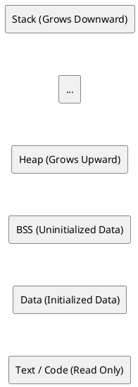
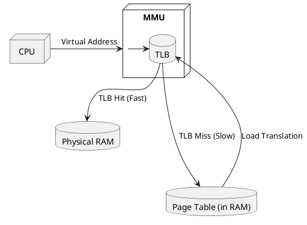

# Memory Layout & Virtual Memory

## Overview
When you run a C program, the Operating System does not give it access to physical RAM. Instead, the OS provides a **Virtual Address Space**—an illusion that the program has access to a massive, contiguous block of memory all to itself (e.g., from `0x00000000` to `0xFFFFFFFF` on a 32-bit system).

This abstraction is crucial for security (process isolation), stability, and allowing the OS to overcommit memory using swapping/paging.

---

## 1. The Anatomy of Virtual Memory Layout

Every C process has a standard virtual memory layout, conceptually divided into segments. Going from the lowest memory addresses to the highest:

### 1. Text Segment (Code Segment)
- **What it holds:** The compiled machine code of your program (the binary instructions).
- **Properties:** It is usually marked as **Read-Only** to prevent the program from accidentally modifying its own instructions, and **Executable**.
- **Sharing:** If you run multiple instances of the same program (e.g., three terminal windows running `bash`), the OS only loads one copy of the Text segment into physical RAM and shares it among all three virtual address spaces.

### 2. Data Segment (Initialized Data)
- **What it holds:** Global variables and `static` variables that are explicitly initialized by the programmer to a non-zero value.
- **Example:** `int global_count = 10;` or `static int status = 1;`
- **Properties:** Read-Write. 

### 3. BSS Segment (Uninitialized Data)
- **What it holds:** Global variables and `static` variables that are uninitialized, or initialized to zero.
- **Example:** `int global_count;` or `static int status = 0;`
- **Why separate it?** BSS stands for "Block Started by Symbol". The OS doesn't store a giant block of zeros in the executable file on disk. Instead, it just records "I need X bytes of zeros here," and allocates/zeroes it out at runtime to save disk space.

### 4. The Heap
- **What it holds:** Memory allocated dynamically at runtime using `malloc`, `calloc`, `realloc`.
- **Properties:** It grows **upward** (towards higher memory addresses). You must manually manage it; failing to `free()` it causes a memory leak.
- **Under the hood:** The heap boundary is tracked by a pointer called the *program break*. System calls like `brk()` and `sbrk()` move this boundary. Modern `malloc` implementations also use `mmap()` to carve out anonymous memory regions for large allocations.

### 5. The Stack
- **What it holds:** Local variables, function arguments, return addresses, and control flow state (stack frames).
- **Properties:** It grows **downward** (towards lower memory addresses). It is automatically managed—when a function returns, its stack frame is instantly popped.
- **Limits:** The stack is limited in size (often 8MB on Linux, check via `ulimit -s`). If you allocate massive arrays locally (e.g., `int giant_array[10000000];`) or recurse too deeply, the stack pointer hits the heap boundary, resulting in a **Stack Overflow**.

---

## 2. How Virtual Maps to Physical

If every process thinks it owns address `0x400000`, how does the hardware know where that actually is in the physical RAM stick?

### Pages and Page Tables
1. **Pages:** The OS divides virtual memory and physical RAM into chunks called **Pages** (typically 4KB in size).
2. **The Page Table:** For every process, the OS maintains a data structure called the Page Table. It is a map: `Virtual Page Number -> Physical Page Frame Number`.
3. **The MMU (Memory Management Unit):** The MMU is a piece of hardware on the CPU. Every time your C code accesses a pointer, the MMU intercepts the virtual address, looks it up in the Page Table, translates it to the physical address, and performs the read/write.

### Translation Lookaside Buffer (TLB)
Walking the Page Table for every single memory access would be incredibly slow because the Page Table itself lives in RAM. 
The **TLB** is a small, ultra-fast hardware cache inside the CPU MMU that stores the most recent virtual-to-physical address translations.
- **TLB Hit:** CPU finds the translation instantly.
- **TLB Miss:** CPU must stall, walk the Page Table in RAM, and load the mapping into the TLB. High-performance code (like 5G DPDK packet processing) optimizes data layout to minimize TLB misses.

---

## 3. What is a Segmentation Fault (SIGSEGV)?

When you dereference a null pointer or access an array out of bounds, the program crashes with a "Segmentation Fault". Why?

1. You try to access a virtual address (e.g., `0x00000000`).
2. The MMU looks up that page in the Page Table.
3. The OS sees that this specific virtual page is **not mapped** to any physical memory, or it lacks the required permissions (e.g., trying to write to the Read-Only Text segment).
4. The MMU hardware triggers an interrupt (Page Fault).
5. The OS kernel takes over, realizes the access is illegal, and sends a `SIGSEGV` signal to your process, instantly killing it.

---

## Interview Questions & Gotchas

1. **Where does a string literal live in memory?**
   - **Code:** `char *str = "Hello World";`
   - **Answer:** The string `"Hello World"` is stored in the Read-Only Data segment (often merged into the Text segment). `str` is a pointer on the stack pointing to that read-only memory. If you try `str[0] = 'h';`, you will get a Segmentation Fault because the hardware enforces read-only access on that page.
   - **The "Why" Behind the Design:** 
     1. **Memory Efficiency (String Pooling):** If you use `"Hello"` 50 times, the compiler stores it once in `.rodata`. If it were mutable, one function modifying it would corrupt it for everyone else. 
     2. **Security:** Hardcoded strings (like SQL queries or passwords) shouldn't be modifiable by malicious buffer overflows. 
     3. **Hardware History:** Historically, code and literals were burned into physical ROM (Read-Only Memory), while variables were copied to precious, tiny RAM.
   - **Contrast:** `char str[] = "Hello World";` allocates an array on the **Stack** and explicitly copies the string from `.rodata` into it at runtime. You *can* modify this array safely.

2. **What is `mmap` and why is it used instead of `malloc` sometimes?**
   - **Answer:** `mmap()` is a system call that maps files or devices directly into memory. Modern `malloc` actually calls `mmap` for large allocations (usually >128KB) because it can allocate independent memory regions outside the main heap, which can be given back to the OS instantly via `munmap()`, preventing heap fragmentation.

3. **How does the OS handle a program requiring more RAM than physically exists?**
   - **Answer:** Demand Paging. The OS evicts the least recently used pages from physical RAM and saves them to the hard drive (Swap space). It unmaps them in the Page Table. If the process tries to access them again, a Page Fault occurs, and the OS pauses the program, loads the page back from disk to RAM, updates the table, and resumes execution.

## Key Takeaways
- The virtual address space isolates processes and provides a massive, contiguous memory illusion.
- **Stack** grows down (auto-managed), **Heap** grows up (manually managed).
- **Text/Data/BSS** are for code, initialized globals, and zeroed globals, respectively.
- The hardware **MMU** and **TLB** translate virtual addresses to physical RAM in real-time via Page Tables.

---
*Last updated: 2026-07-28*
