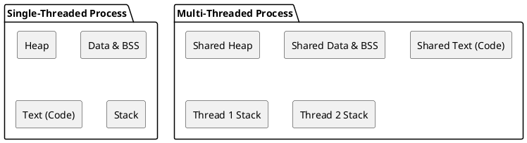

# Multi-threading (pthreads)

## Overview
While **I/O Multiplexing** handles multiple inputs within a single thread, **Multi-threading** solves the blocking I/O problem (and CPU bound tasks) by actually creating concurrent paths of execution within your program.

In C, the POSIX standard for threading is called **pthreads** (`POSIX threads`).

---

## 1. Process vs Thread

Before writing code, it is critical for system programming interviews to understand the difference between a process and a thread.



### Process
A process is an executing instance of a program. The OS gives it an isolated block of memory. 
- **Memory:** Separate virtual address space.
- **Overhead:** High. Creating a new process via `fork()` requires copying page tables. Context switching between processes is slow (involves flushing the TLB cache).
- **Communication:** Difficult. Requires Inter-Process Communication (IPC) like pipes, shared memory, or sockets.

### Thread
A thread is a path of execution *within* a process. 
- **Memory:** Threads share the same virtual address space, data segment (global variables), and heap (`malloc`). They only have their own private **stack** and CPU registers.
- **Overhead:** Low. Creating a thread is much cheaper than a process. Context switching is faster.
- **Communication:** Easy (and dangerous). Since they share the heap and global variables, they can communicate directly.

---

## 2. Basic Pthreads API

To use pthreads in C, you must include `<pthread.h>` and link the program with `-lpthread` (e.g., `gcc main.c -lpthread`).

### Creating a Thread (`pthread_create`)
```c
int pthread_create(pthread_t *thread, const pthread_attr_t *attr,
                   void *(*start_routine) (void *), void *arg);
```
- **thread:** Pointer to a `pthread_t` identifier.
- **attr:** Thread attributes (usually `NULL` for defaults).
- **start_routine:** A function pointer. This is the function the new thread will execute. It **must** return `void *` and take a `void *` argument.
- **arg:** The argument to pass to the function (you cast your struct to `void *`).

### Waiting for a Thread (`pthread_join`)
If your `main()` function finishes, it kills the entire process, including all threads. You use `pthread_join` to force the main thread to wait for a child thread to finish.
```c
int pthread_join(pthread_t thread, void **retval);
```

---

## 3. The Danger: Race Conditions

Because threads share memory, two threads trying to modify the same variable at the exact same time causes undefined behavior known as a **Race Condition**.

**Example:**
Thread A reads `counter = 5`. 
Thread B reads `counter = 5`.
Thread A increments to 6 and writes it back.
Thread B increments to 6 and writes it back.
*Result: The counter is 6, but it should be 7.*

### The Solution: Mutexes
A Mutex (Mutual Exclusion) acts like a lock on a bathroom door. Only one thread can hold the lock at a time.
```c
pthread_mutex_t lock = PTHREAD_MUTEX_INITIALIZER;

pthread_mutex_lock(&lock);
counter++; // Critical section - protected!
pthread_mutex_unlock(&lock);
```

### The Alternative: Semaphores
While a Mutex is a simple lock (binary: 0 or 1), a **Semaphore** is a signaling mechanism with a counter. 
- **Mutex:** "I own this resource, nobody else touch it." (Ownership)
- **Semaphore:** "There are 5 parking spots left. First 5 threads can enter, the 6th must wait." (Signaling/Counting)

In C, semaphores are provided by `<semaphore.h>`.
- `sem_wait(&sem)`: Decrements the counter. If counter is 0, it blocks until someone else increments it.
- `sem_post(&sem)`: Increments the counter, waking up any waiting threads.

**Common Interview Question:** *What is the difference between a binary semaphore and a mutex?*
**Answer:** Ownership. Only the thread that locked a mutex can unlock it. But *any* thread can call `sem_post()` to increment a semaphore, making it ideal for Producer/Consumer scenarios (e.g., Thread A produces data and `posts` the semaphore, Thread B `waits` to consume it).

---

## 4. How Threads Solve the Chat App Problem

If you want to write a chat client, you have the blocking I/O problem:
- `recv()` blocks waiting for the network.
- `fgets()` blocks waiting for the keyboard.

With pthreads, you design it like this:
1. The `main` thread calls `socket()` and `connect()`.
2. The `main` thread calls `pthread_create()` to spawn a **"Receiver Thread"**.
3. The **"Receiver Thread"** enters a `while(1)` loop containing `recv()` and `printf()`. It blocks here waiting for the network.
4. The **"main thread"** enters a `while(1)` loop containing `fgets()` and `send()`. It blocks here waiting for the keyboard.

Since they are two separate threads, if the main thread is frozen waiting for keyboard input, the receiver thread is completely unaffected and will instantly print incoming messages!

---

## Interview Questions & Gotchas

1. **What is a Deadlock?**
   - **Answer:** When Thread A locks Mutex 1 and waits for Mutex 2, while Thread B locks Mutex 2 and waits for Mutex 1. Both freeze forever waiting on each other.

2. **Why do thread functions return and take `void *`?**
   - **Answer:** C lacks templates. `void *` allows you to pass absolutely any data structure into the thread by hiding it behind a generic pointer, and then casting it back inside the thread.

3. **What is a "reentrant" function vs a "thread-safe" function?**
   - **Answer:** A thread-safe function protects shared resources with locks so multiple threads can call it. A reentrant function avoids shared resources (like global/static variables) entirely, relying only on stack variables, making it implicitly thread-safe and safe to be interrupted and recalled. (e.g., `strtok` is NOT thread-safe/reentrant. `strtok_r` is reentrant).

## Key Takeaways
- Threads share memory (heap, data segment); Processes do not.
- Threads have their own stack and registers.
- Use `pthread_create` to spawn concurrent execution paths.
- Shared memory access must be protected using a `pthread_mutex`.

---
*Last updated: 2026-07-28*
