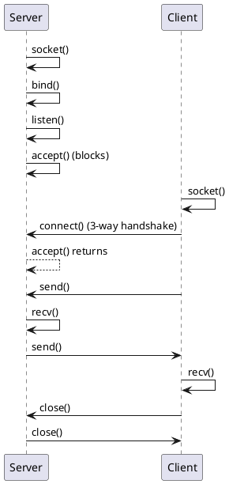

# Socket Programming Basics: Types, Enums & Functions

## Overview
When writing networked applications (which is the core of 5G RAN, communicating via SCTP, TCP, UDP over interfaces like F1, Xn, NG), we use **Berkeley Sockets** (POSIX sockets). 

> **What is POSIX?**
> POSIX stands for **Portable Operating System Interface**. The "X" at the end is a nod to Unix. It's a family of standards specified by the IEEE to maintain compatibility between operating systems (like Linux, macOS, and other Unix variants). Because socket APIs are POSIX-compliant, the socket code you write for a Linux-based 5G gNodeB is highly portable.

The API can initially seem chaotic due to legacy design choices from the 1980s, primarily the way it handles polymorphism in C before object-oriented concepts were built into the language.

This note covers the foundational structures (like `sockaddr_in`), endianness/byte-order conversions, address manipulation functions, and the standard socket lifecycle.

---

## 1. The `sockaddr` Family (C's Version of Polymorphism)

Before diving into the structs, here is the standard lifecycle of a TCP socket connection:



Socket functions like `bind()`, `connect()`, and `accept()` were designed to be protocol-agnostic. They need to accept addresses for IPv4, IPv6, Unix Domain Sockets, etc. In modern C++, we'd use a base class. In C, we use a generic struct and cast to it.

### `struct sockaddr` (The "Base Class")
```c
struct sockaddr {
    unsigned short    sa_family;    // address family, AF_xxx
    char              sa_data[14];  // 14 bytes of protocol address
};
```
You **never** actually populate this struct directly. It exists solely so you can cast other structs to a `struct sockaddr *` when passing them into socket functions.

### `struct sockaddr_in` (The "Derived Class" for IPv4)
The `_in` stands for **Internet** (IPv4). This is the struct you actually interact with.
```c
struct sockaddr_in {
    short            sin_family;   // e.g., AF_INET
    unsigned short   sin_port;     // e.g., htons(3490)
    struct in_addr   sin_addr;     // see struct in_addr, below
    char             sin_zero[8];  // Zero this out! (padding to match struct sockaddr size)
};

struct in_addr {
    unsigned long s_addr; // load with inet_pton()
};
```
**Key gotcha:** Notice `sin_zero[8]`. Because `sockaddr_in` must be the exact same size as `sockaddr` (16 bytes total) so the cast works safely, this padding must be zeroed out (usually via `memset`).

### `struct sockaddr_in6` (For IPv6)
Similar to IPv4 but larger (28 bytes). Socket functions handle the size difference by taking an `addrlen` parameter (e.g., `sizeof(struct sockaddr_in6)`).

---

## 2. Enums and Macros (AF_INET, SOCK_STREAM, etc.)

When creating a socket using `int socket(int domain, int type, int protocol);`, you use several macros:

1. **Domain (Protocol Family):**
   - `AF_INET`: IPv4 Internet protocols.
   - `AF_INET6`: IPv6 Internet protocols.
   - `AF_UNIX` or `AF_LOCAL`: Local communication (Unix Domain Sockets).
   *Note: You might see `PF_INET` (Protocol Family). Historically, one PF could support multiple AFs. In reality, they are a 1:1 mapping, and POSIX specifies using `AF_INET`.*

2. **Type (Semantics of communication):**
   - `SOCK_STREAM`: Sequenced, reliable, two-way, connection-based byte streams (TCP).
   - `SOCK_DGRAM`: Datagrams; connectionless, unreliable messages of fixed maximum length (UDP).
   - `SOCK_SEQPACKET`: Sequenced, reliable, connection-based datagrams of fixed maximum length (SCTP - highly relevant in 5G RAN for NGAP/F1AP interfaces).

---

## 3. Byte Order (Endianness)

Networks communicate in **Network Byte Order**, which is **Big-Endian** (most significant byte first). 
Your local CPU architecture (x86_64/ARM) is likely **Little-Endian** (Host Byte Order). If you don't convert ports and IP addresses, the network will interpret `0x1234` as `0x3412`.

### The Conversion Functions
- `htons()`: **H**ost **TO** **N**etwork **S**hort (used for 16-bit ports).
- `htonl()`: **H**ost **TO** **N**etwork **L**ong (used for 32-bit IPv4 addresses).
- `ntohs()`: **N**etwork **TO** **H**ost **S**hort.
- `ntohl()`: **N**etwork **TO** **H**ost **L**ong.

---

## 4. IP Address Manipulation (`inet` functions)

Historically, people used `inet_addr()` to convert string IPs like "192.168.1.1" to binary. **Do not use this.** It doesn't support IPv6 and returns `-1` on failure (which is a valid broadcast IP `255.255.255.255`).

### The Modern Way: `inet_pton` and `inet_ntop`
The `p` stands for **Presentation** (string format) and `n` for **Network** (binary format).

**String to Binary (pton):**
```c
struct sockaddr_in sa;
// "10.0.0.1" -> binary format, stored in sa.sin_addr
inet_pton(AF_INET, "10.0.0.1", &(sa.sin_addr));
```

**Binary to String (ntop):**
```c
char ip4[INET_ADDRSTRLEN]; 
struct sockaddr_in sa;
// binary -> string
inet_ntop(AF_INET, &(sa.sin_addr), ip4, INET_ADDRSTRLEN);
```
*`INET_ADDRSTRLEN` is a macro defined as 16, which is exactly enough to hold "255.255.255.255\0". For IPv6, use `INET6_ADDRSTRLEN`.*

---

## Code Examples

Please refer to the companion code directory `code/01-socket-programming-basics/`:
- `tcp_server.c`: Demonstrates creating a socket, binding to `INADDR_ANY`, listening, and accepting client connections.
- `tcp_client.c`: Demonstrates translating a string IP via `inet_pton` and `connect()`ing to the server.

---

## Interview Questions & Gotchas

1. **Why do we cast `sockaddr_in` to `sockaddr` in `bind()`?**
   - **Answer**: C lacked inheritance. `bind()` was written to take any address type. `sockaddr` acts as the generic interface. The `addrlen` parameter tells `bind()` exactly how much memory to safely read from the pointer based on the underlying struct type (`sockaddr_in` vs `sockaddr_in6`).

2. **What happens if you forget `htons()` on the port number?**
   - **Answer**: If binding to port 80 (0x0050) on a little-endian machine, it gets sent as 0x5000, which is port 20480. Your application will bind to the wrong port silently.

3. **What is `INADDR_ANY`?**
   - **Answer**: A macro (0.0.0.0) telling the socket to bind to all available network interfaces on the host (Ethernet, Wi-Fi, loopback). Must be wrapped in `htonl(INADDR_ANY)` (though mathematically `htonl(0)` is `0`, it's best practice).

4. **Why is `memset(&addr, 0, sizeof(addr))` critical?**
   - **Answer**: `struct sockaddr_in` has an 8-byte padding array (`sin_zero`). If uninitialized, stack garbage causes the memory footprint to not match standard expectations. Some picky OS implementations (or security tools like valgrind) might reject the `bind()` or flag it as reading uninitialized memory.

## Key Takeaways
- Use `sockaddr_in` to define the address, then cast to `(struct sockaddr *)` for function calls.
- Always use `htons()` / `htonl()` for ports and IPs respectively to prevent endianness bugs.
- Ditch legacy `inet_addr()`; exclusively use `inet_pton()` and `inet_ntop()` for IP parsing.
- SCTP (`SOCK_SEQPACKET`) is highly relevant for 5G RAN interfaces, though the socket fundamentals remain exactly the same as TCP/UDP.

---
*Last updated: 2026-07-28*
