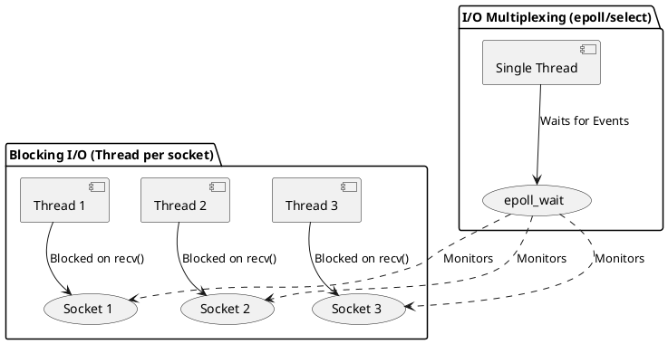

# I/O Multiplexing (select, poll, epoll)

## Overview
When building network applications (like a chat app or a web server), you often need to handle multiple Input/Output (I/O) sources at the same time. For example, a chat client needs to read from the network (incoming messages) AND read from the keyboard (user typing) simultaneously. 

By default, I/O functions like `recv()`, `read()`, and `scanf()` are **blocking**. This means if you call `recv()` to wait for a network message, the execution of your program stops completely at that line until a message arrives. If the user types on the keyboard during this time, the program can't process it.

**I/O Multiplexing** is a single-threaded solution to this problem. It allows a program to monitor multiple file descriptors (sockets, stdin, files) and asks the OS: *"Wake me up when ANY of these are ready to be read from or written to."*



---

## 1. The Legacy Champion: `select()`

`select()` is the oldest, most portable (POSIX standard) way to do multiplexing. It uses bitmasks (`fd_set`) to represent the file descriptors you want to monitor.

### How it works:
1. You add your sockets and `stdin` (File Descriptor 0) to a read `fd_set`.
2. You call `select()`, which **blocks** until one or more of the descriptors have data.
3. Once `select()` unblocks, you iterate through your set to see *which* descriptor woke it up.
4. If it was the socket, you `recv()`. If it was `stdin`, you `read()` the keyboard.

### Why it's bad for high-performance (The C10k problem):
- It has a hard limit of `FD_SETSIZE` (usually 1024). You can't monitor more than 1024 sockets.
- You have to pass the entire set of descriptors from user space to kernel space on *every single call*.
- When `select()` returns, it doesn't tell you *which* socket has data. You have to write a `for` loop to check all 1024 sockets one by one.

---

## 2. The Step Up: `poll()`

`poll()` is similar to `select()` but solves the 1024 limit. Instead of a bitmask, it uses an array of `pollfd` structures.

### The `pollfd` structure:
```c
struct pollfd {
    int   fd;         // The file descriptor
    short events;     // What to look for (e.g., POLLIN for incoming data)
    short revents;    // What actually happened (filled by the OS)
};
```
### Pros vs Cons:
- **Pro:** No artificial 1024 limit.
- **Con:** It still scales linearly ($O(N)$). If you have 10,000 connected users and one sends a message, you still have to loop through 10,000 `pollfd` structs to find out who it was. 

---

## 3. The Modern Standard: `epoll` (Linux Specific)

`epoll` is the engine behind high-performance servers like **Nginx**, **Redis**, and modern 5G User Plane Functions (UPF). It solves the $O(N)$ scanning problem of `select`/`poll`.

### How it works:
Instead of sending the whole list of sockets to the OS on every loop, you use a dedicated `epoll` instance inside the kernel.
1. `epoll_create1()`: Creates the epoll instance.
2. `epoll_ctl()`: You tell the kernel to add/remove a socket from the watch list.
3. `epoll_wait()`: You ask the kernel for events. 

**The Magic:** When `epoll_wait()` returns, it provides an array of *only the sockets that actually have data*. If you have 10,000 connections and 5 send data, `epoll_wait` gives you an array of size 5. The lookup is $O(1)$.

---

## Interview Questions & Gotchas

1. **What is the difference between Level Triggered (LT) and Edge Triggered (ET) in `epoll`?**
   - **Answer:** 
     - **Level Triggered (Default):** `epoll_wait` will keep telling you "this socket has data" every time you call it, as long as you haven't read all the data in the kernel buffer.
     - **Edge Triggered:** `epoll_wait` will only tell you *once* when new data arrives. If you don't read all of it right then, you won't be notified again until even *newer* data arrives. This requires careful non-blocking I/O programming.

2. **When should you use `select` instead of `epoll`?**
   - **Answer:** When portability is more important than performance. `epoll` is Linux-only. MacOS/FreeBSD use `kqueue`. Windows has `IOCP`. `select` works on everything. Also, for a very small number of connections (< 100), the overhead of `select` is negligible.

## Key Takeaways
- **Blocking I/O** is a bottleneck for servers and chat applications.
- **I/O Multiplexing** lets a single thread handle multiple file descriptors concurrently.
- `select` and `poll` are standard but scale poorly ($O(N)$).
- `epoll` scales brilliantly ($O(1)$) and is mandatory knowledge for high-performance C network programming in Linux.

---
*Last updated: 2026-07-28*
