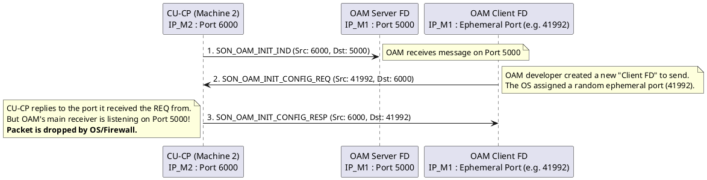

# UDP Socket Architecture & Troubleshooting

## Overview
These concepts are studied under **Network Programming / Socket Programming** (specifically advanced UDP mechanics) and **Systems Architecture**. In 5G RAN development, where nodes (CU, DU, OAM, SON) are frequently distributed across different VMs or physical servers, understanding exactly how the OS handles UDP state is critical for troubleshooting lost packets.

Unlike TCP, UDP is connectionless. The OS does not track a formal "session" or "handshake" between a client and a server. This leads to unique architectural choices and common pitfalls.

---

## 1. The UDP Socket "Two-Way Radio"

In TCP, a server must `accept()` an incoming connection, which creates a *brand new, dedicated socket File Descriptor (FD)* specifically for that one client. 

In UDP, **a socket is just a two-way radio bound to a port**. You do not need a separate "Client FD" and "Server FD". 

- **Listening:** You call `bind(IP, PORT)` on a socket FD. You can now use `recvfrom()` to listen to messages from *any* IP address.
- **Transmitting:** You can use that **exact same socket FD** to call `sendto()` and reply to the sender.

---

## 2. The "Ephemeral Port" Trap (RAN Example)

A common bug in distributed 5G systems (like CU-CP communicating with an OAM/SON server) occurs when developers incorrectly treat UDP like TCP and create a new socket specifically for sending replies.

### Scenario: OAM and CU-CP Initialization
Imagine an OAM server and a CU-CP. The CU-CP needs to send a `SON_OAM_INIT_IND`, receive a `REQ`, and reply with a `RESP`.

If the OAM developer creates a **separate socket** to send the `REQ`, this is what happens at the network layer:

### The Fix: Symmetric Ports
To prevent this, 5G nodes should almost always use **Symmetric Ports** for management traffic. The OAM application should reuse its existing listening socket FD to transmit the `REQ`. This ensures the source port remains `5000`, so the CU-CP sends the `RESP` back to the correct listening port.

---

## 3. Real-World Troubleshooting (Why packets drop)

If you have a scenario where Message 1 (`IND`) and Message 2 (`REQ`) succeed, but Message 3 (`RESP`) never reaches the application layer, the packet is being dropped. Here is how to find out why:

### Suspect A: Firewall / iptables
UDP is stateless. When OAM sends Message 2 out, a stateful firewall (like Linux `iptables`) temporarily opens a "hole" allowing a response to come back from that specific IP/Port combo.
- If OAM used a random ephemeral port to send the `REQ`, the firewall expects the `RESP` to come back to that ephemeral port.
- If the `RESP` is routed to the main listening port instead, the firewall might drop it because it doesn't recognize it as part of the "session".
- **Debug:** Run `sudo tcpdump -i any udp port <OAM_PORT> -n` on the OAM server. If `tcpdump` sees the packet but the application doesn't, the firewall (or OS) is dropping it.

### Suspect B: Asymmetric Routing (Multiple IPs)
If the OAM server has multiple network interfaces (e.g., a management IP `10.0.0.1` and a traffic IP `192.168.1.1`):
- If the developer calls `bind()` on `INADDR_ANY` (`0.0.0.0`), the OS listens on all interfaces.
- The `IND` might arrive on the management IP.
- When OAM sends the `REQ` reply, the Linux routing table might decide to route the packet out via the traffic IP.
- The CU-CP receives a packet from a completely different IP than it expected and drops it for security/validation reasons.
- **Debug:** Never bind to `INADDR_ANY` in production 5G nodes. Always explicitly bind sockets to the specific configured IP address.

### Suspect C: Application-Level Dropping
The packet perfectly arrives at the OAM `recvfrom()` function, but the OAM application code intentionally ignores it. 
- **Debug:** In protocols like F1AP, E1AP, or custom SON protocols, there is usually a **Transaction ID**. If the `RESP` contains a different Transaction ID than the `REQ` generated, the OAM application will silently discard it. Check the application logs.

## Key Takeaways
- UDP does not need a "Client FD". A single bound socket can both send and receive to thousands of IPs.
- Creating separate sending sockets causes the OS to assign **ephemeral source ports**, breaking port symmetry and triggering firewall drops.
- Always explicitly bind to configured IPs, never `0.0.0.0`, to prevent asymmetric routing bugs on multi-interface telecom servers.

---
*Last updated: 2026-07-30*
