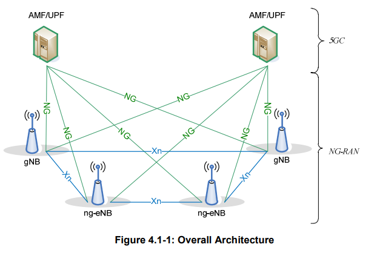
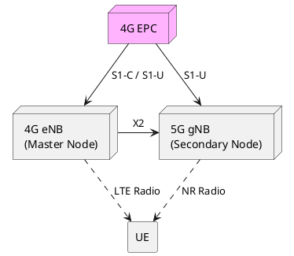
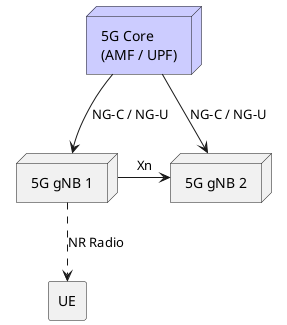

# 5G Network Architecture

## Overview
This note covers the high-level architecture of a 5G system. A 5G system is broadly divided into the Radio Access Network (NG-RAN) and the Core Network (5GC). We will also cover the fundamental difference between Standalone (SA) and Non-Standalone (NSA) deployment options, which is a frequent interview topic.

## Content

### 1. The 5G System (5GS) Split
The 5G System (5GS) is composed of two main domains:
- **NG-RAN (Next Generation Radio Access Network):** Handles all radio-related functions. It consists of `gNBs` (5G base stations) and sometimes `ng-eNBs` (upgraded 4G base stations that connect to the 5G Core).
- **5GC (5G Core Network):** Handles authentication, mobility management, session management, and routing data to the external data network (Internet). 

> [!NOTE] 
> According to **3GPP TS 38.300**, an NG-RAN node is either a `gNB` (providing NR user/control plane terminations) or an `ng-eNB` (providing E-UTRA user/control plane terminations).

#### Key 5GC Nodes
In 5G, the core network was redesigned to be "Service-Based" (SBA), meaning network functions communicate via APIs. The key nodes interacting with the RAN are:
- **AMF (Access and Mobility Management Function):** The control plane anchor. It handles NAS (Non-Access Stratum) signaling, paging, and mobility. (Equivalent to the 4G MME).
- **UPF (User Plane Function):** The user plane anchor. It routes data packets between the RAN and the Data Network (Internet). (Equivalent to the 4G SGW/PGW).
- **SMF (Session Management Function):** Manages PDU sessions and allocates IP addresses to UEs.

### 2. Network Interfaces
According to TS 38.300 (Section 4), the NG-RAN nodes are interconnected with each other and with the 5GC via standardized interfaces:
- **NG Interface (NG-C / NG-U):** Connects the gNB to the 5GC. 
  - **NG-C (Control Plane):** Connects gNB to AMF using SCTP/NGAP.
  - **NG-U (User Plane):** Connects gNB to UPF using GTP-U.
- **Xn Interface (Xn-C / Xn-U):** Connects gNBs to each other. Used heavily for Xn Handover and Dual Connectivity.

### 3. Deployment Options: SA vs NSA
When operators began rolling out 5G, it was too expensive to build the 5G Core immediately. 3GPP introduced deployment "Options" to ease the transition.

#### Non-Standalone (NSA) - Option 3x
In NSA, the 5G radio (gNB) is deployed, but it relies on the **4G Core (EPC)** and a **4G base station (eNB)** for control plane signaling.
- The 4G eNB is the **Master Node (MN)**. It handles the RRC connection to the UE.
- The 5G gNB is the **Secondary Node (SN)**. It provides a data pipe for faster speeds.
- The UE is connected to *both* 4G and 5G simultaneously (EN-DC: E-UTRA NR Dual Connectivity).

#### Standalone (SA) - Option 2
This is "true" 5G. The gNB connects directly to the 5GC. There is no reliance on 4G.
- Simplified architecture.
- Required to support advanced 5G features like Network Slicing and URLLC (Ultra-Reliable Low Latency).

### 4. Comparison with LTE and NB-IoT (Interview Focus)
Interviewers frequently test your understanding by asking you to contrast 5G architecture with previous generations.
- **Core Separation:** In 4G LTE, the MME handled mobility and the SGW/PGW handled user data. In 5G, the **AMF** strictly handles control plane/mobility, while the **UPF** handles user plane. The separation of control and user plane (CUPS) was retrofitted into late 4G but is native and fundamental to 5G.
- **SBA (Service-Based Architecture):** Unlike the point-to-point hardware interfaces in LTE (like S11, S5), 5GC nodes (AMF, SMF, etc.) communicate via HTTP/2 RESTful APIs over a service-based bus.
- **NB-IoT Integration:** NB-IoT (Narrowband IoT) was introduced in 4G. In 5G, NB-IoT UEs are supported by an `ng-eNB` connecting to the 5GC. The 5GC allows NB-IoT to continue operating without needing a completely new radio design for massive IoT.

## Key Takeaways
- **NG-RAN** consists of gNBs connected via the **Xn** interface.
- NG-RAN connects to the **5GC** via the **NG** interface (NG-C to AMF, NG-U to UPF).
- **NSA (Option 3x)** uses the 4G Core and a 4G Master Node for signaling. It is essentially 4G with a 5G data pipe (EN-DC).
- **SA (Option 2)** is pure 5G, connecting directly to the 5GC, unlocking Slicing and URLLC.

## Interview Q&A

**Q: What is the primary difference between SA and NSA?**
**A:** In NSA, the 5G gNB relies on the 4G EPC and a 4G eNB (Master Node) for control plane signaling. The UE is dual-connected (EN-DC). In SA, the gNB connects directly to the 5GC with no 4G dependency, enabling Network Slicing and URLLC.

**Q: Which interfaces connect the gNB to the 5G Core?**
**A:** NG-C (gNB ↔ AMF, control plane, SCTP/NGAP) and NG-U (gNB ↔ UPF, user plane, GTP-U).

**Q: What is the Xn interface used for?**
**A:** Connects gNBs to each other. Used for Xn Handover (UE context transfer + data forwarding) and Dual Connectivity operations.

**Q: In NSA Option 3x, which node handles the RRC connection?**
**A:** The 4G eNB (Master Node). The 5G gNB is a Secondary Node providing additional user plane bandwidth only.

---
*Last updated: 2026-08-08*

