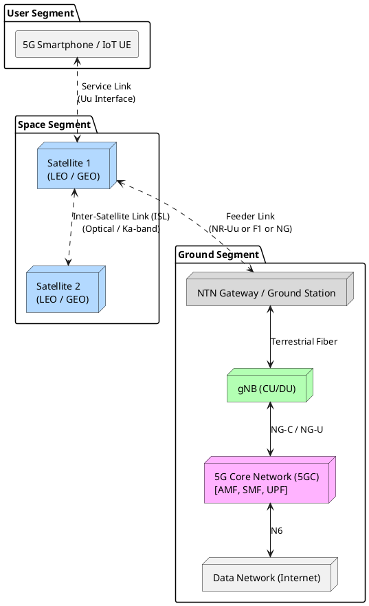
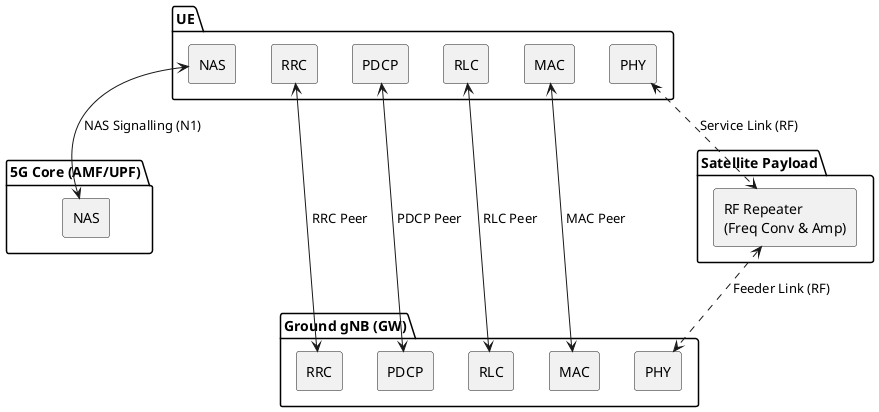
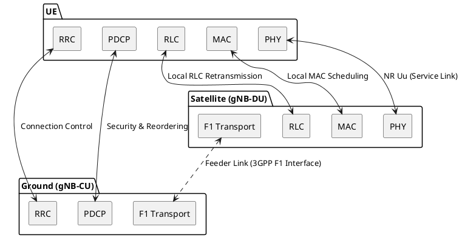
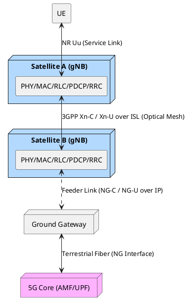

# Non-Terrestrial Networks (NTN) — NR-NTN Architecture & SIB19

## Overview
Introduced normatively in **3GPP Release 17** (and significantly enhanced in Rel-18 and Rel-19), **Non-Terrestrial Networks (NTN)** integrates satellite- and airborne-based communication systems directly into the 3GPP 5G New Radio (NR) and IoT standards. 

Historically, satellite communications relied on proprietary, vendor-locked hardware (e.g., Iridium, Inmarsat, Thuraya) requiring bulky satellite phones or specialized directional dish terminals. NTN revolutionizes this paradigm through **Direct-to-Cell (D2C)**: allowing standard commercial 5G smartphones and mass-market IoT chipsets to connect directly to satellites in orbit without external satellite hardware.

However, moving base stations into orbit breaks fundamental terrestrial cellular assumptions:
- **Propagation Delay:** Radio Round-Trip Time (RTT) increases from single-digit milliseconds in terrestrial cells to 10–50 ms in Low Earth Orbit (LEO) and up to ~540 ms in Geostationary Orbit (GEO).
- **Extreme Mobility & Doppler Shift:** LEO satellites orbit Earth at ~7.56 km/s (~27,000 km/h), causing massive Doppler shifts (up to $\pm 50$ kHz at 2 GHz S-band) and rapid cell coverage transitions every 2 to 10 minutes.
- **Vast Cell Footprints:** A single satellite spot beam spans 50 km to 500 km across international borders and multiple regulatory jurisdictions.

This note covers the origins and evolution of NTN, the physical orbit classifications, link taxonomy, payload architectures (**Transparent**, **Semi-Regenerative / Split gNB**, and **Full Regenerative**), protocol stacks, **SIB19** assistance data, autonomous open-loop synchronization, and key interview traps.

---

## Content

### 1. Origin and 3GPP Evolution of NTN

```
3GPP Release Roadmap for NTN:
┌─────────────────────────┐     ┌─────────────────────────┐     ┌─────────────────────────┐
│     Rel-15 / Rel-16     │     │         Rel-17          │     │         Rel-18          │
│   (Feasibility & TR)    │ ──> │     (First Normative)   │ ──> │       (Evolution)       │
│ • TR 38.811 (Channel)   │     │ • Transparent Payloads  │     │ • 10 GHz+ (Ku/Ka bands) │
│ • TR 38.821 (NR-NTN)    │     │ • SIB19 Ephemeris & TA  │     │ • 10 MHz+ BW, Mobility  │
│ • TR 36.763 (IoT-NTN)   │     │ • FR1 Bands (n255/n256) │     │ • Network Location Verif│
└─────────────────────────┘     └─────────────────────────┘     └─────────────────────────┘
                                                                             │
                                                                             v
                                                                ┌─────────────────────────┐
                                                                │         Rel-19          │
                                                                │       (Expansion)       │
                                                                │ • Regenerative Payloads │
                                                                │ • Store-and-Forward IoT │
                                                                │ • Inter-Satellite Links │
                                                                └─────────────────────────┘
```

#### Why NTN? The Terrestrial Gap
Terrestrial cellular networks (2G through 5G) cover only **~20% of Earth's landmass** and virtually **0% of open oceans**. Deploying cell towers across deserts, mountain ranges, open seas, and polar regions is economically unviable and technically impossible. NTN fills this blank:
- **Global Ubiquity:** Unbroken coverage for maritime vessels, commercial aviation, transcontinental logistics, agriculture, and defense.
- **Disaster Resilience:** When earthquakes, tsunamis, or hurricanes destroy terrestrial power grids and fiber backhauls, satellites remain completely immune.
- **Direct-to-Device (D2D / D2C):** Mass-market adoption without requiring users to purchase specialized $1,000+ satellite terminals.

#### 3GPP Specification Timeline
1. **Rel-15 / Rel-16 (Study Phase):**
   - **TR 38.811:** Defined NTN deployment scenarios, channel models (ionospheric/tropospheric scintillation, atmospheric absorption, rain attenuation), and ray-tracing models.
   - **TR 38.821:** Evaluated NR radio interface solutions across User Plane and Control Plane (Timing Advance pre-compensation, HARQ enhancements, handover triggers).
   - **TR 36.763:** Addressed NB-IoT and eMTC adaptation for satellite operation.
2. **Rel-17 (First Normative Baseline):**
   - Formally standardized **NR-NTN** and **IoT-NTN**.
   - Standardized **Transparent (Bent-Pipe)** payloads.
   - Introduced **SIB19 (SystemInformationBlockType19)** for satellite ephemeris, common Timing Advance, and scheduling offsets ($K_{offset}$, $K_{mac}$).
   - Allocated initial sub-6 GHz dedicated NTN bands: **Band n255** (L-band: 1626.5–1660.5 MHz UL / 1525–1559 MHz DL) and **Band n256** (S-band: 1980–2010 MHz UL / 2170–2200 MHz DL).
3. **Rel-18 (Enhanced NTN):**
   - Extended frequency support above 10 GHz into **Ku-band** and **Ka-band** with larger bandwidths (>10 MHz channel bandwidths for high-throughput broadband).
   - Network-verified UE location (preventing UEs from spoofing GNSS to access unauthorized national spectrum).
   - Enhanced mobility, discontinuous coverage (store-and-forward), and beam switching.
4. **Rel-19 (Advanced NTN):**
   - Standardized normative support for **Regenerative payloads** (on-board gNB / gNB-DU).
   - **Inter-Satellite Links (ISL):** Standardized routing and cross-satellite handover over space-mesh backbones.

---

### 2. Space Orbit Classifications & Physical Realities

NTN operates across airborne and spaceborne platforms. The physical altitude dictates the orbital mechanics, coverage geometry, and latency:

| Orbit / Platform | Altitude ($h$) | Orbital Speed ($v$) | Propagation Delay (One-Way) | Typical RTT | Max Doppler Shift (at 2 GHz S-Band) | Ground Beam Visibility |
| :--- | :--- | :--- | :--- | :--- | :--- | :--- |
| **LEO** (Low Earth Orbit) | 300 – 1,500 km | ~7.56 km/s (~27,000 km/h) | 1.5 – 5 ms | 10 – 25 ms | $\approx \pm 48 \text{ kHz}$ | 2 – 10 minutes |
| **MEO** (Medium Earth Orbit) | 7,000 – 25,000 km | ~3.9 km/s | 25 – 85 ms | 100 – 180 ms | $\approx \pm 15 \text{ kHz}$ | A few hours |
| **GEO** (Geostationary Orbit) | 35,786 km | ~3.07 km/s (matches Earth rotation) | ~120 – 140 ms | ~540 ms | $\approx 0 \text{ Hz}$ (stationary relative to ground) | Permanent (24/7 coverage) |
| **HAPS** (High Altitude Platforms) | ~20 km (Stratosphere) | Stationary or < 100 km/h | < 0.1 ms | < 5 ms | Negligible | Semi-permanent |

> [!NOTE]
> **LEO vs. GEO Trade-Off:**
> - **GEO:** 3 satellites can cover almost the entire planet (except polar regions). Delay is massive (~540 ms RTT), making real-time gaming or interactive voice challenging, but Doppler is virtually zero, and satellites never change position relative to the ground.
> - **LEO:** Low latency (~20 ms RTT, comparable to terrestrial 4G/5G), but requires dense mega-constellations (hundreds to thousands of satellites like Starlink or OneWeb). Satellites flash across the sky in minutes, requiring continuous, rapid handovers and severe Doppler compensation.

---

### 3. Structural Anatomy of an NTN System

An NTN architecture consists of three physical segments connected by three radio links:



#### The Three Radio Links
1. **Service Link:**
   - The radio link between the **UE** and the **Satellite**.
   - Standard 3GPP **NR Uu** radio interface.
   - Typically deployed in lower frequency bands: **FR1 S-band (n256) / L-band (n255)** for handheld direct-to-cell (better penetration and omni-directional handheld antenna efficiency), or **FR2 / Ka-band** for high-gain VSAT terminals.
2. **Feeder Link:**
   - The radio link between the **Satellite** and the **NTN Gateway (Ground Station)**.
   - Operates in high-frequency spectrum: **Ka-band, Ku-band, or Q/V-bands** (20–50 GHz) with massive directional tracking dish antennas on the ground to provide high aggregate backhaul bandwidth.
3. **Inter-Satellite Link (ISL):**
   - Direct communication links between satellites in orbit (satellite-to-satellite).
   - Implemented via high-speed **optical/laser links** (up to 100 Gbps) or millimeter-wave RF.
   - Enables space-mesh routing: user packets can hop from satellite to satellite across oceans and polar caps, reaching a ground gateway thousands of kilometers away without landing intermediate ground stations.

---

### 4. Payload Architectures: Transparent vs. Semi-Regenerative vs. Full Regenerative

The satellite payload can process the 5G protocol stack at different depths. 3GPP TR 38.821 and standards classify payloads into three distinct operational architectures:

```
Option 1: Transparent (Bent-Pipe)
 [ UE ] <=== Service Link ===> [ Satellite (RF Transponder) ] <=== Feeder Link ===> [ Gateway + gNB ] <───> [ 5GC ]
                                (Freq Conversion + RF Amp)

Option 2: Semi-Regenerative (Split-gNB: DU Onboard, CU on Ground)
 [ UE ] <=== Service Link ===> [ Satellite (gNB-DU) ] <=== Feeder Link (F1) ===> [ Gateway + gNB-CU ] <───> [ 5GC ]
                                (PHY / MAC / RLC)                                (PDCP / RRC / SDAP)

Option 3: Full Regenerative (Complete gNB Onboard)
 [ UE ] <=== Service Link ===> [ Satellite (Full gNB) ] <=== Feeder Link (NG) ===> [ Gateway (IP Router) ] <───> [ 5GC ]
                                (PHY/MAC/RLC/PDCP/RRC)
```

#### Detailed Architecture Comparison

| Dimension | Transparent (Bent-Pipe) | Semi-Regenerative (DU Onboard) | Full Regenerative (gNB Onboard) |
| :--- | :--- | :--- | :--- |
| **Payload Classification** | Non-regenerative analog transponder | Split-RAN baseband processor | Complete digital baseband + network node |
| **On-board Protocol Stack** | RF Filtering, Frequency Conversion, Power Amplification (TWTA/SSPA) | **PHY, MAC, RLC** (gNB-DU) | **PHY, MAC, RLC, PDCP, RRC, SDAP** (Full gNB) |
| **Ground Station Node** | Hosts full gNB (CU + DU) | Hosts gNB-CU | Operates as pure IP Gateway / Router |
| **Interface on Feeder Link** | Analog RF spectrum (Digitized/Raw I/Q or analog relay) | **3GPP F1 Interface** (F1-C / F1-U over SCTP/GTP-U) | **3GPP NG Interface** (N2/N3 to 5GC) |
| **Physical Layer RTT** | Double-Hop: $RTT_{service} + RTT_{feeder}$ | Single-Hop: $RTT_{service}$ | Single-Hop: $RTT_{service}$ |
| **HARQ & MAC Scheduling** | Managed on Earth (High RTT; requires $K_{offset}$ & disabled HARQ) | Managed directly in space (Fast MAC scheduling & local HARQ) | Managed directly in space (Fastest loop) |
| **Inter-Satellite Links (ISL)** | **Not possible** (Requires real-time ground gateway line-of-sight) | Limited (DU-to-DU not standard in 3GPP) | **Fully Supported** via Xn / ISL packet routing in orbit |
| **Satellite Weight, Power & Cost** | Low SWaP (Size, Weight, Power); long 15-year lifespan | Medium SWaP; requires radiation-tolerant DSP/FPGA | High SWaP; complex radiation-hardened multi-core CPUs/ASICs |
| **3GPP Specification Baseline** | Rel-17 normative baseline | Studied in Rel-17/18; Rel-19 enhancements | Rel-19 normative specifications |

---

### 5. Protocol Stacks Across Payload Architectures

#### Architecture A: Transparent (Bent-Pipe) Protocol Stack
In transparent mode, the satellite is an RF mirror. The entire 3GPP Layer 1/2/3 stack terminates on the ground:



#### Architecture B: Semi-Regenerative (Split-gNB: DU Onboard, CU on Ground)
In semi-regenerative mode, time-critical layers (PHY, MAC scheduling, RLC ARQ) run in space, eliminating feeder link latency from the radio scheduling loop. Non-time-critical RRC and PDCP reside safely on the ground:



#### Architecture C: Full Regenerative (Complete gNB Onboard with ISL)
The satellite is an autonomous base station. It executes all L1, L2, and L3 protocols in orbit and interfaces directly with the 5G Core over standard 3GPP NG-C and NG-U interfaces:



---

### 6. SIB19: The Backbone of NTN Assistance Data

In terrestrial 5G, the base station measures UL timing offsets from received PRACH and commands the UE dynamically via **MAC CE Timing Advance Commands**. 

In NTN, this closed-loop model breaks down: because of the massive propagation delay, by the time the gNB measures an offset and sends a command, the satellite has moved hundreds of meters.

To solve this, 3GPP inverted the synchronization model:
> **In NTN, the UE autonomously pre-compensates Timing Advance (TA) and Doppler frequency shift before transmitting PRACH Msg1.**

To enable autonomous calculations, the gNB broadcasts satellite trajectory data and timing offsets inside **SIB19 (SystemInformationBlockType19)** defined in **3GPP TS 38.331**.

#### SIB19 ASN.1 Structure (Release 17)

```asn.1
SystemInformationBlockType19-r17 ::= SEQUENCE {
    ntn-Config-r17                 NTN-Config-r17                 OPTIONAL, -- Need R
    t-Service-r17                  INTEGER (0..549755813887)      OPTIONAL, -- Need R
    referenceLocation-r17          ReferenceLocation-r17          OPTIONAL, -- Need R
    distanceThresh-r17             INTEGER (0..65525)             OPTIONAL, -- Need R
    ntn-NeighCellConfigList-r17    NTN-NeighCellConfigList-r17    OPTIONAL, -- Need R
    lateNonCriticalExtension       OCTET STRING                   OPTIONAL,
    ...
}

NTN-Config-r17 ::= SEQUENCE {
    epochTime-r17                  EpochTime-r17                  OPTIONAL, -- Need R
    ntn-UlSyncValidityDuration-r17 ENUMERATED {s5, s10, s15, s20, s25, s30, s35,
                                               s40, s45, s50, s55, s60, s120, 
                                               s180, s240, s900} OPTIONAL, -- Cond SIB19
    cellSpecificKoffset-r17        INTEGER (1..1023)              OPTIONAL, -- Need R
    kmac-r17                       INTEGER (1..512)               OPTIONAL, -- Need R
    ta-Info-r17                    TA-Info-r17                    OPTIONAL, -- Need R
    ephemerisInfo-r17              EphemerisInfo-r17              OPTIONAL, -- Need R
    ntn-PolarizationDL-r17         ENUMERATED {rhcp, lhcp, linear} OPTIONAL, -- Need R
    ntn-PolarizationUL-r17         ENUMERATED {rhcp, lhcp, linear} OPTIONAL, -- Need R
    ta-Report-r17                  ENUMERATED {enabled}           OPTIONAL, -- Need R
    ...
}
```

#### Detailed Explanation of SIB19 Parameters
1. **`ephemerisInfo-r17`**:
   Delivers the satellite's exact position and velocity trajectory in one of two formats:
   - **`positionVelocity-r17` (ECEF Cartesian State Vectors):**
     Specifies $X, Y, Z$ coordinates (meters) and velocity vectors $V_x, V_y, V_z$ (mm/s) in the Earth-Centered Earth-Fixed frame. Preferred for LEO constellations due to direct baseband calculation.
   - **`orbital-r17` (Keplerian Orbital Elements):**
     Broadcasts 6 classical Keplerian parameters: semi-major axis ($a$), eccentricity ($e$), inclination ($i$), longitude of ascending node ($\Omega$), argument of periapsis ($\omega$), and mean anomaly ($M$) at epoch. Remains valid across much longer timeframes and is standard for GEO/MEO.
2. **`epochTime-r17`**:
   The exact reference timestamp (System Frame Number `sfn` and subframe number) at which the broadcast ephemeris state is valid.
3. **`ntn-UlSyncValidityDuration-r17`**:
   Validity timer ($5\text{ s}$ to $900\text{ s}$). If the UE cannot re-read SIB19 before this timer expires, it must stop all uplink transmissions to avoid interfering with adjacent cells.
4. **`cellSpecificKoffset-r17` ($K_{offset}$)**:
   In terrestrial NR, DL scheduling to UL transmission uses small slot offsets ($K_0, K_1, K_2$). In NTN, the propagation delay spans dozens of slots.
   $K_{offset}$ is an integer slot offset added to the scheduling timeline:
   $$\text{Scheduling Delay} = K_2 + K_{offset}$$
   Ensuring the gNB's scheduler and the UE's transmitter align across large space delays.
5. **`kmac-r17`**:
   Slot offset applied to MAC layer procedures, particularly stretching the Random Access Response (RAR) window and Contention Resolution timer so the UE does not prematurely declare RACH failure while waiting for downlink signal traversal.
6. **`ta-Info-r17`**:
   Broadcasts the common delay ($T_{common}$) from the ground gateway to the satellite, plus common drift rates ($T_{drift}$ in $\mu\text{s/s}$).
7. **`ntn-PolarizationDL-r17` / `ntn-PolarizationUL-r17`**:
   Signals antenna polarization: `rhcp` (Right-Hand Circular), `lhcp` (Left-Hand Circular), or `linear`. Standardizes circular polarization to eliminate **Faraday Rotation** signal extinction across Earth's ionosphere.

---

### 7. Autonomous Timing and Frequency Pre-Compensation

```
                     Satellite (Known Ephemeris via SIB19)
                                   🛰️
                                  /  \
               Feeder Link       /    \       Service Link
            (Delay: T_common)   /      \    (Delay: T_UE-specific)
                               v        v
                        Ground gNB     UE (Known 3D Position via GNSS)
```

The total Timing Advance ($T_{TA}$) applied by the UE is split into two components:
$$T_{TA} = T_{common} + T_{UE-specific}$$

1. **$T_{common}$ (Broadband component):** Broadcast by gNB in SIB19 `ta-Info`. Covers feeder link delay and common satellite-to-reference-cell delay.
2. **$T_{UE-specific}$ (Autonomous UE component):**
   The UE determines its own 3D position vector $\mathbf{r}_{UE}$ using its built-in GNSS chip. It propagates the satellite orbit vector $\mathbf{r}_{sat}(t)$ using the SIB19 ephemeris to calculate geometric distance $d_{sat}$:
   $$d_{sat} = \|\mathbf{r}_{sat}(t) - \mathbf{r}_{UE}\|$$
   $$T_{UE-specific} = \frac{2 \cdot d_{sat}}{c}$$
   *(where $c = 3 \times 10^8 \text{ m/s}$ is the speed of light).*

Similarly, the UE pre-compensates the Doppler frequency offset $\Delta f_D$ so the signal arrives at the satellite receiver perfectly centered on the carrier frequency:
$$\Delta f_D = -\frac{f_c}{c} \cdot \left( \frac{\mathbf{r}_{sat} - \mathbf{r}_{UE}}{\|\mathbf{r}_{sat} - \mathbf{r}_{UE}\|} \cdot (\mathbf{v}_{sat} - \mathbf{v}_{UE}) \right)$$

---

### Interview Traps & Gotchas

🪤 **Trap 1: "Why can't the gNB simply use standard 3GPP closed-loop Timing Advance commands for NTN UEs?"**
- **Gotcha:** Assuming traditional closed-loop TA commands sent in MAC CE can handle satellite distances.
- **Answer:** In LEO, propagation delay is 10–25 ms one-way, and the satellite travels at ~7.56 km/s (~750 meters every 100 ms). In GEO, one-way delay is ~270 ms. By the time a gNB receives PRACH Msg1, computes a TA correction, and transmits a MAC CE TA command back to the UE, the satellite has moved kilometers. Standard closed-loop feedback always lags behind reality. NTN mandates **UE-autonomous open-loop pre-compensation** using onboard GNSS + SIB19 ephemeris.

🪤 **Trap 2: "What is the difference between `positionVelocity` and `orbital` ephemeris format in SIB19?"**
- **Gotcha:** Believing both formats are interchangeable without architectural consequences.
- **Answer:**
  - `positionVelocity` provides Earth-Centered Earth-Fixed (ECEF) Cartesian coordinates ($X, Y, Z, V_x, V_y, V_z$). It requires simple linear/polynomial extrapolation on the UE baseband but has a shorter validity window (e.g., 5 to 60 seconds) because gravitational and atmospheric perturbations degrade accuracy over time.
  - `orbital` provides 6 Keplerian orbital elements (semi-major axis, eccentricity, inclination, argument of periapsis, RAAN, mean anomaly). It requires heavier baseband computation (solving Kepler's transcendental equation numerically), but remains mathematically accurate over much longer validity durations (hours to days), making it ideal for GEO/MEO.

🪤 **Trap 3: "Why does NTN require circular polarization (RHCP/LHCP) instead of terrestrial $\pm 45^\circ$ cross-polarization?"**
- **Gotcha:** Candidates assume cellular antennas can use standard linear dual-polarized elements.
- **Answer:** Radio waves traversing the ionosphere interact with ionized plasma and Earth's magnetic field, causing **Faraday Rotation**—the polarization vector rotates unpredictably depending on solar activity and electron density. If linear polarization were used, polarization misalignment could cause up to 30 dB cross-polarization isolation loss (complete signal fading). Circular polarization (RHCP/LHCP) rotates continuously as it propagates, remaining completely immune to Faraday rotational nulls.

🪤 **Trap 4: "How does NTN solve the 5G HARQ stall problem under extreme RTT?"**
- **Gotcha:** Assuming 5G NR always relies on stop-and-wait HARQ retransmissions.
- **Answer:** Standard 5G NR uses up to 16 HARQ processes. In GEO satellites with ~540 ms RTT, 16 processes are exhausted immediately while waiting for ACK/NACK, causing the transmitter buffer to stall completely (throughput drops to near zero). 3GPP Rel-17 solved this with two mechanisms:
  1. Expanded maximum HARQ process count from 16 to **32 processes**.
  2. Introduced **`harq-FeedbackEnabler`**: allowing the network to selectively disable HARQ feedback per UE and per logical channel. When disabled, the PHY layer transmits blindly without waiting for ACKs, and reliable delivery is delegated entirely to **RLC Acknowledged Mode (AM)**.

🪤 **Trap 5: "What is the architectural catch of running a Semi-Regenerative (DU-on-board) split over a satellite Feeder Link?"**
- **Gotcha:** Assuming any 3GPP functional split works over satellite links.
- **Answer:** In semi-regenerative mode, the satellite runs the gNB-DU and the ground station runs the gNB-CU, communicating over the **3GPP F1 interface** (F1-C over SCTP and F1-U over GTP-U). Because the feeder link traverses thousands of kilometers:
  - F1-C control-plane transaction timers (e.g., UE Context Setup, bearer modification) must be tuned to prevent premature SCTP timeouts.
  - The large delay on F1-U causes PDCP buffer bloat at the ground CU unless flow control (Downlink Data Delivery Status - DDDS) polling rates are customized for satellite RTT.
  - Lower-layer splits (like O-RAN 7.2x split where the fronthaul carries time-critical IQ samples with <100 $\mu$s latency requirements) are physically impossible over satellite feeder links. Only higher-layer splits (Option 2 / F1 split) are viable.

🪤 **Trap 6: "Why does LEO satellite velocity dictate wider Subcarrier Spacing (SCS) in 5G NR?"**
- **Gotcha:** Assuming standard 15 kHz subcarrier spacing ($\mu=0$) is always used in sub-6 GHz FR1.
- **Answer:** LEO satellites move at ~7.56 km/s, generating Doppler shifts up to $\pm 48\text{ kHz}$ at 2 GHz. Even with UE pre-compensation, residual Doppler shift and Doppler rate of change ($df/dt$) remain. If a narrow 15 kHz subcarrier spacing is used, residual Doppler offsets cause severe **Inter-Carrier Interference (ICI)** and degrade orthogonality between OFDM subcarriers. NTN therefore favors wider subcarrier spacing (e.g., 30 kHz $\mu=1$ or 60 kHz $\mu=2$ in FR1) because wider subcarriers provide higher tolerance against frequency offsets.

---

## Key Takeaways

- **Direct-to-Cell Revolution:** NTN standardizes satellite connectivity directly into 3GPP Release 17/18/19, allowing unmodified smartphones and IoT devices to connect to LEO/GEO satellites.
- **Payload Architectures:**
  - *Transparent (Bent-Pipe):* RF transponder in orbit; full gNB on ground; double-hop RTT; requires ground gateway in view.
  - *Semi-Regenerative (Split gNB):* gNB-DU onboard in space, gNB-CU on ground; connects over F1 interface; eliminates feeder link latency from MAC/HARQ scheduling.
  - *Full Regenerative:* Full gNB on satellite; single-hop RTT; interfaces via standard NG to 5GC; enables space-mesh Inter-Satellite Links (ISL).
- **Autonomous Synchronization:** UEs combine SIB19 ephemeris data with their own GNSS location to autonomously pre-compensate Timing Advance and Doppler shift before sending PRACH Msg1.
- **Scheduling Adaptations:** $K_{offset}$ shifts the PUSCH/PUCCH scheduling timeline to accommodate huge space propagation delays; $K_{mac}$ expands the RAR window.
- **HARQ Evolution:** Prevented throughput stall by expanding HARQ processes to 32 and enabling HARQ-feedback disabling (`harq-FeedbackEnabler`) in favor of RLC AM.
- **Propagation Physics:** Circular polarization (RHCP/LHCP) is mandatory to prevent ionospheric Faraday rotation fading.

---
*Last updated: 2026-11-24*
