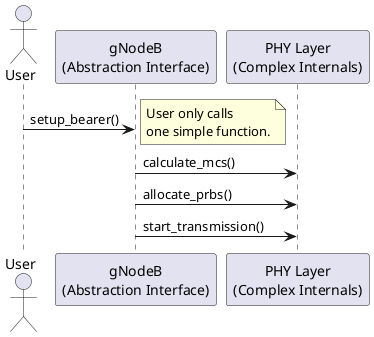

# Core OOP Concepts (The 4 Pillars)

## Overview
Object-Oriented Programming (OOP) is built upon four fundamental pillars. Mastering these is critical not just for C++, but for almost every modern programming language interview. 

To understand them, let's use a 5G network analogy: a `RadioUnit` (RU).

---

## 1. Encapsulation (Data Hiding)

**Concept:** Bundling the data (variables) and the code that manipulates that data (methods) into a single unit (a Class), while hiding the internal state from the outside world.

**Why it matters:** It prevents other parts of the codebase from accidentally corrupting the state of an object. You interact with the object only through a controlled interface (public methods like getters and setters).

**Analogy:** A 5G Radio Unit has internal hardware temperature sensors and voltage regulators. As the Network Controller, you cannot manually override the internal voltage (it's hidden/private). You can only call a public method like `power_on()`, and the RU handles its internal voltage safely.

```cpp
class RadioUnit {
private:
    int temperature; // Hidden from the outside
    int voltage;

public:
    void power_on() {
        voltage = 220; // Only internal methods can touch this
        // safe startup logic...
    }
    
    int get_temperature() {
        return temperature; // Controlled read-only access
    }
};
```

---

## 2. Abstraction (Complexity Hiding)

**Concept:** Showing only the essential features of an object to the user, while hiding the complex implementation details.

**Difference from Encapsulation:** Encapsulation hides the *data state*. Abstraction hides the *complexity of the behavior*.

**Analogy:** When you drive a car, you press the accelerator pedal. You don't need to know how the fuel injector mixes air and gas inside the engine. The pedal is the abstraction. In 5G, the Core Network sends a message to the gNodeB saying "Setup Bearer". The Core doesn't know *how* the gNodeB allocates physical resource blocks (PRBs) over the air interface.



---

## 3. Inheritance (Code Reuse)

**Concept:** Creating a new class (Child/Derived class) from an existing class (Parent/Base class). The child inherits all the attributes and methods of the parent, allowing for massive code reuse and logical hierarchy.

**Analogy:** 
- **Base Class:** `NetworkNode` (Has an IP address, MAC address, reboot() function)
- **Derived Classes:** `CU` (Central Unit), `DU` (Distributed Unit), `RU` (Radio Unit). 
All of these are Network Nodes, so they inherit the IP address and reboot function automatically, but they can add their own specific features.

```cpp
// Base Class
class NetworkNode {
protected:
    string ip_address;
public:
    void reboot() { /* restart logic */ }
};

// Derived Class
class RadioUnit : public NetworkNode {
private:
    int transmit_power;
public:
    void set_power(int tx) { transmit_power = tx; }
};
```

---

## 4. Polymorphism (Many Forms)

**Concept:** The ability to treat objects of different derived classes through the exact same interface (usually a base class pointer). The word literally means "many forms."

**Analogy:** Imagine an array of pointers to `NetworkNode`. Some point to CUs, some point to DUs, some point to RUs. If you loop through the array and call `node->get_status()`, the program automatically knows to call the CU's status function for CU objects, and the RU's status function for RU objects, even though the pointer type is just `NetworkNode*`.

### Types of Polymorphism in C++:
1. **Compile-time (Static):** 
   - **Function Overloading:** Having multiple functions with the same name but different parameters (e.g., `print(int x)` vs `print(string s)`).
   - **Operator Overloading:** Making the `+` sign add two custom `RadioUnit` objects together.
2. **Run-time (Dynamic):** 
   - **Virtual Functions:** Using pointers/references to base classes to call overridden functions in derived classes. (This relies on a hidden V-Table, which we will dive into later).

---
*Last updated: 2026-07-28*
