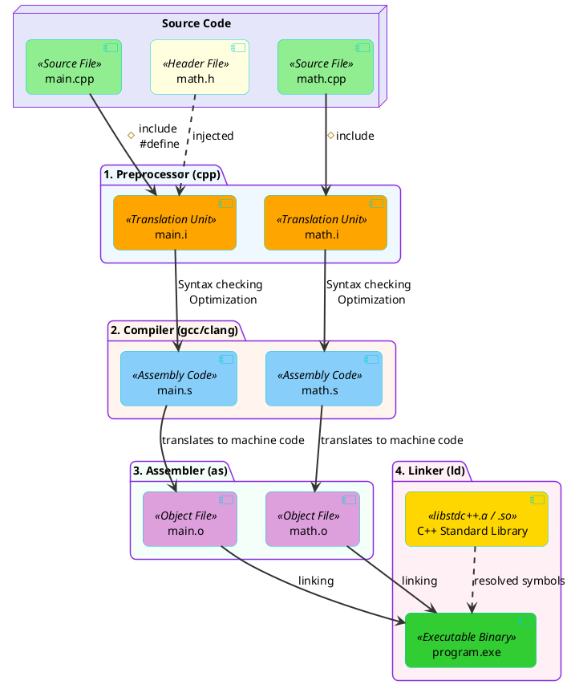

# The C/C++ Compilation and Linking Process

## Overview
Unlike interpreted languages that execute code directly, C and C++ are **Ahead-Of-Time (AOT)** compiled languages. A C++ source file (`.cpp`) cannot be run on its own; it must pass through a strict multi-stage translation pipeline to become an executable binary.

This pipeline consists of four distinct stages:
1. **Preprocessor**
2. **Compiler**
3. **Assembler**
4. **Linker**

## The Translation Pipeline



---

## 1. The Preprocessor
Before any actual C++ code is analyzed, the **Preprocessor** runs. It handles all directives starting with a hash symbol `#`.

- **`#include`:** The preprocessor literally copies and pastes the entire contents of the referenced header file into the `.cpp` file. 
- **`#define`:** Macros are expanded. Everywhere the preprocessor sees the macro name, it replaces it with the macro value.
- **Output:** The result is a massive, pure C++ file called a **Translation Unit** (often with a `.i` extension). The compiler *only* ever sees translation units, not your original `.cpp` or `.h` files.

## 2. The Compiler
The **Compiler** takes the Translation Unit and translates the high-level C++ code into low-level **Assembly Code** specific to your CPU architecture (e.g., x86 or ARM).
- It performs syntax checking, type checking, and heavy optimizations.
- **Output:** Assembly files (usually `.s` extension). 
- *Note:* In modern compilers (like GCC/Clang), the preprocessor and compiler steps are often merged internally for speed.

## 3. The Assembler
The **Assembler** takes the human-readable Assembly Code and translates it directly into pure **Machine Code** (binary 0s and 1s).
- **Output:** An **Object File** (usually `.o` or `.obj`).
- **The Problem:** The object file contains the exact machine code for the functions you wrote in that specific `.cpp` file, but it doesn't know where functions from *other* files are located. If `main.cpp` calls `std::cout`, the `main.o` file has an unresolved "blank spot" pointing to `std::cout`.

## 4. The Linker
The **Linker** is the final and often most frustrating stage (responsible for the infamous "Unresolved External Symbol" errors).
- It takes all the separate Object Files (`main.o`, `math.o`) and ties them together.
- It connects the "blank spots" (function calls) in one object file to the actual machine code definitions located in another object file or in pre-compiled static/dynamic libraries (like the C++ Standard Library).
- **Output:** The final Executable Binary (`.exe` on Windows, or an ELF file on Linux).

## 5. The Entry Point: Where does a program start?
In both C and C++, execution strictly begins at a function named `main()`. This is not just a convention; it is a hardcoded rule enforced by the Linker. When the OS loads your binary into memory, it looks for the memory address associated with the `main` symbol to start executing instructions.

**Is there a limitation on the filename that contains `main()`?**
No. By convention, the file containing the entry point is often named `main.c` or `main.cpp` so other developers can easily find it. However, the C and C++ languages do not care about filenames. You could name the file `startup_logic.cpp` or `dog.cpp`. As long as the compiler finds an `int main()` inside *one* of the translation units it links, the program will compile and run successfully.

**Are there any general limitations on C/C++ filenames?**
The language standards do not enforce filename restrictions. Any limitations are purely imposed by your Operating System (e.g., Windows forbids characters like `:`, `?`, `*` in file names) or your build system (Make/CMake might struggle with spaces in filenames). It is best practice to use lowercase alphanumeric characters and underscores (e.g., `network_socket.cpp`).

**Must `main()` always return an `int`?**
Yes. According to both the C and C++ language standards, `main()` **must** return an `int`. Writing `void main()` is strictly illegal in standard C++ (though some very old, non-compliant compilers might let you get away with it). 

**Why does returning `0` mean "success"? Isn't `0` normally `false`?**
In boolean logic, `0` is indeed false/failure. However, Operating System exit codes operate on a different philosophy: **There is only one way to succeed, but hundreds of ways to fail.**
If `1` meant success, the OS would only have `0` to represent a failure. By reserving `0` for "Success" (no errors), the OS can use all positive integers (1-255) to communicate *specific* error codes. For example, returning `1` might mean "File not found", returning `2` might mean "Out of memory", and returning `139` means a Segmentation Fault occurred. This design is fundamental to UNIX and POSIX systems.

**What happens if you don't return anything?**
`main()` has a unique, special rule in C++: If execution reaches the end of the `main()` function without hitting a `return` statement, the compiler will implicitly insert `return 0;` for you. *(Note: This special rule only applies to `main()`. If you forget a return statement in any other `int` function, it is Undefined Behavior!)*

---

## 6. Build Configurations and Compiler Flags
When you tell the compiler to translate your code, you can pass **compile-time options** (flags) to change *how* it generates the machine code. In professional C++, we generally use two distinct "Build Configurations".

### 1. Debug Configuration
Used during active development. The goal is to make debugging as easy as possible.
- **No Optimization (`-O0`):** The compiler translates your C++ exactly as written, line-by-line. It does not try to be smart or rearrange code. This makes the code slow, but predictable.
- **Debug Symbols (`-g`):** The compiler injects special metadata into the binary that maps the raw machine code instructions back to your exact C++ source code lines and variable names. Without this, tools like GDB just see raw memory addresses.
- *Command:* `g++ -O0 -g main.cpp -o app_debug`

### 2. Release Configuration
Used when shipping the final product to users (or deploying to the 5G tower). The goal is maximum execution speed.
- **Heavy Optimization (`-O2` or `-O3`):** The compiler aggressively analyzes your code. It might completely delete variables you don't use, unroll loops, or inline functions. The resulting machine code looks nothing like your original C++, making it nearly impossible to step through with a debugger.
- **No Debug Symbols:** To keep the binary size small and prevent reverse engineering, debug symbols are stripped out.
- *Command:* `g++ -O3 main.cpp -o app_release`

### What actually happens during Optimization?
If you write:
```cpp
int x = 5;
int y = x + 10;
std::cout << y;
```
Under `-O3` (Release), the compiler realizes `x` and `y` are just mathematical constants. It skips allocating memory for them entirely and just generates machine code equivalent to `std::cout << 15;`. This is why debugging an optimized build is a nightmare—the variables you want to inspect might have been entirely erased by the compiler!

### 3. Warning and Error Levels
By default, compilers are surprisingly permissive. They will often compile code that is technically legal but almost certainly a bug (e.g., using an uninitialized variable, or assigning a negative number to an unsigned integer). To prevent bugs, professional C++ codebases enforce strict **Warning Levels**.

- **`-Wall` (Warning All):** Turns on the most common and obvious warnings. Despite the name, it does *not* turn on all warnings.
- **`-Wextra`:** Turns on additional, slightly more pedantic warnings that `-Wall` misses.
- **`-Werror` (Warnings as Errors):** The most important flag in professional environments. It tells the compiler to halt compilation entirely if it detects even a single warning. This forces developers to write perfectly clean code.

*Command:* `g++ -Wall -Wextra -Werror main.cpp`

*(Note: On Microsoft's MSVC compiler, the equivalents are `/W4` for warnings and `/WX` for warnings-as-errors).*

---

## Interview Highlight: Header Files & Language Capabilities

**Q: Can we write C++ code to do something without including ANY header file?**
**A:** Yes, absolutely! 
Header files are **not** the C++ language itself. They just contain declarations for libraries (like the C++ Standard Library). All core language features—variables, loops, `if`/`else`, classes, math, pointers, and memory allocation—are built directly into the compiler. 

Here is a perfectly valid C++ program with zero headers that calculates the sum of 1 to 100:
```cpp
// No #includes here!
int main() {
    int sum = 0;
    for (int i = 1; i <= 100; ++i) {
        sum += i;
    }
    return sum; // The OS will receive this return code
}
```
You only *need* headers if you want to use pre-written code from a library, such as `std::cout` from `<iostream>` to print to the screen, or `std::vector` from `<vector>`.

**Q: Why do we use Header files (`.h`) if the compiler only compiles `.cpp` files?**
**A:** Because of the Linker. If `main.cpp` wants to use a function `add()` defined in `math.cpp`, `main.cpp` cannot compile because it doesn't know `add()` exists. We put the *declaration* (`int add(int, int);`) in `math.h`. `main.cpp` `#include "math.h"`, satisfying the Compiler. Later, the Linker connects the call in `main.o` to the actual definition inside `math.o`. 

---
*Last updated: 2026-08-07*
