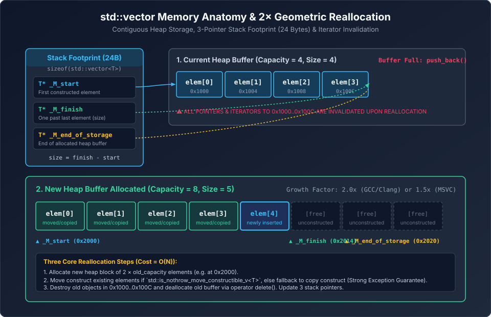

# Asymptotic Complexity, Cache Locality & std::vector Internals

## Overview
Understanding algorithms in production systems and high-throughput telecom runtimes (like 5G gNodeB L2/L3 stacks) requires looking beyond idealized mathematical step counts. While pure algorithmic theory assumes uniform, zero-cost random memory access (the RAM model), real modern hardware is deeply bound by the CPU memory hierarchy: cache line sizes (64 bytes), L1/L2/L3 access latency, branch prediction, and memory fragmentation.

This note establishes both the mathematical rigor of asymptotic analysis and the under-the-hood physical reality of hardware caches, followed by an exhaustive breakdown of the most ubiquitous contiguous container in C++ systems engineering: `std::vector`.

---

## Content

### 1. Mathematical Formalism: Big-O, Big-Ω, and Big-Θ

In algorithmic analysis, asymptotic notation models how execution time or space scales as the input size $n$ approaches infinity ($n \to \infty$).

```
Growth Order:
O(1) < O(log n) < O(√n) < O(n) < O(n log n) < O(n²) < O(n³) < O(2ⁿ) < O(n!)
```


1. **Big-O ($O$) — Asymptotic Upper Bound:**
   $f(n) = O(g(n))$ if there exist positive constants $c > 0$ and $n_0 \ge 1$ such that:
   $$0 \le f(n) \le c \cdot g(n) \quad \forall n \ge n_0$$
   *Engineering meaning:* Guarantees that the algorithm will never scale worse than $g(n)$ in the specified scenario.

2. **Big-Ω ($\Omega$) — Asymptotic Lower Bound:**
   $f(n) = \Omega(g(n))$ if there exist positive constants $c > 0$ and $n_0 \ge 1$ such that:
   $$0 \le c \cdot g(n) \le f(n) \quad \forall n \ge n_0$$
   *Engineering meaning:* The problem or algorithm requires at least $g(n)$ steps in the specified scenario.

3. **Big-Θ ($\Theta$) — Asymptotic Tight Bound:**
   $f(n) = \Theta(g(n))$ if and only if $f(n) = O(g(n))$ and $f(n) = \Omega(g(n))$. There exist constants $c_1, c_2 > 0$ and $n_0 \ge 1$:
   $$0 \le c_1 \cdot g(n) \le f(n) \le c_2 \cdot g(n) \quad \forall n \ge n_0$$
   *Engineering meaning:* The bound is both an upper and lower bound; it precisely captures the rate of growth.

> [!NOTE]
> In colloquial interview discussions, engineers frequently say "Big-O of $N$" when referring to the tight bound $\Theta(N)$ in the worst-case scenario. Be precise when discussing best, average, and worst cases (e.g., QuickSort is $O(N^2)$ worst-case, but $\Theta(N \log N)$ average-case).

---

### 2. Physical Reality: Memory Hierarchy & Cache Lines

Theoretical complexity assumes every memory access costs $O(1)$. In hardware systems (x86-64, ARM Neoverse), this assumption completely falls apart:

| Storage Level | Typical Size | Access Latency (Cycles) | Normalized Time |
|---|---|---|---|
| **CPU Registers** | ~1 KB | 0.5 – 1 cycle | ~0.3 ns |
| **L1 Data Cache (L1d)** | 32 – 64 KB per core | 4 – 5 cycles | ~1 ns |
| **L2 Cache** | 512 KB – 1 MB per core | 12 – 14 cycles | ~3 – 4 ns |
| **L3 Cache (Shared LLC)** | 16 – 64 MB | 40 – 60 cycles | ~15 – 20 ns |
| **Main Memory (DRAM)** | 16 – 256 GB | **150 – 250 cycles** | **~60 – 100 ns** |

#### The 64-Byte Cache Line
When a CPU reads a single 4-byte `int` or 8-byte pointer from DRAM, it **never** fetches just that individual item. It loads an entire **64-byte aligned cache line** into L1d.

- **Spatial Locality:** Accessing memory at address $A$ means adjacent addresses ($A+4$, $A+8$, etc.) are already resident in L1d. Contiguous arrays leverage this to achieve maximum memory bandwidth.
- **Temporal Locality:** Recently accessed data is likely to be accessed again soon.
- **Hardware Prefetcher:** When the memory controller detects sequential streaming access across contiguous addresses (like iterating through a `std::vector`), the hardware prefetcher speculatively fetches future cache lines ahead of execution, masking memory latency entirely.

```
Array / Vector in Memory: [ E0 | E1 | E2 | E3 | E4 | E5 | E6 | E7 ] (Contiguous 64B line)
                          └────────── Fetched in 1 DRAM Transaction ──────────┘

Linked List in Memory:   [ Node A ] ----> [ Node B ] --------> [ Node C ]
                         (Addr: 0x1000)   (Addr: 0x8400)      (Addr: 0x2200)
                         Cache Miss!      Cache Miss!         Cache Miss!
```

> [!IMPORTANT]
> **Why `std::vector` routinely beats `std::list` in practice:**
> A linear search through a 100,000-element `std::vector<int>` is often **10× to 50× faster** than searching through a `std::list<int>` with identical element count. Even though both are mathematically $O(N)$, `std::list` incurs an L1/L2/L3 cache miss on nearly every node traversal (pointer chasing), while `std::vector` hits pre-fetched L1 cache lines sequentially.

---

### 3. `std::vector` Internal Anatomy (Three-Pointer Model)

In almost all standard C++ library implementations (GNU `libstdc++`, LLVM `libc++`, MSVC STL), `sizeof(std::vector<T>)` is exactly **24 bytes** on a 64-bit architecture.

Internally, the vector object contains three raw pointers allocated on the stack (or inside the enclosing object):

```cpp
template <typename T, typename Allocator = std::allocator<T>>
class vector {
    T* _M_start;           // Pointer to the first element in the heap buffer
    T* _M_finish;          // Pointer to one past the last constructed element
    T* _M_end_of_storage;  // Pointer to the end of the allocated heap buffer
};
```

From these three pointers, the primary container queries are calculated in $O(1)$ pointer arithmetic:
- **`size()`** $= \text{\_M\_finish} - \text{\_M\_start}$
- **`capacity()`** $= \text{\_M\_end\_of\_storage} - \text{\_M\_start}$
- **`empty()`** $= (\text{\_M\_start} == \text{\_M\_finish})$
- **`data()`** $= \text{\_M\_start}$



---

### 4. Dynamic Growth & Amortized $O(1)$ Analysis

When `push_back()` or `emplace_back()` is invoked and $\text{size} == \text{capacity}$, the existing contiguous memory block has no room to expand in place because adjacent heap virtual memory may already be allocated to other objects.

The vector executes a **geometric reallocation sequence**:
1. Allocate a brand-new contiguous heap memory block of size $\text{new\_capacity} = \alpha \times \text{old\_capacity}$ (where growth factor $\alpha = 2.0$ in GCC/Clang, $\alpha = 1.5$ in MSVC).
2. Transfer existing elements from the old block to the new block:
   - If `std::is_nothrow_move_constructible_v<T>` is `true`, elements are **moved** (`std::move_if_noexcept`).
   - If `T`'s move constructor can throw or is not marked `noexcept`, elements are **copied** to satisfy the **Strong Exception Guarantee** (if an exception occurs during copy, the old buffer remains pristine and the vector state is rolled back).
3. Construct the new element in the first available slot at `_M_finish`.
4. Call destructors on elements in the old block and free the old buffer using `operator delete()`.
5. Update `_M_start`, `_M_finish`, and `_M_end_of_storage` to point to the new buffer.

#### Mathematical Proof of Amortized $O(1)$
Let the growth factor be $\alpha = 2$, and assume we insert $N = 2^k$ elements starting from an empty vector of capacity 1.

- Reallocations occur at sizes: $1, 2, 4, 8, \dots, 2^k$.
- At each reallocation step $i$, copying/moving takes $2^i$ operations.
- Total element copies across all reallocations:
  $$\sum_{j=0}^{k-1} 2^j = 2^k - 1 = N - 1$$
- Total cost for $N$ insertions $= N \text{ (regular insertions)} + (N - 1) \text{ (copies)} = 2N - 1$.
- **Amortized cost per insertion:**
  $$\text{Amortized Cost} = \frac{2N - 1}{N} < 2 = O(1)$$

> [!CAUTION]
> **Why arithmetic growth ($\text{capacity} += K$) breaks amortized $O(1)$:**
> If a dynamic array expanded by a fixed constant $K$ (e.g., adding 100 elements each time), reaching size $N$ requires $N / K$ reallocations. The total copy work would be:
> $$\sum_{j=1}^{N/K} j \cdot K = K \cdot \frac{(N/K)(N/K + 1)}{2} \approx \frac{N^2}{2K} = O(N^2)$$
> The amortized cost per insertion degrades to $\frac{O(N^2)}{N} = O(N)$! Hence, geometric progression is non-negotiable.

---

### 5. Iterator Invalidation Rules

In real-time multithreaded systems (like packet processing pipelines), dereferencing an invalidated iterator or dangling pointer leads to catastrophic undefined behavior (UB), silent memory corruption, or core dumps (`SIGSEGV`).

| Vector Operation | Capacity Exceeded? | Effect on Iterators / References / Pointers |
|---|---|---|
| `push_back()` / `emplace_back()` | **Yes (Reallocated)** | **ALL** iterators, pointers, and references to elements are **INVALIDATED**. |
| `push_back()` / `emplace_back()` | **No (Within capacity)** | Only `end()` iterator is invalidated; existing element references remain valid. |
| `insert()` | **Yes (Reallocated)** | **ALL** iterators and references are **INVALIDATED**. |
| `insert()` | **No (Within capacity)** | Iterators and references at or after the insertion point are invalidated. |
| `erase()` | N/A | Iterators and references at or after the erased element are invalidated; `end()` is invalidated. |
| `clear()` | No | All iterators and references are invalidated; `capacity()` remains unchanged. |

---

### 6. Modern C++ Systems Idioms (C++17 / C++20)

```cpp
#include <iostream>
#include <vector>
#include <numeric>
#include <span>
#include <utility>

// 1. Avoiding reallocations via reserve()
void efficient_packet_ingest(size_t expected_packet_count) {
    std::vector<uint32_t> packet_headers;
    
    // Critical for deterministic latency: allocate upfront
    packet_headers.reserve(expected_packet_count); 
    
    for (size_t i = 0; i < expected_packet_count; ++i) {
        // Guaranteed no heap reallocations occur here
        packet_headers.emplace_back(static_cast<uint32_t>(i * 4));
    }
}

// 2. Safe, non-owning contiguous spans (C++20 std::span)
// Avoids copying or template bloat when inspecting arrays/vectors
void inspect_contiguous_buffer(std::span<const uint32_t> buffer) {
    std::cout << "Buffer elements: " << buffer.size() 
              << " (" << buffer.size_bytes() << " bytes)\n";
    if (!buffer.empty()) {
        std::cout << "First: " << buffer.front() 
                  << ", Last: " << buffer.back() << "\n";
    }
}

// 3. Ensuring noexcept move constructors for O(1) reallocation transfer
struct RANContext {
    uint32_t rnti;
    std::vector<uint8_t> rrc_pdu;

    RANContext(uint32_t id) : rnti(id), rrc_pdu(128, 0) {}

    // CRITICAL: Must be noexcept for std::vector to move rather than copy on realloc
    RANContext(RANContext&& other) noexcept 
        : rnti(other.rnti), rrc_pdu(std::move(other.rrc_pdu)) {}

    RANContext& operator=(RANContext&& other) noexcept {
        if (this != &other) {
            rnti = other.rnti;
            rrc_pdu = std::move(other.rrc_pdu);
        }
        return *this;
    }

    // Disable copies if unique context ownership is desired
    RANContext(const RANContext&) = delete;
    RANContext& operator=(const RANContext&) = delete;
};
```

---

### Interview Traps & Gotchas

🪤 **Trap 1: `std::vector<bool>` is NOT a standard container!**
`std::vector<bool>` is a specialized template optimization designed to pack 8 boolean values per byte. 
Because C++ cannot return a raw reference (`bool&`) to a single bit within a byte (pointers can only address whole bytes), `operator[]` returns a temporary **proxy object** (`std::vector<bool>::reference`).
```cpp
auto b = vec[0]; // Type of b is NOT bool, it is std::vector<bool>::reference!
bool& ref = vec[0]; // COMPILE ERROR: cannot bind non-const lvalue reference to proxy
```
*Solution:* In systems programming where vector of booleans is required, use `std::vector<uint8_t>`, `std::bitset<N>`, or `std::deque<bool>`.

🪤 **Trap 2: `reserve()` vs `resize()` confusion:**
- `reserve(N)` allocates heap capacity for at least $N$ elements without constructing them. `size()` remains unchanged; indexing `v[0]` is undefined behavior if `size() == 0`.
- `resize(N)` changes `size()` to $N$, default-constructing new elements if growing, or destroying elements if shrinking.

🪤 **Trap 3: Memory deallocation with `clear()` does NOT release capacity:**
Calling `vec.clear()` calls destructors on all elements and sets $\text{\_M\_finish} = \text{\_M\_start}$, but **does not return memory to the OS heap** (`capacity()` is untouched).
*Solution:* To actually shrink memory in C++11 and later, invoke `vec.shrink_to_fit()` or swap with an empty temporary:
```cpp
std::vector<T>().swap(vec); // Deallocates heap buffer completely
```

🪤 **Trap 4: Missing `noexcept` on Move Constructors:**
If a custom class implements a move constructor but forgets to mark it `noexcept`, `std::vector` falls back to **copying** all elements during reallocation. If your class deletes its copy constructor, compilation fails inside `std::vector::push_back`!

🪤 **Trap 5: Modifying a vector while iterating with a range-based `for` loop:**
```cpp
for (const auto& item : vec) {
    if (condition) vec.push_back(new_item); // UNDEFINED BEHAVIOR!
}
```
If `push_back()` triggers reallocation, the range-for loop's cached internal end iterator and current pointer become dangling pointers immediately.

---

## Practice Problems & System Patterns

Master these canonical archetypes to solidify amortized analysis, two-pointer scanning, and contiguous memory manipulation:

| # | Problem Archetype | Pattern | Target Time | Target Space | Key Architectural Intuition |
|---|---|---|---|---|---|
| 1 | **[LeetCode 26] Remove Duplicates from Sorted Array** | Fast/Slow Two Pointers | $O(N)$ | $O(1)$ | In-place array compaction without secondary heap allocations. |
| 2 | **[LeetCode 1] Two Sum (Sorted Array Variant)** | Inward Opposite-Ends Pointers | $O(N)$ | $O(1)$ | Exploits sorted contiguous memory to shrink search space deterministically. |
| 3 | **[LeetCode 121] Best Time to Buy and Sell Stock** | Single-Pass Min Tracking | $O(N)$ | $O(1)$ | Temporal stream processing; streaming state tracking over contiguous buffers. |
| 4 | **[LeetCode 53] Maximum Subarray (Kadane's Algorithm)** | Dynamic State Accumulation | $O(N)$ | $O(1)$ | Optimal local decision making; cache-line friendly streaming iteration. |
| 5 | **Design Dynamic Array (`Vector<T>`)** | Systems Container Implementation | $O(1)$ amortized | $O(N)$ | Direct memory management with `malloc`/`new`, placement new, and growth factors. |

---

## Key Takeaways

- **Big-O is necessary but not sufficient:** Algorithmic complexity analyzes scaling order, but hardware cache performance ($64$-byte cache lines, L1 vs DRAM latency) dictates real-world execution speed in production systems.
- **`std::vector` achieves cache efficiency through contiguous storage:** Elements reside directly adjacent in heap memory, allowing hardware prefetchers to saturate bandwidth and avoid pointer-chasing stalls.
- **Three-pointer stack layout:** Any `std::vector` occupies 24 bytes on 64-bit platforms (`_M_start`, `_M_finish`, `_M_end_of_storage`), giving $O(1)$ size and capacity checks.
- **Geometric capacity doubling is mandatory:** Doubling capacity yields amortized $O(1)$ push operations, while constant-size arithmetic growth degrades insertion to an unacceptable $O(N)$ amortized.
- **Always provide `noexcept` on move constructors:** This ensures `std::vector` moves instead of copies elements during capacity reallocations while preserving the Strong Exception Guarantee.

---
*Last updated: 2026-11-24*
