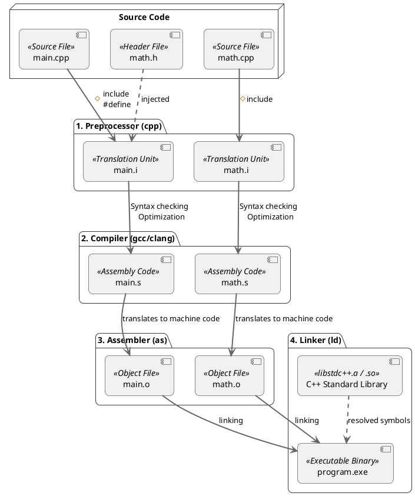

# The C/C++ Compilation and Linking Process

## Overview
Unlike interpreted languages that execute code directly, C and C++ are **Ahead-Of-Time (AOT)** compiled languages. A C++ source file (`.cpp`) cannot be run on its own; it must pass through a strict multi-stage translation pipeline to become an executable binary.

This pipeline consists of four distinct stages:
1. **Preprocessor**
2. **Compiler**
3. **Assembler**
4. **Linker**

## The Translation Pipeline

---

## 1. The Preprocessor
Before any actual C++ code is analyzed, the **Preprocessor** runs. It handles all directives starting with a hash symbol `#`.

- **`#include`:** The preprocessor literally copies and pastes the entire contents of the referenced header file into the `.cpp` file. 
- **`#define`:** Macros are expanded. Everywhere the preprocessor sees the macro name, it replaces it with the macro value.
- **Output:** The result is a massive, pure C++ file called a **Translation Unit** (often with a `.i` extension). The compiler *only* ever sees translation units, not your original `.cpp` or `.h` files.

## 2. The Compiler
The **Compiler** takes the Translation Unit and translates the high-level C++ code into low-level **Assembly Code** specific to your CPU architecture (e.g., x86 or ARM).
- It performs syntax checking, type checking, and heavy optimizations.
- **Output:** Assembly files (usually `.s` extension). 
- *Note:* In modern compilers (like GCC/Clang), the preprocessor and compiler steps are often merged internally for speed.

## 3. The Assembler
The **Assembler** takes the human-readable Assembly Code and translates it directly into pure **Machine Code** (binary 0s and 1s).
- **Output:** An **Object File** (usually `.o` or `.obj`).
- **The Problem:** The object file contains the exact machine code for the functions you wrote in that specific `.cpp` file, but it doesn't know where functions from *other* files are located. If `main.cpp` calls `std::cout`, the `main.o` file has an unresolved "blank spot" pointing to `std::cout`.

## 4. The Linker
The **Linker** is the final and often most frustrating stage (responsible for the infamous "Unresolved External Symbol" errors).
- It takes all the separate Object Files (`main.o`, `math.o`) and ties them together.
- It connects the "blank spots" (function calls) in one object file to the actual machine code definitions located in another object file or in pre-compiled static/dynamic libraries (like the C++ Standard Library).
- **Output:** The final Executable Binary (`.exe` on Windows, or an ELF file on Linux).

## Interview Highlight: The Role of Header Files
**Q: Why do we use Header files (`.h`) if the compiler only compiles `.cpp` files?**
**A:** Because of the Linker. If `main.cpp` wants to use a function `add()` defined in `math.cpp`, `main.cpp` cannot compile because it doesn't know `add()` exists. We put the *declaration* (`int add(int, int);`) in `math.h`. `main.cpp` `#include "math.h"`, satisfying the Compiler. Later, the Linker connects the call in `main.o` to the actual definition inside `math.o`. 

---
*Last updated: 2026-08-07*
